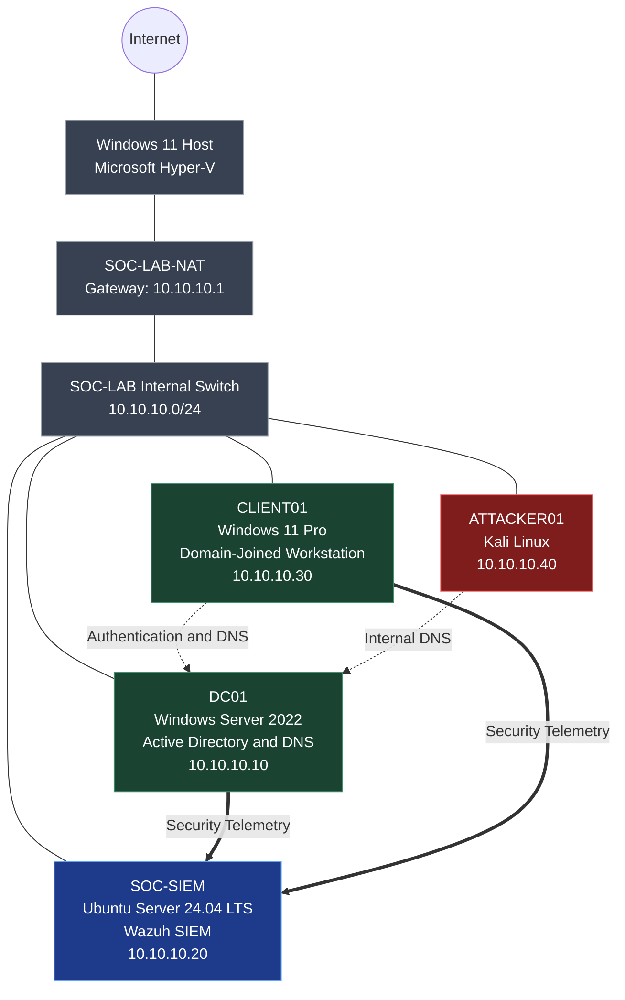
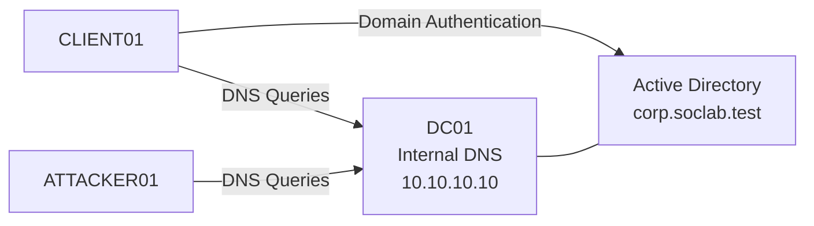
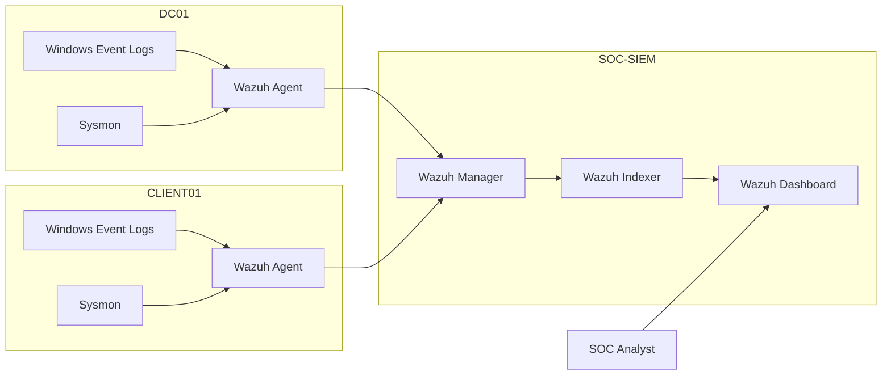

# Network Architecture

## 1. Overview

The SOC Homelab uses a dedicated Hyper-V internal virtual switch with Network Address Translation (NAT) to provide communication between virtual machines, host-based administration, and outbound internet connectivity.

The network supports a functional enterprise-like Active Directory environment, centralized security monitoring, controlled adversary emulation, detection engineering, and incident investigation.

All four laboratory virtual machines have been deployed and are operational.

## 2. Design Objectives

- Separate laboratory devices from the physical network at Layer 2.
- Provide predictable static IP addressing.
- Enable communication between laboratory machines.
- Support centralized Active Directory authentication and DNS.
- Enable centralized security telemetry collection.
- Allow host-based access to the Wazuh Dashboard.
- Enable SSH remote administration.
- Provide outbound internet access for software installation and updates.
- Avoid directly bridging laboratory machines to the physical network.
- Support controlled adversary emulation.
- Provide a foundation for network-related security investigations.
- Maintain existing endpoint security protections.

## 3. Network Topology



The network architecture consists of four operational virtual machines connected to a shared internal virtual switch.

Logical communication flows include Active Directory authentication, DNS resolution, centralized security telemetry, and authorized laboratory security testing.

## 4. IP Addressing Scheme

| Device | IP Address | Role | Status |
|---|---|---|---|
| Hyper-V Host | 10.10.10.1 | NAT Gateway and Administration | Operational |
| DC01 | 10.10.10.10 | Active Directory and DNS | Operational |
| SOC-SIEM | 10.10.10.20 | Wazuh SIEM | Operational |
| CLIENT01 | 10.10.10.30 | Corporate Windows Endpoint | Operational |
| ATTACKER01 | 10.10.10.40 | Adversary Emulation | Operational |

### Network Parameters

| Parameter | Value |
|---|---|
| Network Address | 10.10.10.0 |
| CIDR | /24 |
| Subnet Mask | 255.255.255.0 |
| Gateway | 10.10.10.1 |
| Broadcast Address | 10.10.10.255 |
| Usable Host Range | 10.10.10.1 - 10.10.10.254 |
| Active Directory Domain | corp.soclab.test |
| NetBIOS Domain Name | CORP |
| Internal DNS Server | 10.10.10.10 |
| IP Assignment | Static |
| Virtual Switch | SOC-LAB |
| NAT Configuration | SOC-LAB-NAT |

## 5. Virtual Switch Selection

Hyper-V provides three virtual switch types:

| Switch Type | VM-to-VM | VM-to-Host | Direct Physical Network Access |
|---|---|---|---|
| External | Yes | Configurable | Yes |
| Internal | Yes | Yes | No |
| Private | Yes | No | No |

An Internal Virtual Switch was selected because the laboratory requires communication between virtual machines and host-based administration without directly connecting the virtual machines to the physical network.

NAT was configured separately to provide outbound connectivity.

This architecture provides logical network separation at Layer 2 but does not constitute complete security isolation.

## 6. Network Implementation

All host-side configuration was performed using an elevated Windows PowerShell session.

The following sections document the original network deployment procedure.

### 6.1 Pre-deployment Validation

Existing virtual switches, NAT configurations, and IPv4 addresses were inspected before creating the laboratory network.

```powershell
Get-VMSwitch
Get-NetNat
Get-NetIPAddress -AddressFamily IPv4 |
    Select-Object InterfaceAlias, IPAddress, PrefixLength
```

No conflicting subnet was identified among the existing interface configurations.

### 6.2 Create the Internal Virtual Switch

```powershell
New-VMSwitch -Name "SOC-LAB" -SwitchType Internal
```

This creates an internal virtual network and a corresponding virtual network adapter on the Windows host.

### 6.3 Configure the Gateway

```powershell
New-NetIPAddress `
    -InterfaceAlias "vEthernet (SOC-LAB)" `
    -IPAddress 10.10.10.1 `
    -PrefixLength 24
```

The host virtual network adapter acts as the default gateway for laboratory machines.

### 6.4 Configure Network Address Translation

```powershell
New-NetNat `
    -Name "SOC-LAB-NAT" `
    -InternalIPInterfaceAddressPrefix "10.10.10.0/24"
```

This enables outbound connectivity through the host network.

### 6.5 Validate the Configuration

```powershell
Get-VMSwitch
Get-NetNat

Get-NetIPAddress `
    -InterfaceAlias "vEthernet (SOC-LAB)" `
    -AddressFamily IPv4
```

Observed results during the initial deployment:

| Property | Result |
|---|---|
| Switch Name | SOC-LAB |
| Switch Type | Internal |
| NAT Name | SOC-LAB-NAT |
| Internal Prefix | 10.10.10.0/24 |
| NAT Active | True |
| Gateway Address | 10.10.10.1 |
| Prefix Length | 24 |
| Address State | Preferred |

The default Hyper-V switch was preserved and was not used for the laboratory.

## 7. Virtual Machine Network Configuration

The custom NAT network does not provide DHCP services.

All laboratory virtual machines use manually configured static IPv4 addresses.

### 7.1 SOC-SIEM — Wazuh Server

| Parameter | Configuration |
|---|---|
| Hostname | soc-siem |
| Operating System | Ubuntu Server 24.04.5 LTS |
| Interface | eth0 |
| IPv4 Method | Manual |
| IP Address | 10.10.10.20 |
| Prefix Length | 24 |
| Gateway | 10.10.10.1 |
| Initial Primary DNS | 1.1.1.1 |
| Initial Secondary DNS | 8.8.8.8 |
| Virtual Switch | SOC-LAB |
| Domain Membership | Not Domain-Joined |

Public DNS resolvers were configured during the initial Ubuntu Server deployment.

The current effective DNS resolver configuration has not been independently revalidated for this documentation revision.

### 7.2 DC01 — Domain Controller

| Parameter | Configuration |
|---|---|
| Hostname | DC01 |
| Operating System | Windows Server 2022 |
| IPv4 Method | Manual |
| IP Address | 10.10.10.10 |
| Prefix Length | 24 |
| Gateway | 10.10.10.1 |
| Preferred DNS | 10.10.10.10 |
| Virtual Switch | SOC-LAB |
| Active Directory Domain | corp.soclab.test |
| Role | Active Directory Domain Controller and DNS Server |

DC01 provides centralized authentication and internal DNS services for the corporate environment.

The domain controller uses its own IP address as its preferred DNS server.

### 7.3 CLIENT01 — Corporate Workstation

| Parameter | Configuration |
|---|---|
| Hostname | CLIENT01 |
| Operating System | Windows 11 Pro |
| IPv4 Method | Manual |
| IP Address | 10.10.10.30 |
| Prefix Length | 24 |
| Gateway | 10.10.10.1 |
| Preferred DNS | 10.10.10.10 |
| Virtual Switch | SOC-LAB |
| Domain Membership | corp.soclab.test |
| Role | Monitored Corporate Endpoint |

CLIENT01 uses DC01 for internal DNS resolution and Active Directory authentication.

The workstation has been successfully joined to the corporate domain.

Wazuh Agent and Microsoft Sysmon provide centralized and local security telemetry.

### 7.4 ATTACKER01 — Adversary Emulation Workstation

| Parameter | Configuration |
|---|---|
| Hostname | attacker01 |
| Operating System | Kali Linux 2026.3 |
| IPv4 Method | Manual |
| IP Address | 10.10.10.40 |
| Prefix Length | 24 |
| Gateway | 10.10.10.1 |
| Preferred DNS | 10.10.10.10 |
| Virtual Switch | SOC-LAB |
| Domain Membership | Not Domain-Joined |
| Role | Controlled Adversary Emulation |

ATTACKER01 provides a dedicated environment for authorized security testing and adversary emulation.

The machine uses the internal DNS server to support resolution of laboratory domain resources.

## 8. Active Directory and DNS Architecture

The Active Directory domain provides centralized authentication and internal name resolution.

| Component | Configuration |
|---|---|
| Domain | corp.soclab.test |
| NetBIOS Name | CORP |
| Domain Controller | DC01 |
| DNS Server | 10.10.10.10 |
| Domain-Joined Endpoint | CLIENT01 |
| Forest Functional Level | Windows Server 2016 |
| Domain Functional Level | Windows Server 2016 |

### Logical DNS Architecture



Internal DNS resolution is required for domain controller discovery, domain authentication, Group Policy processing, and access to domain resources.

ATTACKER01 uses internal DNS without being a member of the Active Directory domain.

Further details are available in the [Active Directory Deployment documentation](../02-Active-Directory/01-Active-Directory-Deployment.md).

## 9. Centralized Security Monitoring Architecture

Both Windows endpoints have been enrolled in the Wazuh SIEM platform.

| Agent ID | Endpoint | IP Address | Monitoring Components |
|---|---|---|---|
| 001 | DC01 | 10.10.10.10 | Wazuh Agent, Sysmon, Windows Event Logs |
| 002 | CLIENT01 | 10.10.10.30 | Wazuh Agent, Sysmon, Windows Event Logs |

### Security Telemetry Flow



This diagram represents the logical monitoring architecture rather than every individual service involved in event processing.

Both Windows endpoints successfully enrolled and synchronized their centralized Wazuh configuration during baseline validation.

### Configured Event Sources

- Windows Security.
- Windows System.
- Windows Application.
- Sysmon Operational.
- PowerShell Operational.
- Task Scheduler Operational.
- WMI Activity Operational.
- Windows Defender Operational.

Event channel configuration does not independently establish successful collection or alert generation for every event type.

Further details are available in the [Security Monitoring documentation](../03-Security-Monitoring/README.md).

## 10. Network Services

The laboratory uses several network services to support administration, authentication, monitoring, and security investigations.

| Service | Protocol | Port | Associated System |
|---|---|---|---|
| SSH | TCP | 22 | SOC-SIEM and ATTACKER01 |
| DNS | TCP/UDP | 53 | DC01 |
| Kerberos | TCP/UDP | 88 | DC01 |
| LDAP | TCP/UDP | 389 | DC01 |
| SMB | TCP | 445 | DC01 and applicable Windows services |
| Wazuh Agent Communication | TCP | 1514 | SOC-SIEM |
| Wazuh Agent Enrollment | TCP | 1515 | SOC-SIEM |
| Wazuh Dashboard | HTTPS/TCP | 443 | SOC-SIEM |

This table describes selected standard service ports associated with the deployed architecture.

It is not an exhaustive port inventory or the result of an independent port scan.

The availability of individual ports must be validated separately when required.

## 11. Initial Network Connectivity Validation

The following tests were performed during the original SOC-SIEM deployment.

Historical results are preserved to maintain an accurate record of the initial network implementation.

### 11.1 Interface Configuration

```bash
ip -br a
```

Observed output:

```text
lo      UNKNOWN    127.0.0.1/8
eth0    UP         10.10.10.20/24
```

### 11.2 Routing Table

```bash
ip route
```

Observed output:

```text
default via 10.10.10.1 dev eth0 proto static
10.10.10.0/24 dev eth0 proto kernel scope link src 10.10.10.20
```

The default route and local network route were successfully configured.

### 11.3 Gateway ICMP Test

```bash
ping -c 4 10.10.10.1
```

Initial result:

- Packets transmitted: 4
- Packets received: 0
- Packet loss: 100%

Although the gateway did not initially respond to ICMP echo requests, subsequent internet connectivity and SSH tests were successful.

Inbound ICMP filtering by the Windows host firewall was considered a possible explanation.

This hypothesis was not independently verified.

No firewall protections were disabled.

### 11.4 Internet Connectivity

```bash
ping -c 4 8.8.8.8
```

| Metric | Result |
|---|---|
| Packets Transmitted | 4 |
| Packets Received | 4 |
| Packet Loss | 0% |
| Average Latency | 10.427 ms |

Outbound internet connectivity was successfully validated during the initial deployment.

### 11.5 DNS Resolution

```bash
ping -c 4 google.com
```

| Metric | Result |
|---|---|
| DNS Resolution | Successful |
| Packets Transmitted | 4 |
| Packets Received | 4 |
| Packet Loss | 0% |
| Average Latency | 10.595 ms |

DNS resolution and connectivity were successfully validated.

### 11.6 SSH Remote Administration

The Ubuntu server was accessed from the Windows host using SSH.

```powershell
ssh socadmin@10.10.10.20
```

The SSH service was verified using:

```bash
systemctl status ssh --no-pager
```

Results:

- SSH service active and running.
- TCP port 22 listening.
- Successful authentication from the host gateway address.
- Remote administration established.

### 11.7 Wazuh Dashboard Access

The Wazuh Dashboard was successfully accessed from the Windows host using HTTPS.

```text
https://10.10.10.20
```

Initial dashboard responsiveness was significantly improved compared with the previous VirtualBox deployment.

## 12. Expanded Network Connectivity Validation

Following the deployment of Active Directory, CLIENT01, and ATTACKER01, additional connectivity and service validation was performed.

| Source | Destination | Validation | Result |
|---|---|---|---|
| Hyper-V Host | SOC-SIEM | SSH | Passed |
| Hyper-V Host | SOC-SIEM | HTTPS Dashboard | Passed |
| Hyper-V Host | ATTACKER01 | SSH | Passed |
| CLIENT01 | DC01 | Domain Authentication | Passed |
| CLIENT01 | DC01 | Internal DNS | Passed |
| DC01 | SOC-SIEM | Wazuh Agent Communication | Passed |
| CLIENT01 | SOC-SIEM | Wazuh Agent Communication | Passed |
| ATTACKER01 | DC01 | ICMP | Passed |
| ATTACKER01 | SOC-SIEM | ICMP | Passed |
| CLIENT01 | ATTACKER01 | ICMP | Passed |
| ATTACKER01 | CLIENT01 | ICMP | No Response |

The absence of an ICMP response from CLIENT01 does not establish that the workstation is unreachable through other protocols.

Windows inbound firewall filtering was considered a possible explanation.

The exact cause was not independently verified.

Existing endpoint security protections were preserved.

## 13. Network Observations During OP-001

The initial corporate intrusion investigation introduced additional network-related observations beyond infrastructure connectivity testing.

A custom communication research prototype developed using PowerShell and Python was used to study network behavior and associated endpoint telemetry.

The investigation established that application-level communication occurred between CLIENT01 and ATTACKER01.

### Observed Network Evidence

| Attribute | Observation |
|---|---|
| Associated Endpoint | CLIENT01 |
| Associated Remote Host | ATTACKER01 |
| Transport Protocol | UDP |
| Associated Windows Process | powershell.exe |
| Local Telemetry Source | Sysmon Operational |
| Event ID | 3 |
| Relevant Local Network Records | 12 |
| Heartbeat Communication | Observed |
| Acknowledgment Reception | Observed |
| Arbitrary Remote Command Execution | Not Tested |

The network activity was confirmed through endpoint telemetry and application-level observations.

Packet-level capture and independent protocol analysis were not performed during the initial investigation.

### Centralized Network Visibility

Although relevant Sysmon network events were identified locally, corresponding alerts were not observed in the investigated Wazuh alert windows.

| Validation Layer | Result |
|---|---|
| Network Communication | Confirmed |
| Endpoint Network Telemetry | Confirmed |
| Manager Reception of Relevant Raw Events | Not Established |
| Corresponding Native Wazuh Alerts | Not Observed |
| Root Cause | Undetermined |

Raw event archiving was disabled during the initial assessment.

Consequently, the absence of centralized alerts could not independently establish whether the events were received without generating alerts or were affected by a collection or processing limitation.

This finding was registered as GAP-001 in the OP-001 Detection Gap Analysis.

Further details:

- [OP-001 — Corporate Intrusion](../05-Adversary-Emulation/01-Corporate-Intrusion/README.md)
- [C2 Architecture](../05-Adversary-Emulation/01-Corporate-Intrusion/02-C2-Architecture.md)
- [Detection Gap Analysis](../05-Adversary-Emulation/01-Corporate-Intrusion/06-Detection-Gap-Analysis.md)

## 14. Network Monitoring Limitations

The current architecture provides centralized Windows endpoint monitoring through Wazuh and Microsoft Sysmon.

However, endpoint-based network telemetry is not equivalent to full network traffic visibility.

| Monitoring Capability | Status |
|---|---|
| Endpoint Process Telemetry | Implemented |
| Endpoint Network Event Generation | Confirmed Locally |
| Centralized Network Alert Coverage | Requires Validation |
| Dedicated Network IDS | Not Implemented |
| Dedicated Network Security Monitoring Sensor | Not Implemented |
| Continuous Full Packet Capture | Not Implemented |
| Network Flow Collection | Not Implemented |
| Centralized DNS Query Analysis | Not Independently Validated |
| Internal Network Segmentation | Not Implemented |

All four virtual machines currently share a single internal subnet.

The architecture does not currently implement separate workstation, server, monitoring, or adversary emulation network segments.

Potential future improvements include:

- Dedicated network security monitoring.
- Controlled packet capture during investigations.
- Network traffic analysis.
- DNS telemetry validation.
- Contextual network detection rules.
- Network segmentation and access control evaluation.

These capabilities are potential future improvements rather than implemented features.

## 15. Network Validation Summary

| Test | Result |
|---|---|
| Virtual Switch Configuration | Passed |
| NAT Configuration | Passed |
| Static IPv4 Configuration | Passed |
| Default Route | Passed |
| Initial Gateway ICMP Response | No Response |
| Internet Connectivity | Passed |
| Public DNS Resolution | Passed During Initial Deployment |
| Internal DNS Resolution | Passed |
| SSH Remote Administration | Passed |
| Wazuh Dashboard Access | Passed |
| Active Directory Domain Integration | Passed |
| Wazuh Agent Communication | Passed |
| Inter-VM Connectivity | Validated for Tested Paths |
| OP-001 Application Communication | Confirmed |
| Local Network Telemetry | Confirmed |
| Centralized Network Alert Coverage | Requires Further Validation |

Successful network connectivity does not independently establish successful security telemetry collection or detection coverage.

## 16. Security Considerations

The internal virtual switch prevents direct Layer 2 bridging between the laboratory and the physical network.

However, NAT does not provide complete security isolation.

Laboratory machines can communicate with the host and may initiate connections to external networks, including the physical network.

The shared internal subnet also permits communication between laboratory machines, subject to applicable operating system firewall policies.

### Current Security Boundaries

- Windows host security protections remain enabled.
- Windows endpoint security protections remain enabled.
- No inbound NAT port forwarding was configured during deployment.
- Laboratory credentials must not be exposed in public documentation.
- Security testing is restricted to explicitly authorized laboratory systems.
- Real malware execution is outside the scope of this environment.
- Controlled test activity and synthetic data are used.
- Experimental applications must not be treated as secure remote administration software.
- Recovery checkpoints are maintained.
- Laboratory services must not be intentionally exposed to the public Internet.

### Internet Connectivity Decision

Outbound internet connectivity is intentionally retained to support:

- Software installation and updates.
- Security intelligence updates.
- Access to technical documentation.
- Laboratory administration.
- Representation of a connected enterprise environment.

This design decision introduces additional exposure compared with a fully isolated laboratory.

Activities requiring stronger containment must be preceded by appropriate network isolation and validation.

### Network Security Limitations

The current laboratory does not implement:

- Dedicated inter-segment firewall policies.
- Strict outbound network allowlisting.
- Complete isolation from the Hyper-V host.
- Dedicated network intrusion detection.
- Continuous network traffic inspection.

These limitations are acknowledged as part of the current laboratory architecture.

## 17. Future Network Monitoring Improvements

The initial OP-001 investigation identified the need for further validation of network-related security telemetry.

Planned activities include:

- Validating Sysmon network event collection.
- Investigating discrepancies between endpoint and SIEM visibility.
- Investigating network event timestamp inconsistencies.
- Reviewing native Wazuh network detection rules.
- Developing contextual network detections.
- Validating detections using controlled benign network activity.
- Evaluating additional network monitoring capabilities.

The objective is to improve investigative visibility while maintaining a reproducible monitoring baseline.

These activities will be addressed during the Detection Engineering phase.

## 18. Conclusion

The SOC Homelab network has progressed from an initial single-server deployment into a functional four-machine enterprise-like security environment.

The architecture currently supports:

- Static IPv4 addressing.
- Internal virtual networking.
- Outbound internet connectivity.
- Centralized Active Directory authentication.
- Internal DNS resolution.
- SSH remote administration.
- Wazuh Dashboard access.
- Centralized Windows endpoint monitoring.
- Controlled adversary emulation.
- Network-related security investigations.

The initial OP-001 investigation demonstrated that successful network communication does not necessarily translate into centralized security alert visibility.

The current architecture provides a foundation for subsequent detection engineering, telemetry validation, threat hunting, and incident response activities.

## Related Documentation

- [Hyper-V Deployment](02-Hyper-V-Deployment.md)
- [Ubuntu Server Deployment](03-Ubuntu-Server.md)
- [Wazuh Deployment](04-Wazuh-Deployment.md)
- [Active Directory Environment](../02-Active-Directory/README.md)
- [Security Monitoring](../03-Security-Monitoring/README.md)
- [Attacker Machine Deployment](../04-Attacker-Machine/README.md)
- [Adversary Emulation](../05-Adversary-Emulation/README.md)

---

[Return to Infrastructure Documentation](README.md)

[Return to Project Overview](../README.md)
