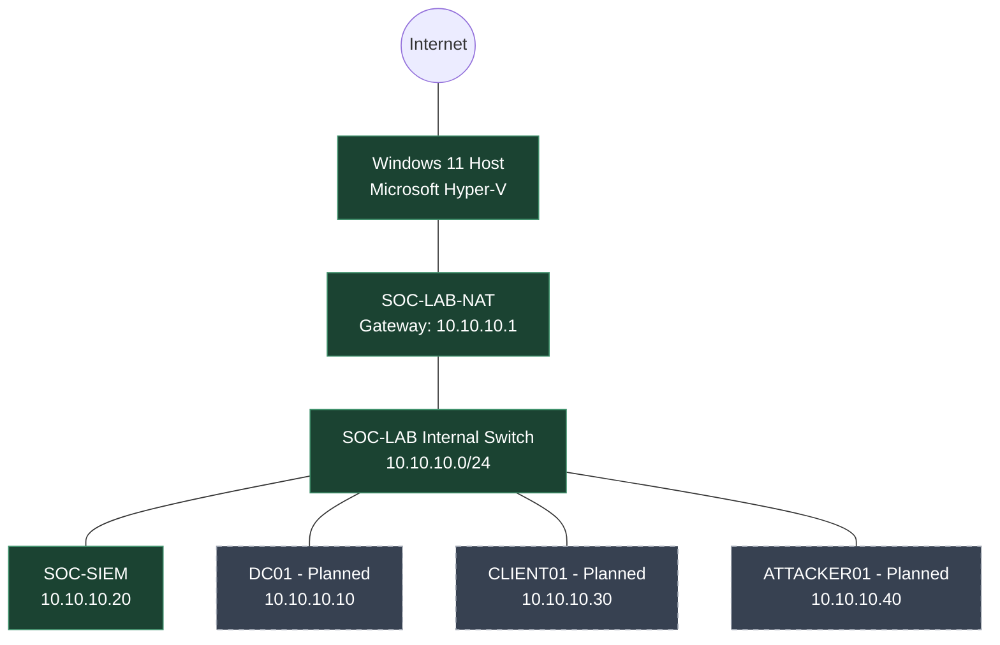

# Network Architecture

## 1. Overview

The SOC Homelab uses a dedicated Hyper-V internal virtual switch with Network Address Translation (NAT) to provide communication between virtual machines, host-based administration, and outbound internet connectivity.

The network is designed to support an enterprise-like Active Directory environment, centralized security monitoring, and controlled adversary simulations.

## 2. Design Objectives

- Separate laboratory devices from the physical network at Layer 2.
- Provide predictable static IP addressing.
- Enable communication between laboratory machines.
- Allow host-based access to the Wazuh Dashboard.
- Enable SSH remote administration.
- Provide outbound internet access for software installation and updates.
- Avoid directly bridging laboratory machines to the physical network.

## 3. Network Topology



## 4. IP Addressing Scheme

| Device | IP Address | Role | Status |
|---|---|---|---|
| Hyper-V Host | 10.10.10.1 | NAT Gateway | Operational |
| DC01 | 10.10.10.10 | Active Directory and DNS | Planned |
| SOC-SIEM | 10.10.10.20 | Wazuh SIEM | Operational |
| CLIENT01 | 10.10.10.30 | Windows Endpoint | Planned |
| ATTACKER01 | 10.10.10.40 | Adversary Simulation | Planned |

### Network Parameters

| Parameter | Value |
|---|---|
| Network Address | 10.10.10.0 |
| CIDR | /24 |
| Subnet Mask | 255.255.255.0 |
| Gateway | 10.10.10.1 |
| Broadcast Address | 10.10.10.255 |
| Usable Host Range | 10.10.10.1 - 10.10.10.254 |
| Planned AD Domain | corp.soclab.test |
| IP Assignment | Static |

## 5. Virtual Switch Selection

Hyper-V provides three virtual switch types:

| Switch Type | VM-to-VM | VM-to-Host | Direct Physical Network Access |
|---|---|---|---|
| External | Yes | Configurable | Yes |
| Internal | Yes | Yes | No |
| Private | Yes | No | No |

An Internal Virtual Switch was selected because the laboratory requires communication between virtual machines and host-based administration without directly connecting the virtual machines to the physical network.

NAT was configured separately to provide outbound connectivity.

## 6. Network Implementation

All host-side configuration was performed using an elevated Windows PowerShell session.

### 6.1 Pre-deployment Validation

Existing virtual switches, NAT configurations, and IPv4 addresses were inspected before creating the laboratory network.

```powershell
Get-VMSwitch
Get-NetNat
Get-NetIPAddress -AddressFamily IPv4 |
    Select-Object InterfaceAlias, IPAddress, PrefixLength
```

No conflicting subnet was identified among the existing interface configurations.

### 6.2 Create the Internal Virtual Switch

```powershell
New-VMSwitch -Name "SOC-LAB" -SwitchType Internal
```

This creates an internal virtual network and a corresponding virtual network adapter on the Windows host.

### 6.3 Configure the Gateway

```powershell
New-NetIPAddress `
    -InterfaceAlias "vEthernet (SOC-LAB)" `
    -IPAddress 10.10.10.1 `
    -PrefixLength 24
```

The host virtual network adapter acts as the default gateway for laboratory machines.

### 6.4 Configure Network Address Translation

```powershell
New-NetNat `
    -Name "SOC-LAB-NAT" `
    -InternalIPInterfaceAddressPrefix "10.10.10.0/24"
```

This enables outbound connectivity through the host network.

### 6.5 Validate the Configuration

```powershell
Get-VMSwitch
Get-NetNat

Get-NetIPAddress `
    -InterfaceAlias "vEthernet (SOC-LAB)" `
    -AddressFamily IPv4
```

Observed results:

| Property | Result |
|---|---|
| Switch Name | SOC-LAB |
| Switch Type | Internal |
| NAT Name | SOC-LAB-NAT |
| Internal Prefix | 10.10.10.0/24 |
| NAT Active | True |
| Gateway Address | 10.10.10.1 |
| Prefix Length | 24 |
| Address State | Preferred |

The default Hyper-V switch was preserved and was not used for the laboratory.

## 7. Ubuntu Server Network Configuration

The SOC-SIEM virtual machine was connected to the SOC-LAB virtual switch.

Because the custom NAT network does not provide DHCP services, IPv4 addressing was configured manually during the Ubuntu Server installation.

| Parameter | Configuration |
|---|---|
| Interface | eth0 |
| IPv4 Method | Manual |
| IP Address | 10.10.10.20 |
| Prefix Length | 24 |
| Gateway | 10.10.10.1 |
| Primary DNS | 1.1.1.1 |
| Secondary DNS | 8.8.8.8 |
| Hostname | soc-siem |

Public DNS resolvers are used during the initial deployment. DNS configuration will be reviewed after the Active Directory infrastructure is deployed.

## 8. Connectivity Validation

### 8.1 Interface Configuration

```bash
ip -br a
```

Observed output:

```text
lo      UNKNOWN    127.0.0.1/8
eth0    UP         10.10.10.20/24
```

### 8.2 Routing Table

```bash
ip route
```

Observed output:

```text
default via 10.10.10.1 dev eth0 proto static
10.10.10.0/24 dev eth0 proto kernel scope link src 10.10.10.20
```

The default route and local network route were successfully configured.

### 8.3 Gateway ICMP Test

```bash
ping -c 4 10.10.10.1
```

Result:

- Packets transmitted: 4
- Packets received: 0
- Packet loss: 100%

Although the gateway did not respond to ICMP echo requests, subsequent internet connectivity and SSH tests were successful.

The most likely explanation is inbound ICMP filtering by the Windows host firewall. This hypothesis was not independently verified.

No firewall protections were disabled.

### 8.4 Internet Connectivity

```bash
ping -c 4 8.8.8.8
```

| Metric | Result |
|---|---|
| Packets Transmitted | 4 |
| Packets Received | 4 |
| Packet Loss | 0% |
| Average Latency | 10.427 ms |

Outbound internet connectivity was successfully validated.

### 8.5 DNS Resolution

```bash
ping -c 4 google.com
```

| Metric | Result |
|---|---|
| DNS Resolution | Successful |
| Packets Transmitted | 4 |
| Packets Received | 4 |
| Packet Loss | 0% |
| Average Latency | 10.595 ms |

DNS resolution and connectivity were successfully validated.

### 8.6 SSH Remote Administration

The Ubuntu server was accessed from the Windows host using SSH.

```powershell
ssh socadmin@10.10.10.20
```

The SSH service was verified using:

```bash
systemctl status ssh --no-pager
```

Results:

- SSH service active and running.
- TCP port 22 listening.
- Successful authentication from the host gateway address.
- Remote administration established.

### 8.7 Wazuh Dashboard Access

The Wazuh Dashboard was successfully accessed from the Windows host using HTTPS.

```text
https://10.10.10.20
```

Initial dashboard responsiveness was significantly improved compared with the previous VirtualBox deployment.

## 9. Network Validation Summary

| Test | Result |
|---|---|
| Virtual Switch Configuration | Passed |
| NAT Configuration | Passed |
| Static IPv4 Configuration | Passed |
| Default Route | Passed |
| Gateway ICMP Response | No Response |
| Internet Connectivity | Passed |
| DNS Resolution | Passed |
| SSH Remote Administration | Passed |
| Wazuh Dashboard Access | Passed |

## 10. Security Considerations

The internal virtual switch prevents direct Layer 2 bridging between the laboratory and the physical network.

However, NAT does not provide complete security isolation. Laboratory machines can communicate with the host and may initiate connections to external networks, including the physical network.

The following precautions apply:

- Windows host security protections remain enabled.
- No inbound NAT port forwarding was configured.
- Laboratory credentials must not be exposed in public documentation.
- Additional network restrictions must be implemented and validated before adversary simulations.
- External connectivity should be restricted during security testing.
- All security testing must remain within explicitly authorized laboratory systems.

## 11. Conclusion

The SOC Homelab network was successfully deployed using Hyper-V internal networking and Windows NAT.

Static IP addressing, outbound internet connectivity, DNS resolution, SSH administration, and Wazuh Dashboard access were validated.

The network provides the foundation for the next deployment phase: Active Directory and Windows endpoint integration.
