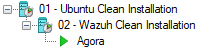

# Hyper-V Deployment

## 1. Overview

Microsoft Hyper-V was selected as the virtualization platform for the SOC Homelab to provide a stable and manageable environment for security monitoring, enterprise infrastructure, and controlled adversary simulations.

The laboratory was previously hosted on Oracle VirtualBox but was rebuilt using Hyper-V following significant performance issues.

## 2. Host Environment

| Component | Specification |
|---|---|
| Operating System | Windows 11 Pro for Workstations |
| Processor | AMD Ryzen 7 9800X3D |
| Physical Memory | 32 GB DDR5 |
| Virtualization Platform | Microsoft Hyper-V |
| Secure Boot | Enabled |
| Virtualization-Based Security | Enabled |
| Memory Integrity | Enabled |
| Microsoft Defender | Enabled |

## 3. Virtualization Platform Selection

The initial VirtualBox deployment experienced significant performance degradation, particularly when accessing the Wazuh Dashboard.

VirtualBox logs contained the following entries:

```text
NEM: WHvCapabilityCodeHypervisorPresent is TRUE
NEM: NEMR3Init: Snail execution mode is active!
```

These entries indicated that VirtualBox was operating through the Windows hypervisor compatibility layer.

Observed symptoms included:

- Slow virtual machine responsiveness.
- Delayed Wazuh Dashboard loading.
- Authentication and connection timeouts.
- Poor overall user experience.

Rather than permanently disabling Windows security features, the laboratory was rebuilt using Microsoft Hyper-V.

The compatibility layer was considered a potential contributing factor, although it was not conclusively established as the sole cause of the performance issues.

## 4. Hyper-V Installation

Hyper-V was installed using an elevated Windows PowerShell session.

### 4.1 Enable Hyper-V

```powershell
Enable-WindowsOptionalFeature -Online -FeatureName Microsoft-Hyper-V-All -All
```

The host was restarted to complete the installation.

### 4.2 Validate Installation

```powershell
Get-WindowsOptionalFeature -Online -FeatureName Microsoft-Hyper-V-All
```

The Hyper-V feature was confirmed as enabled.

The Virtual Machine Management Service was checked using:

```powershell
Get-Service vmms
```

### 4.3 Access Hyper-V Manager

```powershell
virtmgmt.msc
```

Hyper-V Manager was used to create and manage the laboratory virtual machines.

## 5. Virtual Machine Deployment Plan

| Virtual Machine | Operating System | RAM | vCPU | Storage | Status |
|---|---|---|---|---|---|
| SOC-SIEM | Ubuntu Server 24.04.5 LTS | 8 GB | 4 | 100 GB | Deployed |
| DC01 | Windows Server 2022 | 4 GB | 2 | 60 GB | Planned |
| CLIENT01 | Windows 11 | 4 GB | 2 | 80 GB | Planned |
| ATTACKER01 | Kali Linux | 4 GB | 2 | 40 GB | Planned |

The initial resource allocation plan reserves approximately 20 GB of physical memory for the complete laboratory, leaving the remaining memory for the host operating system and other processes.

Resource allocations will be adjusted based on observed workloads.

## 6. SOC-SIEM Virtual Machine Configuration

The first virtual machine was deployed to host the Wazuh All-in-One platform.

| Parameter | Configuration |
|---|---|
| Virtual Machine Name | SOC-SIEM |
| Generation | Generation 2 |
| Operating System | Ubuntu Server 24.04.5 LTS |
| Architecture | AMD64 |
| Assigned Memory | 8192 MB |
| Dynamic Memory | Disabled |
| Virtual Processors | 4 |
| Virtual Disk Capacity | 100 GB |
| Virtual Disk Format | VHDX |
| Disk Allocation | Dynamically Expanding |
| Virtual Switch | SOC-LAB |
| Secure Boot | Enabled |
| Secure Boot Template | Microsoft UEFI Certificate Authority |
| IP Address | 10.10.10.20 |

### 6.1 Generation 2 Selection

Generation 2 was selected to support:

- UEFI firmware.
- Secure Boot.
- Modern virtual hardware.
- SCSI-based virtual storage.

The Microsoft UEFI Certificate Authority template was selected to support Ubuntu Secure Boot.

### 6.2 Memory Allocation

Fixed memory allocation was selected to provide predictable resources for the Wazuh Manager, Indexer, and Dashboard.

During initial validation, Ubuntu reported only 573 MiB of available physical memory capacity despite the configured startup memory of 8192 MB.

Further inspection revealed that Hyper-V Dynamic Memory was enabled with a minimum allocation of 512 MB.

The virtual machine was shut down, Dynamic Memory was disabled, and the machine was restarted.

The following command was used to validate the corrected configuration:

```bash
free -h
```

| Metric | Before Correction | After Correction |
|---|---|---|
| Total Recognized Memory | 573 MiB | 7.8 GiB |
| Available Memory | 148 MiB | 7.3 GiB |
| Dynamic Memory | Enabled | Disabled |

The corrected configuration ensured sufficient memory for the planned SIEM deployment.

### 6.3 Virtual Storage

A dynamically expanding 100 GB VHDX disk was provisioned.

This configuration allows the virtual disk file to grow as storage is consumed rather than allocating its entire maximum capacity immediately.

The Ubuntu installation uses Logical Volume Management (LVM) to support future storage expansion.

### 6.4 Virtual Networking

The virtual machine was connected to the dedicated SOC-LAB internal virtual switch.

The network provides:

- Communication between laboratory virtual machines.
- Host-based administration.
- Outbound internet connectivity through NAT.
- Predictable static IP addressing.

Detailed network configuration is available in [Network Architecture](Network-Architecture.md).

## 7. Security Considerations

The laboratory was designed to preserve the security posture of the physical host.

The following protections remain enabled:

- Secure Boot.
- Virtualization-Based Security.
- Hypervisor-Protected Code Integrity.
- Microsoft Defender Antivirus.
- Windows Defender Firewall.

The laboratory does not require these protections to be disabled.

Additional network isolation controls will be implemented and validated before adversary simulations begin.

## 8. Checkpoint and Recovery Strategy

Hyper-V checkpoints were created at significant deployment milestones.

| Checkpoint | Purpose |
|---|---|
| 01 - Ubuntu Clean Installation | Recovery point before SIEM deployment |
| 02 - Wazuh Clean Installation | Recovery point after successful SIEM deployment |

Checkpoints provide convenient rollback capabilities during laboratory development.

However, checkpoints are not a replacement for independent backups.

## 9. Initial Performance Validation

Following the migration to Hyper-V and the successful Wazuh installation, the following measurements were recorded:

| Metric | Result |
|---|---|
| Total Recognized Memory | 7.8 GiB |
| Available Memory | 5.3 GiB |
| CPU Load Average (1 minute) | 0.04 |
| Available Storage | 69 GB |
| Swap Usage | 12 KiB |
| Wazuh Dashboard | Responsive |
| Wazuh Core Services | All Active |

The previously observed dashboard delays were no longer noticeable during initial testing.

These measurements establish a baseline before endpoint integration and security event ingestion.

## 10. Key Lessons Learned

- Hypervisor compatibility should be considered when investigating virtual machine performance issues.
- Host security protections should not be unnecessarily disabled to accommodate virtualization software.
- Startup memory and currently assigned memory are different concepts when Dynamic Memory is enabled.
- Fixed resource allocation can simplify performance validation for resource-intensive services.
- Checkpoints should be created at important deployment milestones.
- Performance should be validated before introducing additional infrastructure and workloads.

## 11. Conclusion

The migration to Microsoft Hyper-V resulted in a responsive and operational SIEM environment during initial testing.

The virtualization infrastructure is ready to support the planned Active Directory deployment, Windows endpoint monitoring, and subsequent security operations activities.


## Recovery Checkpoint Evidence

Hyper-V checkpoints were created at key deployment stages to provide recovery points before subsequent infrastructure changes.


