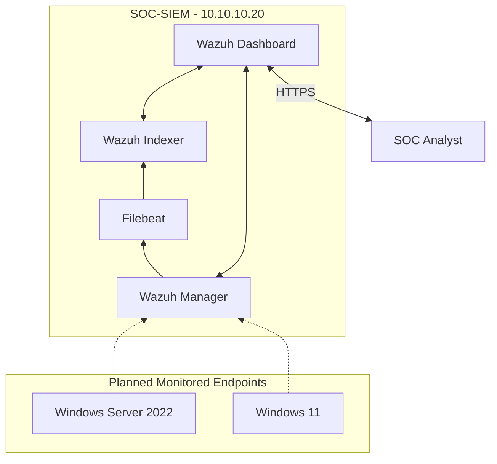
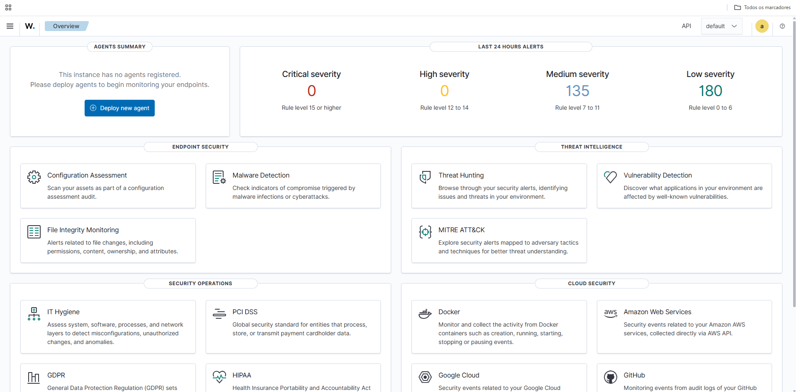
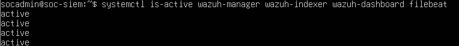
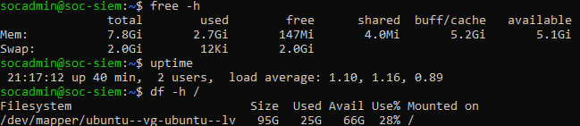

# Wazuh SIEM Deployment

## 1. Overview

Wazuh was selected as the centralized security monitoring platform for the SOC Homelab.

The platform will be used to collect security telemetry, analyze events, generate alerts, investigate suspicious activity, and develop custom detection capabilities across the laboratory infrastructure.

An All-in-One deployment was selected, hosting all central Wazuh components on a dedicated Ubuntu Server virtual machine.

## 2. Platform Selection

Wazuh was selected for the following reasons:

- Open-source security monitoring platform.
- Centralized security event collection and analysis.
- Windows and Linux endpoint monitoring.
- File Integrity Monitoring (FIM).
- Security Configuration Assessment (SCA).
- Vulnerability detection.
- Custom detection rule development.
- MITRE ATT&CK integration.
- Security alert investigation.
- Suitability for hands-on SOC training.

## 3. Deployment Architecture



All central components are deployed on the same virtual machine.

Endpoint integration will be performed during a subsequent project phase.

## 4. Wazuh Components

| Component | Function |
|---|---|
| Wazuh Manager | Event analysis, rule evaluation, alert generation and agent management |
| Wazuh Indexer | Security data indexing, storage and search |
| Wazuh Dashboard | Security visualization, investigation and platform administration |
| Filebeat | Forwarding generated alerts to the Wazuh Indexer |
| Wazuh Agent | Endpoint telemetry collection and security monitoring |

The Wazuh Agent will be deployed during the endpoint monitoring phase.

## 5. Server Specifications

| Parameter | Configuration |
|---|---|
| Virtual Machine | SOC-SIEM |
| Hostname | soc-siem |
| Operating System | Ubuntu Server 24.04.5 LTS |
| Virtualization | Microsoft Hyper-V |
| RAM | 8 GB |
| Dynamic Memory | Disabled |
| Virtual CPUs | 4 |
| Virtual Disk | 100 GB |
| IP Address | 10.10.10.20 |
| Deployment Type | All-in-One |
| Installation Branch | Wazuh 4.14 |

## 6. Pre-installation Validation

Before deploying Wazuh, the underlying operating system and infrastructure were validated.

The following checks were performed:

- Operating system compatibility.
- Static IPv4 configuration.
- Internet connectivity.
- DNS resolution.
- SSH remote administration.
- CPU allocation.
- Physical memory allocation.
- Available disk capacity.
- Operating system updates.

An issue with Hyper-V Dynamic Memory was identified and corrected before installation.

The virtual machine was configured with a fixed allocation of 8192 MB of RAM.

A recovery checkpoint was created before proceeding:

`01 - Ubuntu Clean Installation`

Additional information is available in:

- [Hyper-V Deployment](Hyper-V-Deployment.md)
- [Ubuntu Server Deployment](Ubuntu-Server.md)
- [Network Architecture](Network-Architecture.md)

## 7. Wazuh Installation

The deployment was performed remotely through an SSH session from the Windows host.

### 7.1 Connect to the Server

```powershell
ssh socadmin@10.10.10.20
```

### 7.2 Download the Installation Assistant

The official Wazuh installation assistant was downloaded from the Wazuh package repository.

```bash
cd ~
curl -fLO https://packages.wazuh.com/4.14/wazuh-install.sh
```

### 7.3 Execute the All-in-One Installation

```bash
sudo bash ./wazuh-install.sh -a
```

The installation assistant automatically deployed and configured the central Wazuh components.

The installation process included:

- Wazuh Manager deployment.
- Wazuh Indexer deployment.
- Wazuh Dashboard deployment.
- Filebeat configuration.
- Certificate generation.
- Authentication configuration.
- Service initialization.

The installation completed successfully.

## 8. Dashboard Access

The Wazuh Dashboard was accessed from the Windows host using HTTPS.

Dashboard URL:

`https://10.10.10.20`

The default administrative username was:

`admin`

The automatically generated password was used for initial authentication.

Credentials are intentionally excluded from this repository.

Successful authentication confirmed that the Dashboard was accessible from the host operating system.

## 9. Service Validation

Following installation, the central Wazuh services were inspected using systemctl.

```bash
sudo systemctl status wazuh-manager wazuh-indexer wazuh-dashboard filebeat --no-pager
```

A consolidated service availability check was subsequently performed.

```bash
systemctl is-active wazuh-manager wazuh-indexer wazuh-dashboard filebeat
```

Observed result:

```text
active
active
active
active
```

### Service Status

| Service | Status |
|---|---|
| wazuh-manager | Active |
| wazuh-indexer | Active |
| wazuh-dashboard | Active |
| filebeat | Active |

All four services were confirmed operational.

Service availability alone does not establish complete end-to-end event processing functionality. Endpoint telemetry ingestion and alert generation will be validated during later project phases.

## 10. Initial Resource Utilization

Resource utilization was measured after the installation.

### 10.1 Memory Utilization

```bash
free -h
```

Observed output:

```text
               total        used        free      shared  buff/cache   available
Mem:           7.8Gi       2.5Gi       166Mi       4.0Mi       5.4Gi       5.3Gi
Swap:          2.0Gi        12Ki       2.0Gi
```

Approximately 5.3 GiB of memory remained available.

The low amount of completely unused memory was primarily associated with Linux filesystem caching rather than significant memory pressure.

### 10.2 System Load

```bash
uptime
```

Observed load averages:

| Interval | Load Average |
|---|---|
| 1 minute | 0.04 |
| 5 minutes | 0.03 |
| 15 minutes | 0.08 |

The system exhibited low load relative to its four assigned virtual CPUs.

### 10.3 Storage Utilization

```bash
df -h /
```

Observed output:

```text
Filesystem                         Size  Used Avail Use% Mounted on
/dev/mapper/ubuntu--vg-ubuntu--lv   95G   22G   69G  24% /
```

Approximately 69 GiB of storage remained available following installation.

### 10.4 Process Resource Consumption

```bash
ps -eo pid,comm,%cpu,%mem,rss --sort=-rss | head -15
```

Selected observed processes:

| Process | CPU | Memory | RSS |
|---|---|---|---|
| java | 2.6% | 19.0% | 1513.5 MiB |
| node | 0.3% | 2.7% | 218.4 MiB |
| python3 | 0.2% | 1.4% | 116.3 MiB |
| wazuh-modulesd | 1.0% | 0.9% | 72.9 MiB |
| filebeat | 0.0% | 0.5% | 45.7 MiB |
| wazuh-analysisd | 0.0% | 0.4% | 33.3 MiB |

The Java process associated with the Wazuh Indexer represented the largest observed individual memory consumer.

These measurements represent an initial baseline without monitored endpoints.

## 11. Dashboard Performance Validation

The Wazuh Dashboard was accessed and tested following installation.

The initial deployment on VirtualBox had experienced noticeable delays and connection timeouts.

After rebuilding the laboratory using Hyper-V, the previously observed dashboard delays were no longer noticeable during initial testing.

| Validation | Result |
|---|---|
| Dashboard Accessibility | Passed |
| Administrative Authentication | Passed |
| Initial Responsiveness | Passed |
| Previously Observed Delays | Not observed during initial testing |
| Central Service Availability | Passed |

The results indicate an improvement in the initial user experience.

However, no controlled benchmark was performed to establish a precise performance difference between the two hypervisors.

Additional performance testing will be conducted after endpoint integration.

## 12. Security Considerations

The following security considerations apply to the initial deployment:

- HTTPS is used for Dashboard access.
- SSH is used for remote server administration.
- Administrative credentials are excluded from documentation.
- The SIEM is hosted on a dedicated internal virtual network.
- No inbound NAT port forwarding was configured.
- Windows host security protections remain enabled.
- Laboratory services are not intentionally exposed to the public internet.

Future security improvements include:

- Role-based access control.
- Administrative account review.
- Certificate trust configuration.
- SSH authentication hardening.
- Service exposure review.
- Network isolation before adversary simulations.
- Index retention and storage management.

The current deployment represents a functional laboratory baseline rather than a fully hardened production SIEM.

## 13. Recovery Checkpoint

Following successful installation and initial validation, a second Hyper-V checkpoint was created.

Checkpoint name:

`02 - Wazuh Clean Installation`

This checkpoint provides a recovery point before endpoint integration and subsequent security monitoring configuration.

## 14. Deployment Validation Summary

| Validation | Result |
|---|---|
| Wazuh Installation | Passed |
| Wazuh Manager | Active |
| Wazuh Indexer | Active |
| Wazuh Dashboard | Active |
| Filebeat | Active |
| Dashboard Authentication | Passed |
| Initial Resource Utilization | Acceptable |
| Initial Dashboard Responsiveness | Passed |
| Recovery Checkpoint | Created |
| Endpoint Integration | Pending |
| End-to-End Event Ingestion | Pending |
| Detection Rule Validation | Pending |

## 15. Next Steps

The following activities are planned for subsequent project phases:

- Deploy Active Directory infrastructure.
- Deploy a domain-joined Windows endpoint.
- Install Wazuh Agents.
- Configure Sysmon.
- Collect Windows security telemetry.
- Validate event ingestion and alert generation.
- Establish normal activity baselines.
- Conduct authorized adversary simulations.
- Develop and validate custom detection rules.
- Investigate security incidents.
- Develop incident response playbooks.

## 16. References

- [Official Wazuh Documentation](https://documentation.wazuh.com/)
- [Wazuh Quickstart](https://documentation.wazuh.com/current/quickstart.html)
- [Wazuh Architecture](https://documentation.wazuh.com/current/getting-started/architecture.html)

## 17. Conclusion

The Wazuh All-in-One platform was successfully deployed on Ubuntu Server using Microsoft Hyper-V.

All central services were confirmed operational, and initial resource utilization and Dashboard responsiveness were satisfactory.

The SIEM infrastructure is ready for endpoint integration and subsequent security monitoring activities.


## Deployment Evidence

### Wazuh Dashboard

Successful access to the Wazuh Dashboard following the All-in-One deployment.



### Service Validation

Verification of the operational status of Wazuh Manager, Wazuh Indexer, Wazuh Dashboard, and Filebeat.



### Resource Utilization

Initial resource utilization baseline following the Wazuh deployment, including memory usage, system load, and disk utilization.


