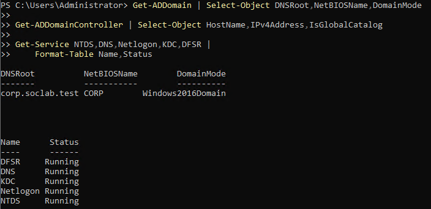

# Active Directory Deployment

## Overview

A Windows Server 2022 Domain Controller was deployed to establish a simulated corporate Active Directory environment.

This infrastructure will support centralized authentication, identity management, security monitoring, and controlled adversary simulations.

## Domain Controller Configuration

| Component | Configuration |
|---|---|
| Hostname | DC01 |
| Operating System | Windows Server 2022 Standard Evaluation |
| Hypervisor | Hyper-V |
| VM Generation | 2 |
| RAM | 4 GB |
| vCPU | 2 |
| Virtual Disk | 60 GB |
| IP Address | 10.10.10.10 |
| Subnet | 255.255.255.0 |
| Default Gateway | 10.10.10.1 |
| DNS Server | 10.10.10.10 |
| Virtual Switch | SOC-LAB |

## Active Directory Configuration

| Component | Configuration |
|---|---|
| Domain Name | corp.soclab.test |
| NetBIOS Name | CORP |
| Forest Functional Level | Windows Server 2016 |
| Domain Functional Level | Windows Server 2016 |
| Global Catalog | Enabled |
| DNS | Active Directory-integrated |
| FSMO Roles | All five roles assigned to DC01 |

## Deployment

Active Directory Domain Services was installed using PowerShell.

```powershell
Install-WindowsFeature -Name AD-Domain-Services -IncludeManagementTools
```

A new Active Directory forest was subsequently created.

```powershell
Install-ADDSForest `
    -DomainName "corp.soclab.test" `
    -DomainNetbiosName "CORP" `
    -InstallDNS:$true
```

## Validation

The following components were validated:

- Active Directory domain and forest configuration.
- Domain Controller availability.
- Global Catalog configuration.
- FSMO role ownership.
- DNS resolution and LDAP service discovery.
- SYSVOL and NETLOGON shares.
- Essential Active Directory services.

The following services were confirmed to be running:

| Service | Status |
|---|---|
| NTDS | Running |
| DNS | Running |
| Netlogon | Running |
| KDC | Running |
| DFSR | Running |

### Deployment Evidence



## Outcome

The Domain Controller was successfully deployed and validated.

The environment is ready to support corporate identity management, domain-joined endpoints, centralized security policies, and security telemetry collection.
