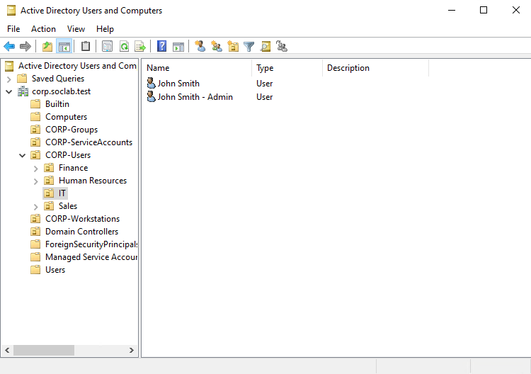

# Corporate Active Directory Structure

## Overview

A simulated corporate identity structure was implemented to represent a small enterprise environment.

The structure includes departmental Organizational Units, security groups, standard user accounts, privileged accounts, and dedicated service accounts.

## Organizational Units

```text
corp.soclab.test
|
|-- CORP-Users
|   |-- IT
|   |-- Finance
|   |-- Human Resources
|   |-- Sales
|
|-- CORP-Groups
|-- CORP-ServiceAccounts
|-- CORP-Workstations
```

All custom Organizational Units were configured with protection against accidental deletion.

## Security Groups

Departmental access management was implemented using Global Security Groups.

| Security Group | Department | Members |
|---|---|---|
| IT-Users | IT | 1 |
| Finance-Users | Finance | 2 |
| HR-Users | Human Resources | 1 |
| Sales-Users | Sales | 2 |

## Standard User Accounts

| Username | Department | Security Group |
|---|---|---|
| john.smith | IT | IT-Users |
| sarah.wilson | Finance | Finance-Users |
| michael.brown | Finance | Finance-Users |
| emma.davis | Human Resources | HR-Users |
| james.miller | Sales | Sales-Users |
| average.user | Sales | Sales-Users |

## Privileged Accounts

A separate administrative account was created to demonstrate the separation of standard and privileged identities.

| Username | Role |
|---|---|
| Administrator | Built-in Domain Administrator |
| admin.john | Domain Administrator |

The standard account john.smith remains separate from the privileged account admin.john.

## Service Accounts

| Username | Intended Purpose |
|---|---|
| svc_backup | Backup operations |
| svc_sql | SQL services |

These accounts are currently provisioned without additional privileged group memberships or operational service assignments.

## Security Principles

The corporate structure was designed around the following principles:

- Separation of standard and privileged identities.
- Department-based group membership.
- Principle of least privilege.
- Dedicated service identities.
- Centralized identity management.

## Validation

All nine additional accounts were successfully created and enabled.

Departmental security group memberships were validated using PowerShell.

Membership of the Domain Admins group was also verified.

### Corporate Structure Evidence



## Security Monitoring Use Cases

This identity structure will support future investigations involving:

- Password spraying and brute-force attempts.
- Suspicious authentication activity.
- Unauthorized group membership changes.
- Privilege escalation.
- Privileged account abuse.
- Lateral movement.
- Service account abuse.

## Outcome

A functional corporate identity structure was established and validated, providing a realistic foundation for identity-based security monitoring and controlled attack simulations.
