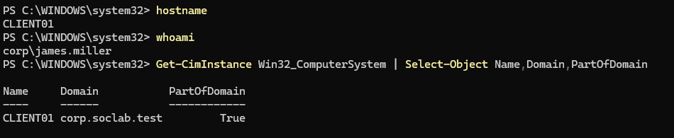

# Windows Endpoint Deployment

## Overview

A Windows 11 workstation was deployed to represent a standard corporate endpoint within the Active Directory environment.

The workstation will serve as a monitored endpoint for security telemetry collection, detection engineering, threat hunting, and incident response investigations.

## Virtual Machine Configuration

| Component | Configuration |
|---|---|
| Hostname | CLIENT01 |
| Operating System | Windows 11 Pro |
| Hypervisor | Hyper-V |
| VM Generation | 2 |
| RAM | 4 GB |
| vCPU | 2 |
| Virtual Disk | 80 GB |
| Secure Boot | Enabled |
| Virtual TPM | Enabled |
| Virtual Switch | SOC-LAB |

## Network Configuration

| Component | Configuration |
|---|---|
| IP Address | 10.10.10.30 |
| Subnet Mask | 255.255.255.0 |
| Default Gateway | 10.10.10.1 |
| DNS Server | 10.10.10.10 |
| Domain | corp.soclab.test |

## Connectivity Validation

Before joining the Active Directory domain, connectivity to the Domain Controller was validated.

The following TCP ports were successfully tested:

| Port | Service | Result |
|---|---|---|
| 53 | DNS | Successful |
| 88 | Kerberos | Successful |
| 135 | RPC | Successful |
| 389 | LDAP | Successful |
| 445 | SMB | Successful |
| 464 | Kerberos Password Change | Successful |

Internal DNS resolution and LDAP service discovery were also validated.

## Active Directory Integration

The workstation was joined to the Active Directory domain using PowerShell.

```powershell
Add-Computer `
    -DomainName "corp.soclab.test" `
    -OUPath "OU=CORP-Workstations,DC=corp,DC=soclab,DC=test" `
    -Credential (Get-Credential) `
    -Restart
```

The computer object was successfully created in the designated workstation Organizational Unit.

```text
CN=CLIENT01,OU=CORP-Workstations,DC=corp,DC=soclab,DC=test
```

## Domain Authentication

Domain authentication was successfully validated using the standard corporate account:

```text
CORP\james.miller
```

The following PowerShell commands were used to verify the endpoint identity and domain membership:

```powershell
hostname
whoami

Get-CimInstance Win32_ComputerSystem |
    Select-Object Name,Domain,PartOfDomain
```

### Validation Results

| Component | Result |
|---|---|
| Hostname | CLIENT01 |
| Domain | corp.soclab.test |
| Domain Membership | True |
| Authenticated User | CORP\james.miller |
| Workstation OU | CORP-Workstations |

### Domain Join Evidence



## Recovery Checkpoint

A Hyper-V checkpoint was created after the successful domain integration.

```text
01 - Windows 11 Domain Joined
```

This checkpoint provides a recovery point before the deployment of security monitoring tools.

## Outcome

A functional domain-joined Windows 11 endpoint was successfully deployed and validated.

The endpoint is ready for Wazuh agent deployment, Sysmon configuration, Windows security auditing, and security telemetry collection.
