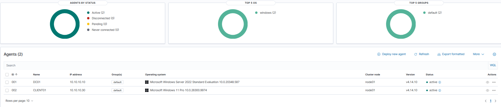
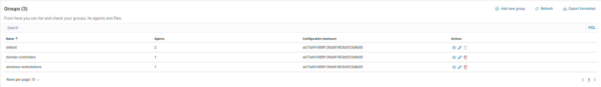

# Wazuh Agent Deployment

## Objective

Deploy Wazuh agents across the corporate Active Directory environment to establish centralized endpoint monitoring and security event collection.

## Agent Inventory

| Agent ID | Hostname | IP Address | Operating System | Agent Version |
|---|---|---|---|---|
| 001 | DC01 | 10.10.10.10 | Windows Server 2022 | 4.14.10 |
| 002 | CLIENT01 | 10.10.10.30 | Windows 11 Pro | 4.14.10 |

Both agents communicate with the centralized Wazuh manager hosted on SOC-SIEM (10.10.10.20).

## Agent Deployment

The Windows agents were deployed using the official Wazuh MSI installer.

Each agent was configured with:

- Centralized Wazuh manager address.
- Unique agent name.
- Automatic service startup.
- Agent enrollment and authentication.
- TCP communication with the Wazuh manager.

Successful enrollment and connectivity were verified through the Wazuh dashboard and local agent logs.

## Agent Group Management

Dedicated agent groups were created to support role-based configuration management.

| Group | Intended Asset | Purpose |
|---|---|---|
| default | All Windows endpoints | Shared monitoring configuration |
| domain-controllers | DC01 | Domain controller-specific monitoring |
| windows-workstations | CLIENT01 | Workstation-specific monitoring |

This structure allows future monitoring configurations to be tailored to different asset roles without requiring individual endpoint configuration.

## Centralized Configuration

Shared Windows event collection settings are managed through the following configuration file on the Wazuh manager:

`/var/ossec/etc/shared/default/agent.conf`

Centralized configuration provides several operational advantages:

- Consistent monitoring across endpoints.
- Reduced manual configuration.
- Simplified deployment of additional telemetry sources.
- Improved scalability and configuration management.

Configuration synchronization was verified for both agents using the Wazuh agent group management utility.

Both agents reported successful synchronization.

## Communication Ports

| Port | Protocol | Purpose |
|---|---|---|
| 1514 | TCP | Agent communication and event forwarding |
| 1515 | TCP | Agent enrollment |

## SOC Relevance

Centralized endpoint monitoring enables security analysts to investigate activity across multiple systems from a single platform.

Separating domain controllers and workstations into dedicated groups also establishes a foundation for asset-specific monitoring, configuration management, and future detection engineering.

## Validation Results

| Validation | Result |
|---|---|
| DC01 Agent Enrollment | Passed |
| CLIENT01 Agent Enrollment | Passed |
| Agent Service Availability | Passed |
| Manager Connectivity | Passed |
| Agent Group Creation | Passed |
| Centralized Configuration Synchronization | Passed |
| Windows Event Channel Monitoring | Passed |

## Conclusion

Both Windows endpoints were successfully enrolled in the Wazuh monitoring infrastructure.

Centralized configuration and agent group management establish the foundation for advanced endpoint telemetry collection, threat detection, and security investigations.
