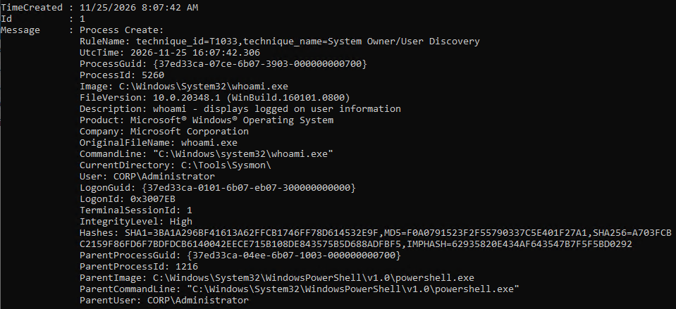
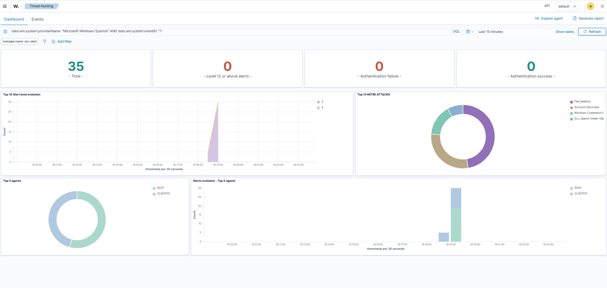
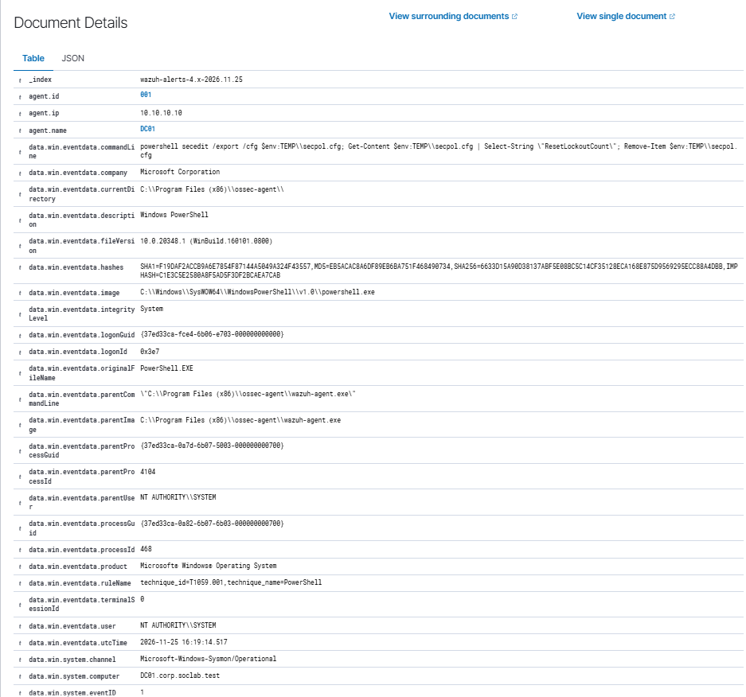

# Sysmon Integration

## Objective

Enhance endpoint visibility by deploying Microsoft Sysmon and integrating its telemetry with the centralized Wazuh monitoring infrastructure.

Sysmon provides detailed system activity information that supports threat detection, behavioral analysis, threat hunting, and incident investigation.

## Deployment Overview

| Component | Configuration |
|---|---|
| Monitored Endpoints | DC01 and CLIENT01 |
| Sysmon Version | 15.22 |
| Configuration | Sysmon Modular — Balanced |
| Configuration Author | Olaf Hartong |
| XML Schema Version | 4.91 |
| SIEM Platform | Wazuh |
| Deployment Directory | C:\Tools\Sysmon |

The community-maintained Sysmon Modular configuration was selected as a baseline to provide security-relevant endpoint telemetry while maintaining reasonable resource consumption.

Configuration source: [Sysmon Modular](https://github.com/olafhartong/sysmon-modular)

## Security Monitoring Capabilities

| Event ID | Event Type | Security Relevance |
|---|---|---|
| 1 | Process Creation | Suspicious execution and process relationships |
| 3 | Network Connection | Potential command-and-control communication |
| 7 | Image Loaded | Suspicious DLL loading |
| 10 | Process Access | Potential credential access and process manipulation |
| 11 | File Creation | Payload delivery and suspicious file activity |
| 12–14 | Registry Activity | Persistence and configuration changes |
| 22 | DNS Query | Suspicious domain resolution |

These event types represent relevant Sysmon monitoring capabilities. Their collection depends on the active configuration and filtering rules. Not every event type was individually validated during this phase.

## Centralized Wazuh Integration

Sysmon event collection was configured centrally through the Wazuh shared agent configuration.

Configuration file:

`/var/ossec/etc/shared/default/agent.conf`

```xml
<agent_config os="Windows">
  <localfile>
    <location>Microsoft-Windows-Sysmon/Operational</location>
    <log_format>eventchannel</log_format>
  </localfile>
</agent_config>
```

This configuration represents the initial Sysmon integration. Additional Windows event channels were subsequently added.

Both Windows agents successfully synchronized their configuration and initialized monitoring of the Sysmon Operational event channel.

## Endpoint Telemetry Validation

Controlled execution of legitimate Windows commands was performed to validate process creation telemetry.

```powershell
whoami.exe
ipconfig.exe /all
hostname.exe
```

Sysmon Event ID 1 provided detailed process execution information, including:

- Process image and command-line arguments.
- Parent process information.
- User account and integrity level.
- Process identifiers and GUIDs.
- Execution timestamps.
- File hashes.



## SIEM Telemetry Validation

The following query was used within Wazuh Threat Hunting to identify Sysmon process creation alerts:

```
data.win.system.providerName: "Microsoft-Windows-Sysmon" AND data.win.system.eventID: "1"
```

Alerts originating from both DC01 and CLIENT01 were successfully observed, confirming end-to-end visibility for the detected Sysmon activity.



## Initial Alert Triage — Benign Positive

During telemetry validation, a native Wazuh detection rule generated an alert associated with PowerShell file deletion activity on the domain controller.

### Alert Details

| Field | Value |
|---|---|
| Endpoint | DC01 |
| Rule ID | 92021 |
| Severity Level | 3 |
| Description | Powershell was used to delete files or directories |
| Event Source | Sysmon Event ID 1 |
| MITRE ATT&CK | T1070.004 — File Deletion |
| Execution Context | NT AUTHORITY\SYSTEM |
| Parent Process | wazuh-agent.exe |
| Classification | Benign Positive |
| Confidence | High |



### Analysis

The observed PowerShell command exported the local security policy, retrieved the account lockout counter reset configuration, and included an instruction to remove the temporary policy file.

The parent process was identified as the legitimate Wazuh agent.

Further validation confirmed that the exact command was present within the Wazuh Security Configuration Assessment policy:

`C:\Program Files (x86)\ossec-agent\ruleset\sca\cis_win2022.yml`

The activity was attributed to an automated security configuration assessment associated with CIS Windows Server 2022 benchmark requirements.

The process creation event confirmed the executed command line but did not independently establish whether the file deletion completed successfully.

### Analyst Verdict

**Benign Positive — Authorized security assessment activity.**

The alert correctly identified a potentially security-relevant command pattern, but the execution context and
