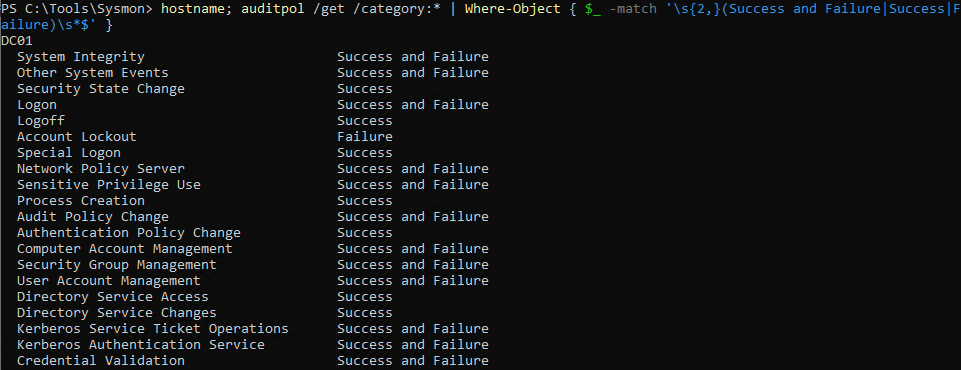
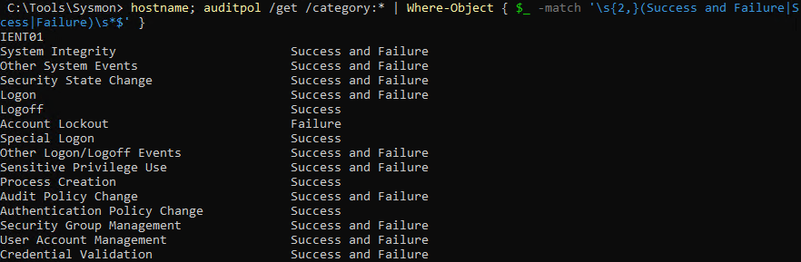

# Windows Advanced Audit Policies

## Objective

Implement centralized Windows security auditing across the Active Directory environment to improve visibility into authentication activity, account management, process execution, privilege usage, and directory service changes.

## Group Policy Architecture

Dedicated Group Policy Objects were created to separate domain controller auditing from workstation auditing.

| Group Policy Object | Target Organizational Unit |
|---|---|
| SOC - DC Auditing | Domain Controllers |
| SOC - Workstation Auditing | CORP-Workstations |

This approach enables role-based auditing while preserving the default domain policies.

The following security option was enabled to ensure that advanced audit subcategory settings override legacy audit category settings:

`Audit: Force audit policy subcategory settings (Windows Vista or later) to override audit policy category settings`

## Domain Controller Audit Policies

The following audit subcategories were configured and validated on DC01.

| Audit Subcategory | Configuration |
|---|---|
| Credential Validation | Success and Failure |
| Kerberos Authentication Service | Success and Failure |
| Kerberos Service Ticket Operations | Success and Failure |
| Computer Account Management | Success and Failure |
| Security Group Management | Success and Failure |
| User Account Management | Success and Failure |
| Process Creation | Success |
| Directory Service Changes | Success |
| Directory Service Access | Success |
| Logon | Success and Failure |
| Logoff | Success |
| Account Lockout | Failure |
| Special Logon | Success |
| Audit Policy Change | Success and Failure |
| Authentication Policy Change | Success |
| Sensitive Privilege Use | Success and Failure |
| System Integrity | Success and Failure |
| Other System Events | Success and Failure |
| Security State Change | Success |
| Network Policy Server | Success and Failure |

A total of 20 audit subcategories were enabled on the domain controller.



## Workstation Audit Policies

The following audit subcategories were configured and validated on CLIENT01.

| Audit Subcategory | Configuration |
|---|---|
| Credential Validation | Success and Failure |
| User Account Management | Success and Failure |
| Security Group Management | Success and Failure |
| Process Creation | Success |
| Logon | Success and Failure |
| Logoff | Success |
| Account Lockout | Failure |
| Special Logon | Success |
| Other Logon/Logoff Events | Success and Failure |
| Audit Policy Change | Success and Failure |
| Authentication Policy Change | Success |
| Sensitive Privilege Use | Success and Failure |
| System Integrity | Success and Failure |
| Other System Events | Success and Failure |
| Security State Change | Success and Failure |

A total of 15 audit subcategories were enabled on the corporate workstation.



## Security-Relevant Windows Events

The implemented audit policies establish a foundation for monitoring the following Windows Security Event IDs.

| Event ID | Description | Security Use Case |
|---|---|---|
| 4624 | Successful Logon | Unauthorized access and lateral movement |
| 4625 | Failed Logon | Brute force and password spraying |
| 4634 | Account Logoff | Session reconstruction |
| 4672 | Special Privileges Assigned | Privileged account monitoring |
| 4688 | Process Creation | Suspicious command execution |
| 4719 | System Audit Policy Changed | Defense evasion |
| 4720 | User Account Created | Unauthorized account creation |
| 4724 | Password Reset Attempt | Account manipulation |
| 4728 | Member Added to Global Security Group | Privilege escalation |
| 4732 | Member Added to Local Security Group | Privilege escalation |
| 4740 | User Account Locked Out | Authentication attack investigation |
| 4768 | Kerberos TGT Requested | Kerberos authentication analysis |
| 4769 | Kerberos Service Ticket Requested | Potential Kerberoasting activity |
| 4771 | Kerberos Pre-Authentication Failed | Authentication attack investigation |
| 4776 | Credential Validation | NTLM authentication monitoring |
| 5136 | Directory Service Object Modified | Unauthorized Active Directory changes |

These events represent expected monitoring capabilities rather than individually validated detections. Certain events require additional conditions, including appropriate System Access Control Lists (SACLs) for directory service auditing.

## Configuration Validation

Group Policy application and effective audit settings were verified using native Windows administrative utilities.

```powershell
gpresult /r /scope computer
```

```powershell
auditpol /get /category:*
```

Both endpoints successfully applied their respective auditing policies.

Validation focused on effective endpoint configuration rather than relying exclusively on the settings displayed within Group Policy Management.

## Troubleshooting

During the initial domain controller configuration, the auditing GPO appeared in the applied policy list, but the expected audit subcategories were not active.

Investigation identified a missing Advanced Audit Policy client-side extension association within the GPO metadata.

Reapplying an audit subcategory through Group Policy Management restored the extension association. Following a Group Policy refresh, the expected audit settings were successfully applied.

The underlying reason for the missing extension association was not conclusively established.

## SOC Relevance

Centralized Windows auditing provides the foundation for investigating authentication attacks, suspicious process execution, privilege escalation, account manipulation, and Active Directory activity.

Combined with Sysmon and Wazuh, these policies improve the ability to correlate security events across multiple endpoints and reconstruct incident timelines.

## Conclusion

Role-based Windows Advanced Audit Policies were successfully implemented and validated across the domain controller and corporate workstation.

The resulting audit configuration establishes a security monitoring baseline for future adversary simulations, detection engineering, and incident response activities.
