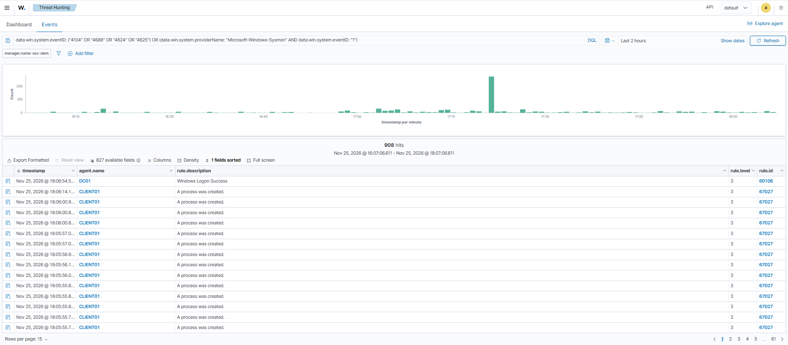

# Security Telemetry Validation

## Objective

Validate the effectiveness of the centralized security monitoring infrastructure and establish a baseline for future adversary simulations and detection engineering.

The validation focused on endpoint event generation, agent configuration synchronization, event channel monitoring, and security alert visibility within Wazuh.

## Centralized Event Collection

The following Windows event channels were configured for monitoring across DC01 and CLIENT01.

| Event Channel | Monitoring Status |
|---|---|
| Application | Active |
| Security | Active |
| System | Active |
| Microsoft-Windows-Sysmon/Operational | Active |
| Microsoft-Windows-PowerShell/Operational | Active |
| Microsoft-Windows-TaskScheduler/Operational | Active |
| Microsoft-Windows-WMI-Activity/Operational | Active |
| Microsoft-Windows-Windows Defender/Operational | Active |

Additional event channels were configured through the centralized Wazuh agent configuration file:

`/var/ossec/etc/shared/default/agent.conf`

```xml
<agent_config os="Windows">
  <localfile>
    <location>Microsoft-Windows-Sysmon/Operational</location>
    <log_format>eventchannel</log_format>
  </localfile>

  <localfile>
    <location>Microsoft-Windows-PowerShell/Operational</location>
    <log_format>eventchannel</log_format>
  </localfile>

  <localfile>
    <location>Microsoft-Windows-TaskScheduler/Operational</location>
    <log_format>eventchannel</log_format>
  </localfile>

  <localfile>
    <location>Microsoft-Windows-WMI-Activity/Operational</location>
    <log_format>eventchannel</log_format>
  </localfile>

  <localfile>
    <location>Microsoft-Windows-Windows Defender/Operational</location>
    <log_format>eventchannel</log_format>
  </localfile>
</agent_config>
```

The Application, Security, and System event channels were already monitored through the existing agent configuration.

Both agents successfully synchronized their centralized configuration and initialized monitoring of all eight event channels.

## Controlled Validation Activity

Legitimate administrative commands were executed to generate security-relevant endpoint telemetry.

```powershell
whoami.exe /all
ipconfig.exe /all
powershell.exe -NoProfile -Command "Get-Process | Select-Object -First 5"
powershell.exe -NoProfile -Command "Get-Service | Select-Object -First 5"
schtasks.exe /query /fo LIST
Get-CimInstance Win32_OperatingSystem
```

These activities were performed exclusively for telemetry validation and did not constitute malicious activity or adversary simulations.

## Telemetry Validation Matrix

| Telemetry Source | Local Availability | SIEM Alert Visibility |
|---|---|---|
| Windows Authentication — 4624/4625 | Available | Confirmed |
| Windows Process Creation — 4688 | Confirmed | Confirmed |
| Sysmon Process Creation — 1 | Confirmed | Confirmed |
| PowerShell Script Block Logging — 4104 | Confirmed | Confirmed |
| PowerShell Module Logging — 4103 | Confirmed | Not confirmed |
| WMI Activity | Available | Confirmed |
| Task Scheduler | Available | Not confirmed |
| Windows Defender | Available | Not confirmed |

SIEM visibility was assessed through Wazuh Threat Hunting using event identifiers, event providers, and Windows event channel names.



## Threat Hunting Queries

### Windows Authentication

```
data.win.system.eventID: ("4624" OR "4625")
```

### Windows Process Creation

```
data.win.system.eventID: "4688"
```

### Sysmon Process Creation

```
data.win.system.providerName: "Microsoft-Windows-Sysmon" AND data.win.system.eventID: "1"
```

### PowerShell Script Block Logging

```
data.win.system.eventID: "4104"
```

### WMI Activity

```
data.win.system.channel: "Microsoft-Windows-WMI-Activity/Operational"
```

These queries established initial visibility into security-relevant endpoint activity using native Wazuh detection capabilities.

## Timestamp Consistency

During validation, an eight-hour difference was identified between the local timestamps displayed by DC01 and CLIENT01.

Further verification established that the endpoints were configured with different time zones rather than demonstrating an eight-hour system clock discrepancy.

UTC timestamps were consistent with the sequential execution of the validation commands.

UTC will be used as the primary timestamp reference during future security investigations and incident timeline reconstruction.

## Monitoring Limitations

The Wazuh dashboard primarily exposes indexed security alerts rather than every event received by the manager under the current configuration.

No corresponding alerts were observed during validation for:

- PowerShell Module Logging — Event ID 4103.
- Task Scheduler Operational events.
- Windows Defender Operational events.

Although the agents successfully initialized monitoring of these event channels, direct ingestion of the corresponding events was not independently verified.

The absence of indexed alerts does not establish that event collection failed.

Further validation was deferred to future detection engineering activities.

## Detection Baseline

The environment retains its native Wazuh detection baseline.

At the conclusion of this phase:

- No custom Wazuh detection rules were introduced.
- No native detection rules were suppressed.
- Raw event archiving was not enabled.
- No malicious payloads were executed.
- No adversary simulations were conducted.

This approach allows future attack simulations to evaluate existing detection coverage and identify potential detection gaps before introducing custom rules.

## SOC Relevance

This phase established the distinction between endpoint event generation, telemetry collection, detection logic, and indexed security alerts.

Understanding these differences is essential when investigating detection gaps, validating SIEM coverage, and developing effective security monitoring rules.

## Conclusion

The initial security monitoring objectives were successfully achieved.

Centralized endpoint monitoring, advanced Windows auditing, Sysmon integration, and PowerShell logging provide the foundation for subsequent adversary simulations and security operations activities.

The remaining telemetry validation limitations will be addressed during future detection engineering exercises.

**Phase Status: Completed — Initial monitoring objectives achieved.**
