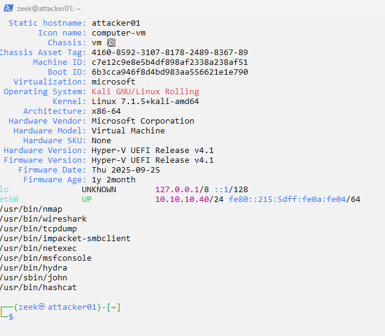

# Kali Linux Deployment

## 1. Overview

A dedicated Kali Linux virtual machine was deployed to simulate adversary behavior within the SOC homelab.

The primary purpose of this machine is to generate controlled security events that can be monitored, detected, and investigated using Wazuh and Windows security telemetry.

## 2. Virtual Machine Configuration

| Component | Configuration |
|---|---|
| Virtual Machine | ATTACKER01 |
| Hostname | attacker01 |
| Operating System | Kali Linux 2026.3 Rolling |
| Hypervisor | Microsoft Hyper-V |
| Generation | Generation 2 |
| Architecture | x86-64 |
| Desktop Environment | Xfce |
| CPU | 2 vCPUs |
| Memory | 4 GB (Static) |
| Virtual Disk | 40 GB |
| Network Switch | SOC-LAB |
| Secure Boot | Disabled |
| Remote Administration | SSH |

## 3. Network Configuration

| Parameter | Configuration |
|---|---|
| IP Address | 10.10.10.40 |
| Subnet Mask | 255.255.255.0 |
| Default Gateway | 10.10.10.1 |
| DNS Server | 10.10.10.10 |
| Network | 10.10.10.0/24 |

A static IP address was configured to ensure consistent communication with the monitored infrastructure.

The machine uses the Active Directory DNS server for internal hostname resolution.

## 4. Connectivity Validation

| Source | Destination | Result |
|---|---|---|
| ATTACKER01 | DC01 | Successful — 0% packet loss |
| ATTACKER01 | SOC-SIEM | Successful — 0% packet loss |
| ATTACKER01 | CLIENT01 | No ICMP reply |
| CLIENT01 | ATTACKER01 | Successful — 0% packet loss |
| ATTACKER01 | Internal DNS | Successful |
| Hyper-V Host | ATTACKER01 SSH | Successful |

CLIENT01 did not respond to inbound ICMP requests. However, successful communication initiated from CLIENT01 and the presence of an ARP entry on ATTACKER01 confirmed internal network reachability.

Windows Firewall is the suspected cause of the inbound ICMP behavior. No firewall protections were disabled.

## 5. Security Tools

The following security tools were verified as available on the system:

| Tool | Purpose |
|---|---|
| Nmap | Network discovery and service enumeration |
| Wireshark | Network traffic analysis |
| Tcpdump | Packet capture |
| Impacket SMBClient | SMB security testing |
| NetExec | Active Directory security testing |
| Metasploit Framework | Controlled adversary simulation |
| Hydra | Authentication security testing |
| John the Ripper | Password security auditing |
| Hashcat | Password hash auditing |

Tool availability was validated through executable discovery. Individual operational testing will be performed when required by specific simulation scenarios.

Additional tools will be introduced as needed.

## 6. Deployment Validation

System validation confirmed:

- Successful Kali Linux deployment.
- Correct virtual machine resource allocation.
- Static network configuration.
- Internal DNS resolution.
- SSH remote administration.
- Availability of core security testing tools.

## 7. Network Architecture and Security Boundaries

The SOC homelab maintains Internet connectivity through the Hyper-V NAT configuration to represent a connected enterprise environment.

This supports software updates, tool installation, security intelligence, and realistic network activity.

The environment is not fully isolated from external networks.

The following security boundaries apply:

- Adversary simulations are restricted to authorized lab systems.
- Real malware execution is outside the scope of this environment.
- Controlled payloads and synthetic test data are used for security exercises.
- Existing endpoint security protections remain enabled.
- Lab services must not be intentionally exposed to the public Internet.
- Recovery checkpoints are maintained before simulation activities.

## 8. Baseline Checkpoint

A clean deployment checkpoint was created after completing the initial configuration and validation.

| Virtual Machine | Checkpoint |
|---|---|
| ATTACKER01 | 01 - Kali Linux Clean Deployment |

Recovery checkpoints are also available for the domain controller, Windows workstation, and Wazuh SIEM.

## 9. Outcome

ATTACKER01 is ready to support controlled adversary simulations within the SOC homelab.

The infrastructure now provides the foundation for generating attack-related telemetry, developing detection rules, conducting threat hunting, and investigating security incidents.
