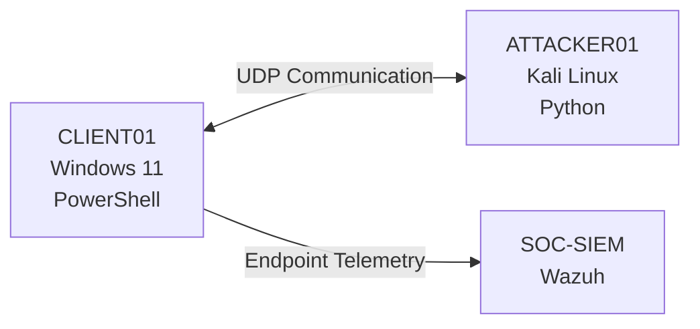
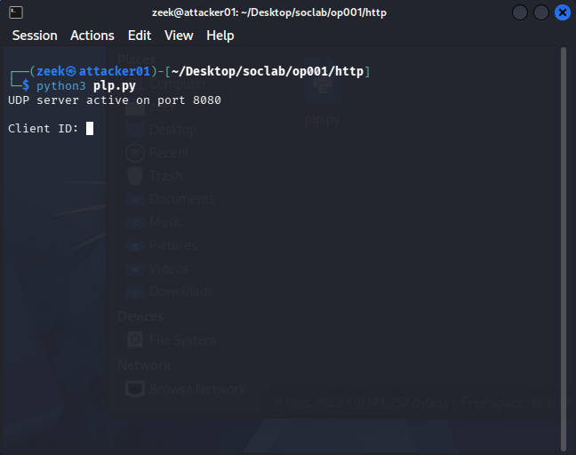
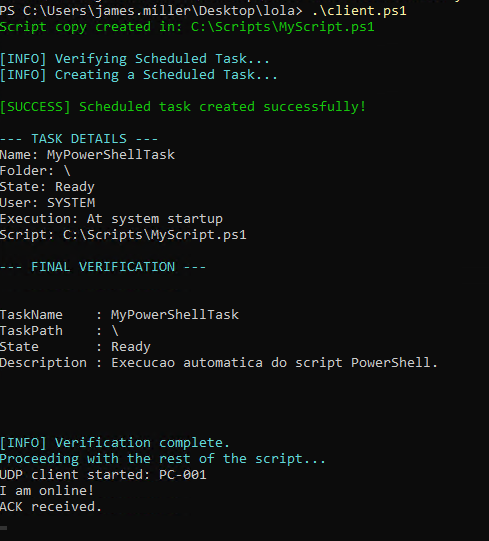
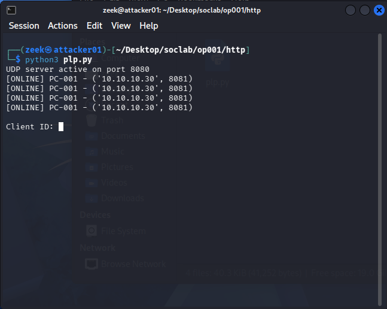
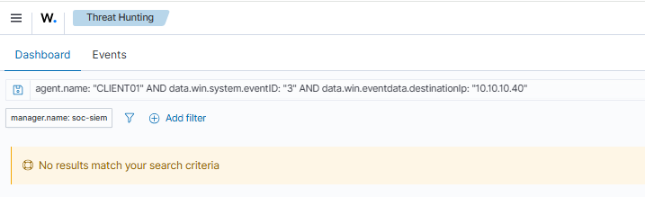

# OP-001 — Custom Command and Control Architecture

## 1. Project Overview

As part of OP-001 — Corporate Intrusion, a custom Command and Control (C2) prototype was independently designed and developed by the author using PowerShell and Python.

Instead of relying exclusively on existing adversary emulation frameworks, this approach was selected to gain a deeper understanding of:

- Client-server architecture.
- Socket programming.
- UDP network communication.
- JSON serialization and deserialization.
- Asynchronous communication.
- Message identification and correlation.
- Windows execution contexts.
- Persistence-related artifacts.
- Endpoint telemetry and detection engineering.

The prototype provides a controlled environment for investigating adversarial behavior from a defensive security perspective.

### Source Code Disclosure

The original prototype includes arbitrary remote command execution and privileged persistence capabilities.

Selected implementation details have been intentionally omitted or replaced with non-operational examples in this documentation.

These modifications are explicitly identified and do not represent limitations of the original implementation.

The published code excerpts are intended to explain individual programming concepts rather than provide a deployable C2 framework.

Implemented capabilities are distinguished from experimentally validated functionality throughout this document.

## 2. Version History

Two versions of the prototype are distinguished for evidence traceability.

| Attribute | Version 1.0 | Version 1.1 |
|---|---|---|
| Purpose | Original investigation | Documentation demonstration |
| Client language | PowerShell | PowerShell |
| Server language | Python | Python |
| Transport | UDP | UDP |
| Client ID | PC-001 | PC-001 |
| Scheduled Task | MinhaTaskPowerShell | MyPowerShellTask |
| Script filename | MeuScript.ps1 | MyScript.ps1 |
| Console language | Portuguese | Predominantly English |
| Configured heartbeat interval | 30 seconds | 30 seconds |

Version 1.0 was used during the initial Wazuh investigation.

Version 1.1 introduced English-language console messages and renamed persistence artifacts.

The original indicators remain unchanged in the incident investigation documentation to preserve evidence integrity.

The version numbers are documentation identifiers rather than formal software releases.

## 3. Technical Architecture

| Component | Technology |
|---|---|
| Client | PowerShell |
| Server | Python |
| Transport Protocol | UDP |
| Message Format | JSON |
| Character Encoding | UTF-8 |
| Message Identification | UUID |
| Timestamp Format | ISO 8601 / UTC |
| Server Interface | prompt_toolkit |
| Concurrency | Python threading |
| Synchronization | Threading Lock |
| Endpoint Monitoring | Microsoft Sysmon |
| SIEM | Wazuh |

### 3.1 — Architecture Diagram



The client and server communicate within the dedicated SOC Homelab network.

Endpoint activity is monitored through Sysmon, Windows event logging, and the Wazuh agent.

## 4. Communication Protocol

The prototype uses structured JSON messages to represent application-level information transported over UDP.

The original design includes the following message categories:

| Message Type | Purpose |
|---|---|
| HEARTBEAT | Client availability reporting |
| ACK | Message acknowledgment |
| NOTIFY | Notification delivery |
| COMMAND | Remote operation request |
| RESULT | Operation result reporting |

The client implements handling for these message categories.

The server implements heartbeat acknowledgment and command-result processing.

Notification handling exists in the client, but notification delivery has not been independently validated.

### 4.1 — Design Considerations

UDP was selected as the transport protocol for this experimental implementation.

Unlike TCP, UDP does not provide built-in guarantees for message delivery, ordering, or retransmission.

The prototype therefore includes application-level acknowledgments and message identifiers.

However, these mechanisms do not constitute a complete reliable transport protocol.

## 5. PowerShell Client Implementation

The Windows client was developed using PowerShell and .NET networking capabilities.

Its responsibilities include:

- Network communication.
- JSON message processing.
- Client identification.
- Heartbeat generation.
- Message acknowledgment handling.
- Remote operation handling.
- Persistence management.

### 5.1 — JSON Serialization

The original client uses PowerShell's native JSON serialization capabilities.

Selected original code excerpt:

```powershell
$Json = $Message | ConvertTo-Json -Compress -Depth 5
$Bytes = $Encoding.GetBytes($Json)
```

The first statement converts a PowerShell object into a compact JSON representation.

The second converts the serialized string into bytes using the configured character encoding.

This allows structured application data to be represented in a format that can be exchanged between PowerShell and Python.

**Modification:** None. The excerpt is taken from the original serialization logic, with the surrounding network and execution functionality omitted.

### 5.2 — Message Identification

The client generates unique message identifiers using the .NET GUID class.

```powershell
[guid]::NewGuid().ToString()
```

Unique identifiers allow individual messages to be distinguished and provide a foundation for message correlation.

**Modification:** None. The surrounding message construction logic has been omitted.

### 5.3 — UTC Timestamp Generation

The client generates timestamps using UTC and ISO 8601 formatting.

```powershell
[DateTime]::UtcNow.ToString("o")
```

Using UTC reduces ambiguity when comparing application activity with endpoint and SIEM telemetry.

This is particularly relevant to incident reconstruction across systems with different time zone configurations.

**Modification:** None.

### 5.4 — Heartbeat Mechanism

The original client implements periodic heartbeat communication.

The configured heartbeat interval is 30 seconds.

The purpose of the heartbeat is to report client availability to the server.

The server maintains information about clients that have reported their presence and acknowledges received heartbeat messages.

Heartbeat transmission and acknowledgment reception were demonstrated during laboratory testing.

The precise transmission interval has not yet been independently verified through packet capture.

### 5.5 — Remote Execution Component

The original client contains functionality designed to process remotely supplied PowerShell operations and return their results.

This functionality introduces a significant security risk because externally supplied content can be interpreted as executable instructions.

The operational execution logic is intentionally excluded from this documentation.

The following standalone example illustrates a harmless replacement for the result-generation concept:

```powershell
$Result = "Demonstration response"
$Status = "success"

@{
    status = $Status
    result = $Result
} | ConvertTo-Json
```

This example generates a fixed local response.

It does not receive remote instructions, execute supplied commands, or transmit results to a remote system.

#### Original vs. Published Behavior

| Original Implementation | Published Example |
|---|---|
| Processes remotely supplied operations | Generates a predefined local response |
| Supports arbitrary command execution | Contains no dynamic execution |
| Captures operation output | Returns a fixed demonstration string |
| Reports execution status | Demonstrates a static status field |
| Includes remote result reporting | Displays JSON locally |

**Modification:** The arbitrary execution and remote result-reporting functionality has been removed from the published example.

**Validation status:** Arbitrary remote command execution and remote command-result reception have not yet been experimentally validated.

## 6. Python Server Implementation

The server was developed using Python.

Its responsibilities include:

- UDP communication.
- JSON message processing.
- Client identification and tracking.
- Heartbeat acknowledgment.
- Interactive console management.
- Request tracking.
- Result processing.

### 6.1 — JSON Deserialization

The original server uses Python's standard JSON library to interpret incoming application data.

Selected original code excerpt:

```python
message = json.loads(data.decode("utf-8"))
```

This statement decodes UTF-8 bytes and converts the resulting JSON string into a Python object.

It demonstrates interoperability between the PowerShell client and Python server.

**Modification:** None. The surrounding socket reception and message dispatch logic has been omitted.

### 6.2 — UUID Generation

The server uses Python's UUID library to generate unique identifiers.

```python
str(uuid.uuid4())
```

Unique identifiers are used to distinguish messages and requests.

The original design includes request tracking to associate operations with corresponding results.

End-to-end command-result correlation has not yet been experimentally validated.

**Modification:** None.

### 6.3 — Timestamp Generation

The server generates timezone-aware UTC timestamps.

Original code excerpt:

```python
from datetime import datetime, timezone

def now():
    return datetime.now(timezone.utc).isoformat()
```

This function returns the current UTC time in ISO 8601 format.

Consistent timestamp representation is useful when comparing application activity against security telemetry.

**Modification:** None.

### 6.4 — Client Registry

The original server maintains an in-memory client registry.

The registry associates reported client identifiers with network endpoint information and their most recent heartbeat timestamp.

This provides a basic representation of client availability.

A reported client identifier is not equivalent to a cryptographically authenticated identity.

The registry also does not independently establish that a previously observed client remains online indefinitely.

### 6.5 — Threading and Synchronization

The server uses Python threading to separate network reception from the interactive console.

This allows incoming communication to be processed while the console remains available.

A threading lock is used to coordinate access to shared application state.

The original implementation also uses prompt_toolkit to provide an interactive console experience.

These design choices demonstrate practical concepts involving concurrent programming and shared-state management.

### 6.6 — Remote Operation Management

The original server contains an interactive component designed to accept operator instructions and associate requests with their corresponding results.

The operational command-dispatch functionality is intentionally excluded from this documentation.

The following standalone example demonstrates local presentation of a predefined result:

```python
result = {
    "status": "success",
    "result": "Demonstration response"
}

print(json.dumps(result, indent=2))
```

This example does not send commands, communicate with an endpoint, or execute remote operations.

#### Original vs. Published Behavior

| Original Implementation | Published Example |
|---|---|
| Interactive remote operation interface | Local demonstration output |
| Remote operation dispatch | No network transmission |
| Pending request tracking | No active request management |
| Remote result processing | Predefined result object |

**Modification:** The operational dispatch and result-handling workflow has been omitted.

The example illustrates result representation without providing remote execution capabilities.

## 7. Persistence Mechanism

The original PowerShell client includes a persistence component based on Windows Task Scheduler.

The implementation is designed to maintain a local script artifact and configure execution during system startup.

The scheduled task is configured to execute under the SYSTEM security context.

Administrative privileges were explicitly provided during testing.

No privilege escalation exploit was performed or demonstrated.

The operational persistence installation code is intentionally excluded from this documentation.

### 7.1 — Observed Persistence Artifacts

| Artifact | Version 1.0 | Version 1.1 |
|---|---|---|
| Script path | C:\Scripts\MeuScript.ps1 | C:\Scripts\MyScript.ps1 |
| Scheduled Task | MinhaTaskPowerShell | MyPowerShellTask |
| Configured account | SYSTEM | SYSTEM |
| Configured trigger | System startup | System startup |

These artifacts provide opportunities for file creation, scheduled task, process execution, and privilege-context monitoring.

The initial investigation confirmed execution of the Version 1.0 task under SYSTEM.

Version 1.1 screenshots demonstrate task registration, but do not independently establish execution following a system restart.

## 8. Operational Evidence

The following screenshots were captured using Version 1.1 of the prototype.

### 8.1 — Server Initialization



The screenshot demonstrates:

- Python server initialization.
- UDP port 8080 reported by the application.
- Interactive client selection interface.
- Server availability before client heartbeat reception.

### 8.2 — Client Initialization



The screenshot demonstrates application-reported confirmation of:

- Local script replication.
- Scheduled task registration.
- Scheduled task state.
- Configured SYSTEM execution context.
- Configured startup trigger.
- UDP client initialization.
- Heartbeat activity.
- Acknowledgment reception.

The scheduled task is displayed in the Ready state.

This confirms the reported task registration state, not successful execution of the updated task following a restart.

### 8.3 — Server Heartbeat Reception



The screenshot demonstrates repeated heartbeat reception from the Windows endpoint.

Observed application output:

```text
[ONLINE] PC-001 - ('10.10.10.30', 8081)
```

The repeated entries demonstrate recurring communication and recognition of the reported client identifier.

Combined with the acknowledgment displayed on the client, this provides evidence of bidirectional application communication.

These screenshots do not demonstrate arbitrary remote command execution.

## 9. Functional Validation Matrix

| Functionality | Validation Status |
|---|---|
| Python server initialization | Demonstrated |
| PowerShell client initialization | Demonstrated |
| Client identification | Demonstrated |
| Heartbeat transmission | Demonstrated |
| Heartbeat reception | Demonstrated |
| Acknowledgment reception | Demonstrated |
| Bidirectional communication | Demonstrated |
| Script replication | Demonstrated |
| Scheduled task registration | Demonstrated |
| SYSTEM execution — Version 1.0 | Confirmed through endpoint telemetry |
| Startup execution — Version 1.1 | Not independently validated |
| Exact heartbeat periodicity | Not independently validated |
| Notification delivery | Not independently validated |
| Arbitrary remote command execution | Implemented, not tested |
| Remote command result reception | Implemented, not tested |
| End-to-end command-result correlation | Implemented, not tested |

The validation matrix distinguishes implemented capabilities from experimentally demonstrated behavior.

## 10. Observed Network Indicators

The initial Version 1.0 investigation identified the following network indicators through local Sysmon telemetry.

| Indicator | Observed Value |
|---|---|
| Source Host | CLIENT01 |
| Source IP | 10.10.10.30 |
| Destination Host | ATTACKER01 |
| Destination IP | 10.10.10.40 |
| Source Port | 8081 |
| Destination Port | 8080 |
| Transport | UDP |
| Associated Process | powershell.exe |

Network activity was observed under multiple Windows security contexts, including a standard domain user, an administrative account, and SYSTEM.

These indicators are specific to the laboratory implementation.

Behavioral detections should not depend exclusively on fixed filenames, ports, or IP addresses.

## 11. Endpoint Telemetry

The prototype generated several categories of security-relevant endpoint telemetry.

| Telemetry Source | Event ID | Observed Behavior |
|---|---|---|
| PowerShell Operational | 4104 | Script block content |
| Sysmon | 3 | Network communication |
| Sysmon | 11 | Script file creation |
| Task Scheduler Operational | 106 | Task registration |
| Task Scheduler Operational | 140 | Task update |
| Task Scheduler Operational | 100 | Task execution |
| Task Scheduler Operational | 200 | Task action execution |

These events were identified during the original Version 1.0 investigation.

The availability of local endpoint telemetry does not guarantee that corresponding events generate centralized SIEM alerts.

Detailed event analysis is documented separately in the execution, persistence, and native detection assessment documents.

## 12. Native Wazuh Detection Assessment

During the original investigation, local Sysmon Event ID 3 records confirmed PowerShell-associated UDP communication.

However, corresponding network alerts were not identified in the investigated Wazuh time window.



The investigation identified an important distinction between:

- Endpoint event generation.
- Event collection.
- Event processing.
- Alert generation.
- Alert indexing.

Raw event archiving was disabled during the initial assessment.

Consequently, the available evidence does not establish whether the network events failed to reach the Wazuh Manager or were received without generating qualifying alerts.

This limitation is recorded in the detection gap register.

## 13. MITRE ATT&CK Mapping

| Technique ID | Technique | Evidence |
|---|---|---|
| T1059.001 | PowerShell | PowerShell execution and script block telemetry |
| T1095 | Non-Application Layer Protocol | Custom UDP communication |
| T1053.005 | Scheduled Task | Task registration and execution |

These mappings are based on observed behavior.

The PowerShell mapping does not imply that arbitrary remote command execution has been experimentally validated.

No privilege escalation technique is claimed solely because the scheduled task executes under SYSTEM.

## 14. Security Limitations

The prototype is an experimental implementation and is not suitable for production use.

The following security limitations were identified:

| Limitation | Security Implication |
|---|---|
| No cryptographic authentication | Communication participants cannot be securely authenticated |
| No encryption | Application data may be exposed |
| No operation-level authorization | Remote operations lack appropriate privilege boundaries |
| UDP transport | Delivery and ordering are not guaranteed |
| In-memory application state | State is not preserved across server restarts |
| Privileged persistence | Potentially significant endpoint impact |
| Arbitrary execution capability | High risk if communication is abused |

Message identifiers and acknowledgments do not provide authentication or encryption.

Source IP verification alone does not establish a trusted communication channel.

The original prototype must not be treated as secure remote administration software.

## 15. Defensive Detection Opportunities

The observed architecture provides several opportunities for defensive security research.

| Detection Opportunity | Relevant Telemetry |
|---|---|
| Unusual PowerShell network communication | Sysmon Event ID 3 |
| Suspicious script block content | PowerShell Event ID 4104 |
| Unexpected script file creation | Sysmon Event ID 11 |
| Scheduled task registration | Task Scheduler and Security logs |
| Unexpected SYSTEM process execution | Process execution telemetry |
| Recurring network communication | Network traffic analysis |
| Multi-stage behavioral correlation | Wazuh |

Future detection engineering will prioritize behavioral indicators and correlation across multiple telemetry sources.

Controlled, non-destructive simulations will be used to validate monitoring improvements.

## 16. Investigation Limitations

- Initial access was assumed rather than experimentally performed.
- Administrative privileges were explicitly provided.
- Arbitrary remote command execution has not been tested.
- Remote command-result correlation has not been validated.
- No packet capture has yet been analyzed.
- Exact heartbeat periodicity remains unverified.
- The updated task's startup execution has not been independently confirmed.
- Raw event archiving was disabled during the initial investigation.
- Sysmon network timestamps presented inconsistencies.
- The original and updated prototype versions contain different persistence artifact names.

These limitations are documented to maintain evidence integrity and avoid unsupported conclusions.

## 17. Conclusion

The custom C2 prototype demonstrates practical knowledge of PowerShell, Python, networking, structured message processing, concurrent programming, and Windows security concepts.

Laboratory testing demonstrated bidirectional UDP communication, heartbeat reception, acknowledgment handling, script replication, and scheduled task registration.

The initial investigation also confirmed security-relevant endpoint artifacts and identified limitations in centralized monitoring visibility.

The primary value of this project is the relationship between adversarial behavior, endpoint telemetry, SIEM visibility, and detection engineering.

Rather than relying exclusively on existing tools, independently developing the prototype provided additional insight into how application behavior translates into observable security events.

## References

- [MITRE ATT&CK — T1095: Non-Application Layer Protocol](https://attack.mitre.org/techniques/T1095/)
- [MITRE ATT&CK — T1059.001: PowerShell](https://attack.mitre.org/techniques/T1059/001/)
- [MITRE ATT&CK — T1053.005: Scheduled Task](https://attack.mitre.org/techniques/T1053/005/)
- [Microsoft Sysmon Documentation](https://learn.microsoft.com/en-us/sysinternals/downloads/sysmon)
- [Python Socket Documentation](https://docs.python.org/3/library/socket.html)
- [Python Threading Documentation](https://docs.python.org/3/library/threading.html)
- [Python JSON Documentation](https://docs.python.org/3/library/json.html)

---

[Return to OP-001 — Corporate Intrusion](README.md)
