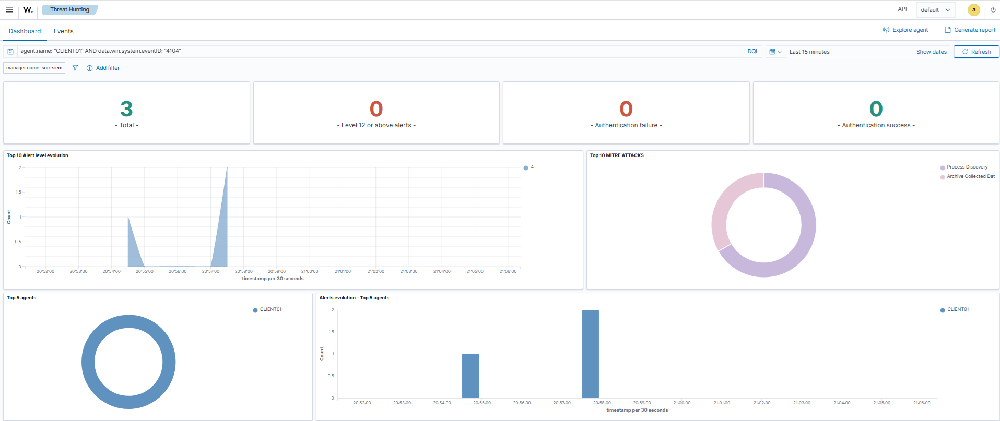
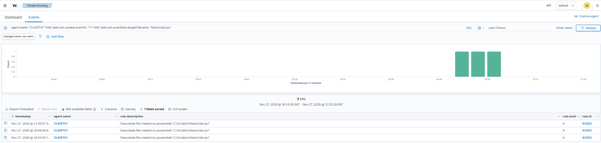
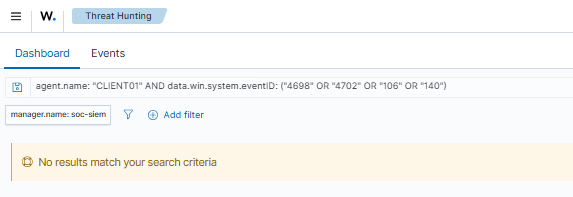
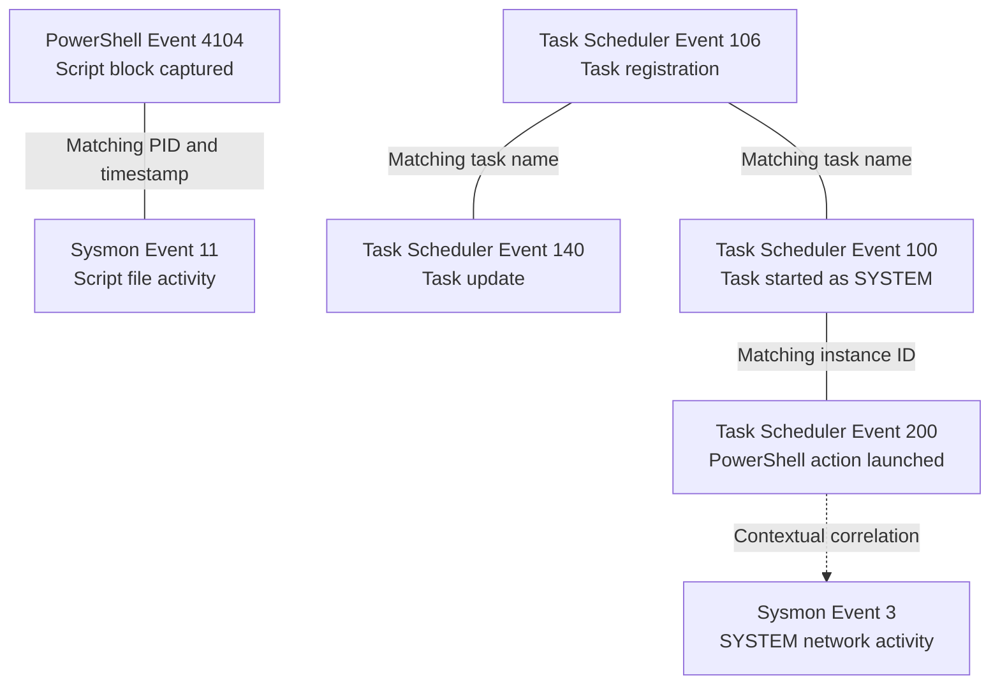

# OP-001 — Execution and Persistence

## 1. Investigation Overview

This document presents the endpoint investigation conducted following the initial execution of the custom C2 prototype on CLIENT01.

The investigation focuses on identifying and correlating security-relevant artifacts associated with:

- PowerShell execution.
- Local script replication.
- Scheduled task registration.
- Scheduled task execution.
- SYSTEM security context.
- Network communication.
- Endpoint and SIEM visibility.

The objective is to reconstruct observed behavior using endpoint telemetry rather than relying exclusively on application output or native SIEM alert descriptions.

## 2. Investigation Scope

| Attribute | Value |
|---|---|
| Operation | OP-001 — Corporate Intrusion |
| Investigation Date | November 27, 2026 |
| Target Endpoint | CLIENT01 |
| Domain | corp.soclab.test |
| Standard User | CORP\james.miller |
| Administrative Account | CORP\admin.john |
| Prototype Version | 1.0 |
| SIEM | Wazuh |
| Investigation Status | Initial assessment completed |

The evidence presented in this document corresponds to Version 1.0 of the prototype.

Version 1.1 introduced renamed persistence artifacts and updated console messages. Its demonstration screenshots are documented separately in the C2 architecture document.

## 3. Evidence Sources

The following telemetry sources were examined during the investigation.

| Log Source | Event ID | Description |
|---|---|---|
| PowerShell Operational | 4104 | Script block logging |
| Sysmon | 3 | Network connection |
| Sysmon | 11 | File creation |
| Task Scheduler Operational | 106 | Task registration |
| Task Scheduler Operational | 140 | Task update |
| Task Scheduler Operational | 100 | Task started |
| Task Scheduler Operational | 200 | Task action started |
| Windows Security | 4698 | Scheduled task created |
| Windows Security | 4702 | Scheduled task updated |

Windows Security Events 4698 and 4702 were searched for but were not identified during the initial investigation.

## 4. PowerShell Execution Analysis

### 4.1 — Initial Findings

PowerShell Script Block Logging captured the content of the original client script.

A corresponding native Wazuh alert was identified during the initial Threat Hunting assessment.

### 4.2 — Wazuh Investigation Query

```text
agent.name: "CLIENT01" AND data.win.system.eventID: "4104"
```



Three PowerShell alerts were identified within the initial investigation window.

One alert was directly associated with the prototype script.

The remaining two alerts were associated with manual process identification performed during troubleshooting.

These troubleshooting alerts are assessed separately in the native detection assessment.

### 4.3 — Relevant Event Evidence

The following excerpt contains selected fields from the relevant PowerShell alert.

```text
Computer: CLIENT01.corp.soclab.test
EventID: 4104
EventRecordID: 261851
ProcessID: 6400
ThreadID: 11392
SystemTime: 2026-11-27T20:54:54.3265461Z

ScriptBlockID:
2c82cdd7-14e2-44be-9594-2ea92595025b

Path:
C:\Users\james.miller\Desktop\lola\client.ps1

Wazuh Rule ID: 91826
Wazuh Rule Level: 4
Description: Powershell executed "Copy-Item"
MITRE ATT&CK: T1560
```

The complete script block was captured in a single event.

The operational source code is intentionally excluded from this evidence excerpt.

### 4.4 — Analyst Assessment

The script block provides visibility into the capabilities present in the prototype, including network communication, local file replication, scheduled task persistence, and dynamic execution functionality.

However, Event ID 4104 does not independently establish that every statement or conditional branch contained in the script was executed.

Additional telemetry is required to confirm individual behaviors.

The native Wazuh alert classified the activity as T1560 — Archive Collected Data.

The observed file-copying behavior does not establish data archiving or collection activity.

Therefore, the alert is relevant to the simulated intrusion, but its MITRE ATT&CK classification is not supported by the observed behavior.

| Assessment | Result |
|---|---|
| Relevant simulated activity | Confirmed |
| Script block visibility | Confirmed |
| Arbitrary remote command execution | Not validated |
| Native MITRE classification | Unsupported by observed behavior |
| Analyst classification | True positive — simulated activity |

## 5. Script File Creation Analysis

### 5.1 — Identified Artifact

The investigation identified the following local script artifact:

```text
C:\Scripts\MeuScript.ps1
```

Sysmon Event ID 11 recorded file creation or overwrite activity associated with PowerShell.

### 5.2 — Wazuh Investigation Query

```text
agent.name: "CLIENT01" AND data.win.system.eventID: "11" AND data.win.eventdata.targetFilename: *MeuScript.ps1
```

Three corresponding native Wazuh alerts were identified.



### 5.3 — Endpoint Evidence

The following excerpt presents selected fields from one of the local Sysmon events.

```text
Event ID: 11
UtcTime: 2026-11-27 20:54:54.347

ProcessGuid:
{043acd20-edce-6b09-ba05-000000000c00}

ProcessId: 6400

Image:
C:\Windows\System32\WindowsPowerShell\v1.0\powershell.exe

TargetFilename:
C:\Scripts\MeuScript.ps1

CreationUtcTime:
2026-11-27 20:02:44.930

User:
CORP\admin.john
```

### 5.4 — Repeated File Activity

Three centrally visible events were associated with the same process and target file.

| Event Time (UTC) | Process ID | User |
|---|---|---|
| 20:54:54.347 | 6400 | CORP\admin.john |
| 20:56:09.271 | 6400 | CORP\admin.john |
| 21:00:56.762 | 6400 | CORP\admin.john |

All three events shared the following ProcessGuid:

```text
{043acd20-edce-6b09-ba05-000000000c00}
```

The CreationUtcTime field also remained identical across the three events.

This distinction is important because CreationUtcTime represents file creation metadata, whereas UtcTime represents the timestamp associated with the recorded Sysmon event.

The three records are consistent with repeated activity involving the same file and PowerShell process.

They do not necessarily represent three distinct files or three independent compromises.

### 5.5 — Native Alert Classification

| Attribute | Value |
|---|---|
| Wazuh Rule ID | 92203 |
| Severity Level | 6 |
| Description | Executable file created by powershell |
| Native MITRE Mapping | T1105 — Ingress Tool Transfer |
| Analyst Classification | True positive — simulated activity |

The alert correctly identifies security-relevant file activity.

However, the available evidence establishes local script replication rather than a transfer from an external system.

The T1105 classification is therefore not independently supported by this event.

## 6. Scheduled Task Persistence Investigation

### 6.1 — Identified Persistence Artifact

The original prototype used Windows Task Scheduler as its persistence mechanism.

The following task was identified:

```text
\MinhaTaskPowerShell
```

The investigation examined both Windows Security and Task Scheduler Operational logs.

### 6.2 — Windows Security Log Assessment

The following event IDs were investigated:

| Event ID | Description |
|---|---|
| 4698 | A scheduled task was created |
| 4702 | A scheduled task was updated |

No matching events were returned during the local endpoint investigation.

The absence of these events prompted an assessment of the effective Windows audit configuration.

The relevant audit subcategory was identified as:

```text
Other Object Access Events
```

The effective configuration was:

```text
No Auditing
```

This represents a confirmed auditing gap.

The disabled audit subcategory is consistent with the absence of the expected Security events.

### 6.3 — Task Scheduler Operational Evidence

Although matching Security events were not identified, the Task Scheduler Operational channel contained relevant evidence.

| TimeCreated | Event ID | Observed Activity |
|---|---|---|
| 20:20:48 | 106 | Task registered |
| 20:20:48 | 140 | Task updated |
| 20:30:24 | 100 | Task started |
| 20:30:24 | 200 | PowerShell action launched |

All four events were recorded on November 27, 2026.

### 6.4 — Task Registration

Selected event excerpt:

```text
TimeCreated: 11/27/2026 8:20:48 PM
Event ID: 106

User "SYSTEM" registered Task Scheduler task
"\MinhaTaskPowerShell".
```

This event establishes that the scheduled task was registered.

The SYSTEM identity reported by the Task Scheduler event should not be interpreted as independent evidence that the original operator obtained SYSTEM privileges through exploitation.

### 6.5 — Task Update

Selected event excerpt:

```text
TimeCreated: 11/27/2026 8:20:48 PM
Event ID: 140

User "SYSTEM" updated Task Scheduler task
"\MinhaTaskPowerShell".
```

This event establishes that a task update was recorded.

Because registration and update events share the same displayed timestamp, their precise internal ordering is not established by the available excerpt.

### 6.6 — Task Execution

Selected event excerpt:

```text
TimeCreated: 11/27/2026 8:30:24 PM
Event ID: 100

Task: \MinhaTaskPowerShell

Instance ID:
{a6cf23af-1bf1-45fa-b9d2-966c1b01f583}

User:
NT AUTHORITY\SYSTEM
```

This event confirms that the scheduled task started under the SYSTEM security context.

### 6.7 — Task Action Execution

Selected event excerpt:

```text
TimeCreated: 11/27/2026 8:30:24 PM
Event ID: 200

Task: \MinhaTaskPowerShell

Instance ID:
{a6cf23af-1bf1-45fa-b9d2-966c1b01f583}

Action:
powershell.exe
```

The shared task instance identifier establishes a direct relationship between the task-start and action-start events.

This provides stronger evidence than task registration alone.

### 6.8 — Centralized Visibility Assessment

The following Wazuh search was performed:

```text
agent.name: "CLIENT01" AND
(data.win.system.eventID: "4698" OR
data.win.system.eventID: "4702" OR
data.win.system.eventID: "106" OR
data.win.system.eventID: "140")
```



No corresponding alerts were identified within the investigated time window.

The local Task Scheduler evidence confirms that relevant endpoint events existed.

However, their absence from the Wazuh alert index does not independently establish a collection failure.

Raw event archiving was disabled during the initial assessment, preventing retrospective confirmation of whether these events reached the Wazuh Manager.

## 7. SYSTEM Execution and Network Correlation

### 7.1 — Network Evidence

Local Sysmon Event ID 3 records identified PowerShell-associated network activity under multiple security contexts.

The following excerpt corresponds to activity observed under SYSTEM.

```text
TimeCreated: 11/27/2026 8:30:29 PM
Event ID: 3

UtcTime:
2026-11-27 06:02:25.007

ProcessGuid:
{043acd20-e85f-6b09-2b05-000000000c00}

ProcessId: 7528

Image:
C:\WINDOWS\System32\WindowsPowerShell\v1.0\powershell.exe

User:
NT AUTHORITY\SYSTEM

Protocol: udp
Initiated: true
SourceIp: 10.10.10.30
SourcePort: 8081
DestinationIp: 10.10.10.40
DestinationPort: 8080
```

This event establishes that PowerShell-associated UDP communication was observed under the SYSTEM security context.

### 7.2 — Temporal Correlation

Using the Windows TimeCreated field, the following sequence was identified:

| TimeCreated | Source | Activity |
|---|---|---|
| 20:30:24 | Task Scheduler 100 | Task started as SYSTEM |
| 20:30:24 | Task Scheduler 200 | PowerShell action launched |
| 20:30:29 | Sysmon 3 | SYSTEM PowerShell network activity |

The five-second interval, matching security context, and associated PowerShell activity support a relationship between the scheduled task execution and the subsequent network activity.

However, the available Task Scheduler excerpts do not provide a process identifier that directly links the task action to Sysmon Process ID 7528.

The relationship is therefore assessed as a strong contextual correlation rather than a definitive process-level linkage.

### 7.3 — Timestamp Discrepancy

The Sysmon network event contains a significant discrepancy between its Windows TimeCreated and embedded UtcTime fields.

```text
TimeCreated: 20:30:29
UtcTime:     06:02:25.007
```

The difference is approximately 14 hours and 28 minutes.

Similar discrepancies were identified in other Sysmon network events.

The underlying cause has not been established.

For the preliminary reconstruction, TimeCreated is used as the provisional reference.

All affected timeline conclusions remain subject to timestamp validation.

## 8. Cross-Source Event Correlation

### 8.1 — PowerShell and File Creation

A strong temporal and process-level relationship was identified between the PowerShell script block and a Sysmon file creation event.

| Attribute | PowerShell 4104 | Sysmon 11 |
|---|---|---|
| Host | CLIENT01 | CLIENT01 |
| Timestamp | 20:54:54.326 | 20:54:54.347 |
| Process ID | 6400 | 6400 |
| Artifact | client.ps1 | MeuScript.ps1 |

The events occurred approximately 21 milliseconds apart.

The matching host, process identifier, timing, and script-related behavior provide strong evidence of a relationship between the recorded script block and file activity.

The Sysmon event additionally identifies the administrative user context.

### 8.2 — Task Scheduler Correlation

The Task Scheduler Event IDs 100 and 200 share the same task instance identifier.

This provides direct evidence that both events relate to the same scheduled task execution instance.

### 8.3 — Correlation Diagram



This diagram represents evidence relationships rather than a complete chronological execution sequence.

Solid connections represent direct matching attributes.

The dashed connection represents contextual correlation requiring further process-level validation.

## 9. Security Context Analysis

Network activity associated with the prototype was observed under the following identities:

| Identity | Observed Process IDs |
|---|---|
| CORP\james.miller | 11156 |
| CORP\admin.john | 9684, 6400 |
| NT AUTHORITY\SYSTEM | 7528 |

The presence of multiple security contexts demonstrates the importance of correlating process activity with user identity.

Administrative privileges were explicitly provided during laboratory testing.

The evidence does not establish that the standard domain user exploited a vulnerability or independently escalated privileges.

Consequently, successful privilege escalation is not claimed as an observed technique.

## 10. Evidence Confidence Assessment

| Finding | Confidence | Supporting Evidence |
|---|---|---|
| PowerShell script block captured | High | Event 4104 |
| Local script file activity | High | Sysmon 11 |
| Scheduled task registered | High | Task Scheduler 106 |
| Scheduled task updated | High | Task Scheduler 140 |
| Task execution as SYSTEM | High | Task Scheduler 100 |
| PowerShell task action launched | High | Task Scheduler 200 |
| SYSTEM-associated UDP communication | High | Sysmon 3 |
| Task action associated with observed network process | Moderate | Temporal and contextual correlation |
| Successful arbitrary remote command execution | Not established | Not tested |
| Successful privilege escalation | Not established | Administrative access provided |
| Precise network event chronology | Provisional | Timestamp discrepancy |

Confidence levels describe the strength of the available evidence rather than the severity of the simulated activity.

## 11. MITRE ATT&CK Assessment

| Technique ID | Technique | Assessment |
|---|---|---|
| T1059.001 | PowerShell | Observed |
| T1053.005 | Scheduled Task | Observed |
| T1095 | Non-Application Layer Protocol | Observed |
| T1105 | Ingress Tool Transfer | Native mapping not supported by file-copy evidence |
| T1560 | Archive Collected Data | Native mapping not supported by observed behavior |

The investigation distinguishes observed techniques from classifications automatically assigned by Wazuh.

## 12. Identified Monitoring Gaps

| Gap ID | Finding |
|---|---|
| GAP-001 | No corresponding UDP network alerts identified |
| GAP-002 | No corresponding Task Scheduler alerts identified |
| GAP-003 | Scheduled task security auditing disabled |
| GAP-004 | Native MITRE ATT&CK classification inaccuracies |
| GAP-005 | Sysmon network timestamp inconsistencies |
| GAP-006 | No specific dynamic execution alert identified |
| GAP-007 | Raw event archiving disabled |

GAP-006 represents a limitation of the observed alert coverage.

Because arbitrary remote command execution was not tested, the investigation cannot establish whether Wazuh would detect successful execution of remotely supplied commands.

The complete detection gap register is documented separately.

## 13. Recommended Defensive Improvements

Based on the observed evidence, the following improvements are recommended:

- Enable the relevant Windows scheduled task auditing subcategory.
- Validate Task Scheduler event collection.
- Validate Sysmon network event collection.
- Investigate endpoint time synchronization.
- Evaluate native Wazuh rule coverage.
- Develop behavioral detections for suspicious PowerShell activity.
- Improve correlation between process, file, network, and scheduled task telemetry.
- Validate detection changes using controlled, non-destructive test activity.
- Preserve relevant evidence before making configuration changes.

These recommendations will be addressed during subsequent monitoring and detection engineering activities.

## 14. Investigation Conclusion

The investigation successfully identified security-relevant endpoint artifacts associated with PowerShell execution, local script replication, scheduled task persistence, and SYSTEM-associated network communication.

PowerShell Script Block Logging and Sysmon provided valuable evidence for reconstructing the observed activity.

Task Scheduler Operational logs confirmed task registration and execution despite the absence of corresponding Windows Security events.

The initial assessment also identified significant limitations in centralized alert visibility and native MITRE ATT&CK classification accuracy.

The investigation demonstrates why effective SOC analysis requires correlation across multiple telemetry sources rather than relying exclusively on individual SIEM alerts.

The identified gaps establish a baseline for subsequent detection engineering and monitoring improvements.

## Related Documentation

- [Operation Overview](01-Operation-Overview.md)
- [C2 Architecture](02-C2-Architecture.md)
- [Native Detection Assessment](04-Native-Detection-Assessment.md)
- [Incident Timeline](05-Incident-Timeline.md)
- [Detection Gap Analysis](06-Detection-Gap-Analysis.md)

## References

- [Microsoft Sysmon Documentation](https://learn.microsoft.com/en-us/sysinternals/downloads/sysmon)
- [Microsoft — Event 4698](https://learn.microsoft.com/en-us/windows/security/threat-protection/auditing/event-4698)
- [Microsoft — Event 4702](https://learn.microsoft.com/en-us/windows/security/threat-protection/auditing/event-4702)
- [MITRE ATT&CK — T1059.001](https://attack.mitre.org/techniques/T1059/001/)
- [MITRE ATT&CK — T1053.005](https://attack.mitre.org/techniques/T1053/005/)
- [MITRE ATT&CK — T1095](https://attack.mitre.org/techniques/T1095/)

---

[Return to OP-001 — Corporate Intrusion](README.md)
