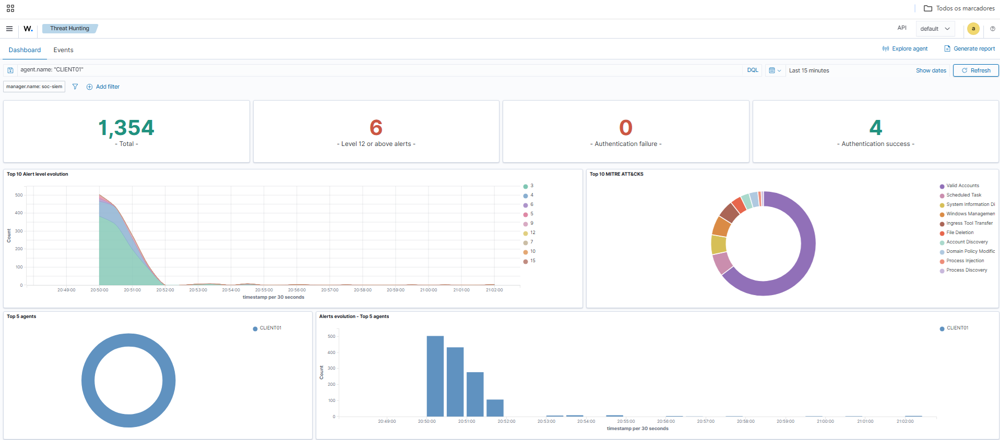
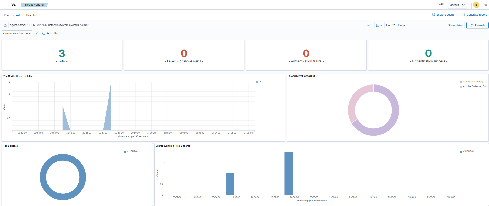
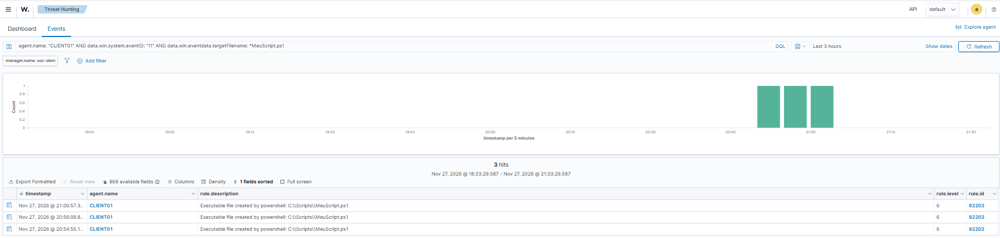
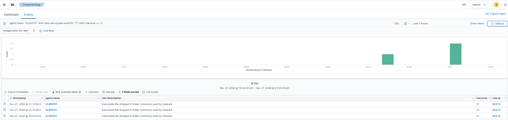
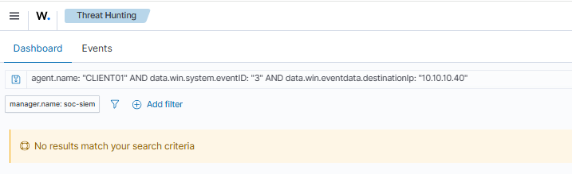
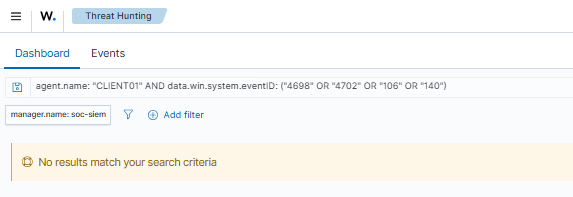
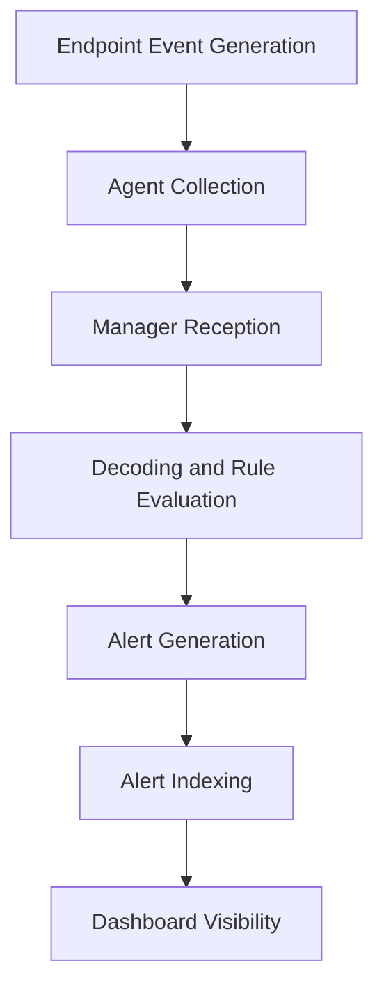

# OP-001 — Native Detection Assessment

## 1. Executive Summary

This assessment evaluates the effectiveness of native Wazuh detection rules during the initial stage of OP-001 — Corporate Intrusion.

The investigation identified security-relevant alerts associated with PowerShell execution and local script file creation.

However, several important behaviors were not represented in the centralized alert index, despite being recorded locally on the endpoint.

The assessment also identified potentially inaccurate MITRE ATT&CK classifications and high-severity alerts associated with apparently legitimate PowerShell activity.

These findings demonstrate the importance of contextual alert triage, independent telemetry validation, and detection engineering.

## 2. Assessment Objectives

- Evaluate native Wazuh detection coverage.
- Identify alerts associated with simulated adversarial activity.
- Distinguish malicious simulation activity from legitimate administrative behavior.
- Evaluate alert severity and contextual relevance.
- Review native MITRE ATT&CK classifications.
- Identify monitoring and detection gaps.
- Establish a baseline for subsequent detection improvements.

## 3. Assessment Environment

| Attribute | Value |
|---|---|
| Operation | OP-001 — Corporate Intrusion |
| Assessment Date | November 27, 2026 |
| Target Endpoint | CLIENT01 |
| Wazuh Agent ID | 002 |
| SIEM | Wazuh |
| Detection Rules | Native Wazuh rules |
| Custom Detection Rules | None introduced for this assessment |
| Raw Event Archiving | Disabled |
| Prototype Version | 1.0 |

The assessment was conducted before introducing custom detection rules or alert suppression mechanisms.

The original monitoring configuration was preserved to establish an initial detection baseline.

## 4. Investigation Methodology

The assessment followed a structured SOC alert investigation workflow:

1. Review alerts generated during the investigation window.
2. Identify alerts associated with the target endpoint.
3. Examine relevant Windows event sources.
4. Inspect individual alert fields.
5. Correlate alerts with known laboratory activity.
6. Validate corresponding endpoint telemetry.
7. Evaluate alert severity and MITRE ATT&CK mappings.
8. Assign analyst classifications and confidence levels.
9. Identify missing alert coverage.
10. Document findings and limitations.

## 5. Initial Alert Overview

The initial Wazuh investigation focused on alerts generated by CLIENT01.



Relevant alert categories included:

- PowerShell script block activity.
- PowerShell-associated file creation.
- Process discovery-related activity.
- Executable script creation in temporary directories.

The investigation also examined network and scheduled task activity for which corresponding centralized alerts were not identified.

## 6. Alert Classification Methodology

The following classification model was used throughout the assessment.

| Classification | Definition |
|---|---|
| True Positive | An alert associated with confirmed simulated adversarial behavior |
| Benign Positive | A rule correctly identifies a behavior that occurred for a legitimate purpose |
| False Positive | An alert incorrectly identifies a behavior or condition that did not occur |
| Potential Detection Gap | Relevant behavior is observed, but corresponding alert coverage is not established |
| Inconclusive | Available evidence is insufficient to establish a reliable classification |

A benign positive does not necessarily indicate that the detection rule is technically incorrect.

It may instead indicate that additional context is required to distinguish legitimate activity from malicious behavior.

Similarly, an inaccurate MITRE ATT&CK mapping does not automatically invalidate an otherwise relevant alert.

## 7. Alert Inventory

Nine selected alerts were examined across the relevant investigation searches.

| Alert Group | Rule ID | Level | Count | Analyst Classification |
|---|---|---|---|---|
| PowerShell script block | 91826 | 4 | 1 | True Positive |
| PowerShell process discovery | 91815 | 4 | 2 | Benign Positive |
| PowerShell file creation | 92203 | 6 | 3 | True Positive |
| Executable file in temporary directory | 92213 | 15 | 3 | Likely Benign Positive |

These nine alerts represent the selected investigation sample.

They do not represent the complete alert volume generated by CLIENT01.

The alerts were obtained through multiple searches and investigation windows.

## 8. Alert Investigation 01 — PowerShell Script Block

### 8.1 — Alert Details

| Attribute | Value |
|---|---|
| Investigation ID | ALERT-001 |
| Wazuh Rule ID | 91826 |
| Severity Level | 4 |
| Event Source | PowerShell Operational |
| Event ID | 4104 |
| Endpoint | CLIENT01 |
| Native Description | Powershell executed "Copy-Item" |
| Native MITRE Mapping | T1560 — Archive Collected Data |

### 8.2 — Evidence



Selected alert fields:

```text
EventID: 4104
EventRecordID: 261851
ProcessID: 6400
ThreadID: 11392
SystemTime: 2026-11-27T20:54:54.3265461Z

ScriptBlockID:
2c82cdd7-14e2-44be-9594-2ea92595025b

Path:
C:\Users\james.miller\Desktop\lola\client.ps1

Rule ID: 91826
Rule Level: 4
MITRE ID: T1560
```

The complete prototype script block was captured by PowerShell Script Block Logging.

The operational source code is excluded from this evidence excerpt.

### 8.3 — Investigation Findings

The captured script contained functionality associated with:

- UDP network communication.
- Local script replication.
- Scheduled task persistence.
- Dynamic execution capabilities.

The native Wazuh alert was associated with the presence of the Copy-Item operation.

Subsequent Sysmon file creation evidence confirmed activity involving the corresponding destination script.

However, the script block alone does not establish that every statement or conditional branch was executed.

### 8.4 — MITRE ATT&CK Assessment

The native rule assigned T1560 — Archive Collected Data.

The observed file operation was associated with local script replication.

No evidence of data archiving was identified in this activity.

The native MITRE classification is therefore unsupported by the observed behavior.

PowerShell execution is more appropriately associated with T1059.001.

The persistence-related behavior is assessed separately under T1053.005.

### 8.5 — Analyst Verdict

| Attribute | Assessment |
|---|---|
| Classification | True Positive |
| Confidence | High |
| Native Severity | 4 |
| Contextual Priority | High |
| Native MITRE Mapping | Unsupported |
| Remote Command Execution | Not validated |

The alert is relevant to the simulated intrusion.

However, its description and severity do not communicate the broader security implications of the captured script.

## 9. Alert Investigation 02 — Process Discovery

### 9.1 — Alert Details

| Attribute | Value |
|---|---|
| Investigation ID | ALERT-002 |
| Wazuh Rule ID | 91815 |
| Severity Level | 4 |
| Event Source | PowerShell Operational |
| Event ID | 4104 |
| Native MITRE Mapping | T1057 — Process Discovery |
| Number of Alerts | 2 |

### 9.2 — Evidence

| Event Time (UTC) | Event Record ID | Process ID |
|---|---|---|
| 20:57:57.354 | 263796 | 6400 |
| 20:57:57.396 | 263797 | 6400 |

Both events were associated with the same PowerShell process and thread.

The relevant command was:

```powershell
Get-NetUDPEndpoint -LocalPort 8081 |
    ForEach-Object { Get-Process -Id $_.OwningProcess }
```

### 9.3 — Investigation Findings

The command was manually executed by the laboratory operator during troubleshooting.

Its purpose was to identify the process associated with a local UDP port.

The activity was not initiated through the C2 server.

Although process discovery is a behavior commonly associated with adversarial activity, it is also a legitimate administrative and troubleshooting operation.

The two alerts were associated with the same troubleshooting action rather than two independent adversarial operations.

### 9.4 — Analyst Verdict

| Attribute | Assessment |
|---|---|
| Classification | Benign Positive |
| Confidence | High |
| Native Severity | 4 |
| Contextual Priority | Low |
| Native MITRE Mapping | Behaviorally consistent |
| Incident Relevance | Troubleshooting context only |

The native rule identified process-discovery-related script content.

However, the confirmed operator intent was legitimate troubleshooting.

No rule suppression was introduced.

These alerts are excluded from the confirmed adversarial activity count.

## 10. Alert Investigation 03 — Script File Creation

### 10.1 — Alert Details

| Attribute | Value |
|---|---|
| Investigation ID | ALERT-003 |
| Wazuh Rule ID | 92203 |
| Severity Level | 6 |
| Event Source | Sysmon |
| Event ID | 11 |
| Native Description | Executable file created by powershell |
| Native MITRE Mapping | T1105 — Ingress Tool Transfer |
| Number of Alerts | 3 |

### 10.2 — Evidence



All three alerts were associated with the following target file:

```text
C:\Scripts\MeuScript.ps1
```

Selected event details:

| Event Time (UTC) | Event Record ID | Process ID |
|---|---|---|
| 20:54:54.347 | 20487 | 6400 |
| 20:56:09.271 | 20500 | 6400 |
| 21:00:56.762 | 20524 | 6400 |

Common event attributes:

```text
Image: powershell.exe
User: CORP\admin.john

ProcessGuid:
{043acd20-edce-6b09-ba05-000000000c00}

TargetFilename:
C:\Scripts\MeuScript.ps1

CreationUtcTime:
2026-11-27 20:02:44.930
```

### 10.3 — Investigation Findings

All three alerts shared the same ProcessGuid, Process ID, target filename, and administrative security context.

The events are consistent with repeated file creation or overwrite activity involving the same script artifact.

The identical CreationUtcTime value should not be interpreted as the occurrence time of all three events.

The individual Sysmon UtcTime values identify the respective recorded activities.

The events are associated with the same laboratory intrusion scenario and should not be counted as three independent compromises.

### 10.4 — Cross-Source Correlation

The first file creation event occurred approximately 21 milliseconds after the corresponding PowerShell script block event.

| Source | Event Time | Process ID |
|---|---|---|
| PowerShell 4104 | 20:54:54.326 | 6400 |
| Sysmon 11 | 20:54:54.347 | 6400 |

The matching process identifier, host, timing, and associated behavior establish a strong contextual relationship between the events.

### 10.5 — MITRE ATT&CK Assessment

The native rule assigned T1105 — Ingress Tool Transfer.

The observed behavior involved local script replication.

No external file transfer was established by these events.

Consequently, the T1105 mapping is unsupported by the available evidence.

### 10.6 — Analyst Verdict

| Attribute | Assessment |
|---|---|
| Classification | True Positive |
| Confidence | High |
| Native Severity | 6 |
| Contextual Priority | High |
| Native MITRE Mapping | Unsupported |
| Incident Relevance | Directly associated with simulated activity |

The alerts provide useful visibility into the local script artifact.

Their investigative value increases when correlated with PowerShell and Task Scheduler telemetry.

## 11. Alert Investigation 04 — High-Severity Temporary Script Activity

### 11.1 — Alert Details

| Attribute | Value |
|---|---|
| Investigation ID | ALERT-004 |
| Wazuh Rule ID | 92213 |
| Severity Level | 15 |
| Event Source | Sysmon |
| Event ID | 11 |
| Native Description | Executable file dropped in folder commonly used by malware |
| Native MITRE Mapping | T1105 — Ingress Tool Transfer |
| Number of Alerts | 3 |

### 11.2 — Evidence



The three alerts were associated with temporary PowerShell script files.

| Event Time (UTC) | Process ID | User |
|---|---|---|
| 20:53:34.901 | 6400 | CORP\admin.john |
| 21:15:25.967 | 3504 | CORP\james.miller |
| 21:15:49.830 | 9424 | CORP\admin.john |

Identified filenames:

```text
__PSScriptPolicyTest_vh0teg32.y1g.ps1
__PSScriptPolicyTest_lig3ltmt.ogw.ps1
__PSScriptPolicyTest_xizeavf3.o11.ps1
```

The files were located within user-specific AppData\Local\Temp directories.

### 11.3 — Investigation Findings

The filenames are consistent with temporary files commonly generated by PowerShell when evaluating application control policy behavior.

The observed characteristics include:

- A consistent PowerShell policy-test filename pattern.
- Temporary directory placement.
- PowerShell-associated file creation.
- Activity across multiple user contexts.

These characteristics support a preliminary assessment of legitimate PowerShell policy-check activity.

However, filenames alone cannot establish that a file is benign.

Additional validation of file content, process ancestry, and execution context would be required for definitive attribution.

### 11.4 — Relationship to the Simulated Intrusion

The first temporary file event shared the same PowerShell process associated with the prototype investigation.

This establishes a process-level relationship but does not prove that the temporary file itself was malicious.

Legitimate runtime behavior can occur within a process that is also associated with suspicious activity.

Each artifact must therefore be evaluated independently.

### 11.5 — Severity Assessment

The native rule assigned severity level 15.

This was significantly higher than the severity assigned to the confirmed prototype script block and file replication activity.

The difference highlights the limitations of evaluating incident priority using native alert severity alone.

### 11.6 — Analyst Verdict

| Attribute | Assessment |
|---|---|
| Classification | Likely Benign Positive |
| Confidence | High, preliminary |
| Native Severity | 15 |
| Contextual Priority | Low, pending validation |
| Native MITRE Mapping | Not independently supported |
| Rule Suppression | Not applied |

The available evidence supports a likely legitimate explanation.

The classification remains preliminary.

No broad exclusion or automatic suppression was introduced based solely on the filename pattern.

## 12. Alert Severity Comparison

| Observed Activity | Native Level | Analyst Assessment |
|---|---|---|
| Prototype script block | 4 | High contextual priority |
| Prototype script file creation | 6 | High contextual priority |
| Manual process troubleshooting | 4 | Low contextual priority |
| Apparent PowerShell policy checks | 15 | Low contextual priority, pending validation |

The assessment identified a discrepancy between native rule severity and contextual investigative relevance.

A higher numerical severity does not necessarily indicate a more significant security incident.

Similarly, a low-severity alert may represent an important component of a broader intrusion.

Effective alert prioritization should consider:

- Asset criticality.
- User identity.
- Process ancestry.
- Associated network activity.
- Persistence-related artifacts.
- Correlated security events.
- Threat context.
- Confidence in the available evidence.

## 13. Network Detection Assessment

### 13.1 — Investigation Query

The following search represents the network activity investigated in Wazuh:

```text
agent.name: "CLIENT01" AND
data.win.system.eventID: "3" AND
data.win.eventdata.destinationIp: "10.10.10.40"
```



### 13.2 — Observed Results

No corresponding alerts were identified within the investigated time window.

A broader search for CLIENT01 Sysmon Event ID 3 alerts also returned no results during the three-hour assessment window.

Local endpoint investigation identified 12 relevant Sysmon network event records.

These records confirmed PowerShell-associated UDP communication involving the laboratory server.

The number of Sysmon records does not represent the number of individual transmitted datagrams.

### 13.3 — Assessment

| Attribute | Result |
|---|---|
| Local Endpoint Telemetry | Confirmed |
| Centralized Alert Visibility | Not observed |
| Manager Reception | Not established |
| Root Cause | Undetermined |
| Gap Reference | GAP-001 |

The absence of centralized alerts does not independently establish a collection failure or a missing detection rule.

Further validation is required.

## 14. Persistence Detection Assessment

### 14.1 — Investigation Query

```text
agent.name: "CLIENT01" AND
(data.win.system.eventID: "4698" OR
data.win.system.eventID: "4702" OR
data.win.system.eventID: "106" OR
data.win.system.eventID: "140")
```



### 14.2 — Observed Results

No corresponding alerts were identified within the investigated time window.

Local Task Scheduler Operational logs contained four relevant events:

| Event ID | Observed Behavior |
|---|---|
| 106 | Task registration |
| 140 | Task update |
| 100 | Task execution |
| 200 | PowerShell action execution |

No matching Windows Security Events 4698 or 4702 were identified.

The effective Windows audit configuration showed that Other Object Access Events auditing was disabled.

### 14.3 — Assessment

| Attribute | Result |
|---|---|
| Local Task Scheduler Telemetry | Confirmed |
| Windows Security Task Events | Not observed |
| Relevant Security Auditing | Disabled |
| Centralized Task Alerts | Not observed |
| Manager Reception | Not established |
| Gap References | GAP-002, GAP-003 |

Two distinct monitoring limitations were identified.

The Windows Security auditing gap was confirmed.

The cause of the missing centralized Task Scheduler alerts remains undetermined.

## 15. Raw Event Visibility Assessment

The Wazuh Manager configuration was examined to determine whether non-alerting events were retained.

Relevant configuration values:

```xml
<logall>no</logall>
<logall_json>no</logall_json>
<log_alert_level>3</log_alert_level>
```

The existing archives.log file contained no retained event data.

No archives.json file was identified during the assessment.

Consequently, the investigation could not retrospectively establish whether the missing network and scheduled task events had reached the Wazuh Manager.

The following stages must be evaluated independently:



An event may exist locally without appearing in the Wazuh alert index.

This limitation is recorded as GAP-007.

## 16. Native Detection Coverage Matrix

| Observed Behavior | Local Evidence | Native Alert | Assessment |
|---|---|---|---|
| PowerShell script block | Yes | Yes | Detected |
| Local script replication | Yes | Yes | Detected |
| UDP communication | Yes | No | Visibility gap |
| Scheduled task registration | Yes | No | Visibility gap |
| Scheduled task update | Yes | No | Visibility gap |
| Scheduled task execution | Yes | No | Visibility gap |
| SYSTEM-associated network activity | Yes | No | Visibility gap |
| Arbitrary remote command execution | Not tested | Not established | Not evaluated |
| Manual process troubleshooting | Yes | Yes | Benign Positive |
| Apparent PowerShell policy checks | Yes | Yes | Likely Benign Positive |

The matrix represents observed coverage within the investigated time windows.

It does not establish the complete detection capabilities of Wazuh.

## 17. MITRE ATT&CK Classification Review

| Rule ID | Native Mapping | Analyst Assessment |
|---|---|---|
| 91826 | T1560 — Archive Collected Data | Unsupported by observed script replication |
| 91815 | T1057 — Process Discovery | Behaviorally consistent, legitimate context |
| 92203 | T1105 — Ingress Tool Transfer | External transfer not established |
| 92213 | T1105 — Ingress Tool Transfer | External transfer not established |

The review identified multiple cases where native technique classifications did not accurately represent the observed activity.

The following techniques are supported by the broader investigation:

| Technique ID | Technique | Supporting Evidence |
|---|---|---|
| T1059.001 | PowerShell | Script block and process-related telemetry |
| T1053.005 | Scheduled Task | Task registration and execution |
| T1095 | Non-Application Layer Protocol | Custom UDP communication |

MITRE ATT&CK mappings should be validated against observed behavior rather than accepted solely because they appear in an alert.

## 18. Assessment Metrics

The selected alert sample contained nine alert records.

| Classification | Count | Percentage |
|---|---|---|
| True Positive | 4 | 44.4% |
| Confirmed Benign Positive | 2 | 22.2% |
| Likely Benign Positive | 3 | 33.3% |
| Confirmed False Positive | 0 | 0% |
| Total | 9 | 100% |

The selected sample contained four alert records directly associated with simulated adversarial activity.

Five alert records were associated with confirmed or likely legitimate behavior.

These figures describe only the selected investigation sample.

They must not be interpreted as a statistically representative false-positive rate, detection accuracy measurement, or overall SIEM performance metric.

Multiple alerts may represent repeated activity or different observations of the same underlying behavior.

## 19. Detection Engineering Recommendations

Based on the assessment, the following defensive improvements are recommended:

1. Correct the identified Windows auditing gap.
2. Validate raw event collection using controlled test events.
3. Confirm Sysmon network event visibility.
4. Confirm Task Scheduler Operational event visibility.
5. Investigate the network timestamp discrepancy.
6. Review native detection rules and technique mappings.
7. Develop contextual behavioral detections.
8. Evaluate alert severity based on correlated evidence.
9. Validate legitimate PowerShell activity before introducing exclusions.
10. Compare native and improved detection coverage.

No custom detection rules or suppression mechanisms were introduced during this assessment.

The native baseline remains available for subsequent comparison.

## 20. Assessment Limitations

- The SIEM was unavailable during part of the initial activity.
- Raw event archiving was disabled.
- Manager reception of non-alerting events could not be retrospectively established.
- Network event timestamps contained inconsistencies.
- Arbitrary remote command execution was not tested.
- The PowerShell policy-check classification remains preliminary.
- The selected alert sample is not statistically representative.
- Multiple investigation windows were used.
- Native rule implementation details require further review.

These limitations prevent unsupported conclusions about overall detection effectiveness.

## 21. Conclusion

The initial native detection assessment demonstrated that Wazuh provided useful visibility into PowerShell script content and local file creation activity.

However, corresponding alerts for several important network and persistence behaviors were not identified.

The assessment also identified discrepancies between native alert severity, MITRE ATT&CK classifications, and contextual investigative relevance.

Confirmed simulated adversarial activity generated alerts at severity levels 4 and 6, while apparently legitimate PowerShell policy-check activity generated alerts at severity level 15.

These findings demonstrate the importance of analyst-driven investigation, event correlation, and detection engineering.

The assessment establishes a documented baseline against which subsequent monitoring improvements will be evaluated.

## Related Documentation

- [Operation Overview](01-Operation-Overview.md)
- [C2 Architecture](02-C2-Architecture.md)
- [Execution and Persistence](03-Execution-and-Persistence.md)
- [Incident Timeline](05-Incident-Timeline.md)
- [Detection Gap Analysis](06-Detection-Gap-Analysis.md)

## References

- [Wazuh Documentation](https://documentation.wazuh.com/)
- [Microsoft Sysmon Documentation](https://learn.microsoft.com/en-us/sysinternals/downloads/sysmon)
- [MITRE ATT&CK — T1057](https://attack.mitre.org/techniques/T1057/)
- [MITRE ATT&CK — T1059.001](https://attack.mitre.org/techniques/T1059/001/)
- [MITRE ATT&CK — T1053.005](https://attack.mitre.org/techniques/T1053/005/)
- [MITRE ATT&CK — T1095](https://attack.mitre.org/techniques/T1095/)
- [MITRE ATT&CK — T1105](https://attack.mitre.org/techniques/T1105/)
- [MITRE ATT&CK — T1560](https://attack.mitre.org/techniques/T1560/)

---

[Return to OP-001 — Corporate Intrusion](README.md)
