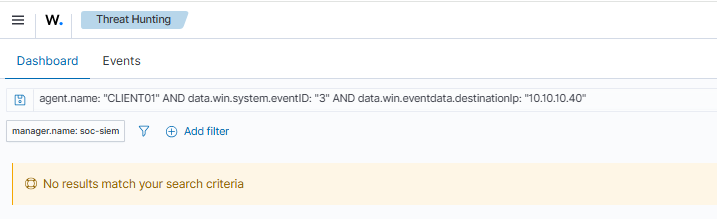
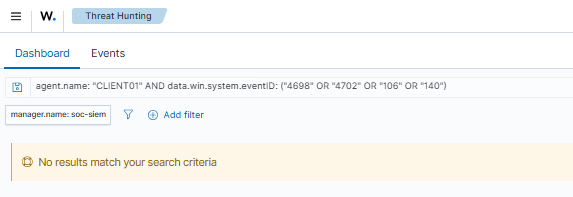
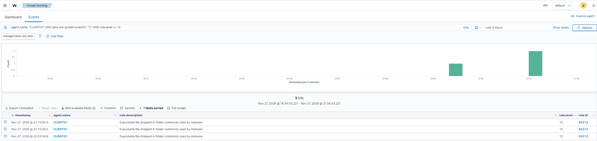
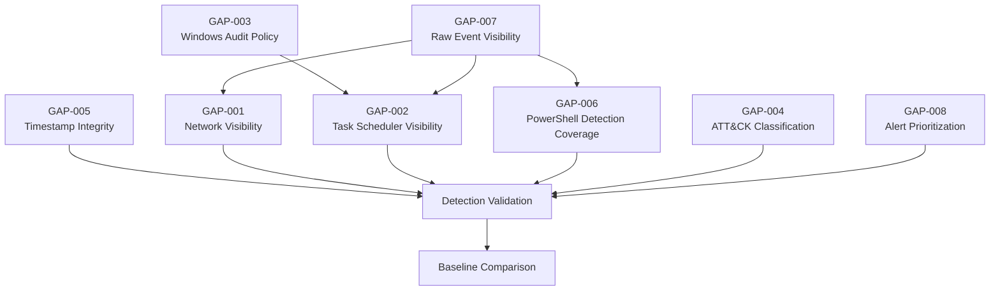

# OP-001 — Detection Gap Analysis

## 1. Executive Summary

The initial OP-001 investigation identified several limitations in endpoint auditing, centralized monitoring, native detection coverage, alert prioritization, and evidence correlation.

Although Wazuh successfully generated alerts associated with PowerShell execution and script file creation, other security-relevant behaviors were not represented in the investigated centralized alert windows.

Eight findings were documented for further investigation and remediation.

These findings establish the foundation for the subsequent Detection Engineering phase.

The objective is not simply to increase alert volume, but to improve detection accuracy, contextual relevance, telemetry reliability, and investigative visibility.

## 2. Assessment Scope

| Attribute | Value |
|---|---|
| Operation | OP-001 — Corporate Intrusion |
| Assessment Date | November 27, 2026 |
| Target Endpoint | CLIENT01 |
| SIEM | Wazuh |
| Detection Baseline | Native Wazuh rules |
| Prototype Version | 1.0 |
| Identified Findings | 8 |
| Remediation Status | Pending |

No custom detection rules, audit policy corrections, or alert suppression mechanisms were introduced during the initial assessment.

This preserves the original monitoring baseline for subsequent comparison.

## 3. Gap Classification Methodology

The identified findings are classified into the following categories.

| Category | Description |
|---|---|
| Audit Gap | Required endpoint security auditing is not enabled |
| Visibility Gap | Relevant endpoint activity is not represented in centralized alerts |
| Detection Coverage | Detection effectiveness for a particular behavior requires validation |
| Classification Gap | Alert metadata does not accurately describe observed behavior |
| Prioritization Gap | Native severity does not reflect contextual investigative relevance |
| Telemetry Integrity | Event data contains inconsistencies affecting investigation |
| Evidence Retention | Available retention settings limit retrospective analysis |

A missing alert does not automatically establish a missing detection rule.

Endpoint generation, agent collection, manager reception, rule evaluation, and alert indexing must be evaluated independently.

## 4. Remediation Priority Model

| Priority | Definition |
|---|---|
| P1 — Critical | Foundational monitoring or evidence integrity issue requiring immediate attention |
| P2 — High | Significant visibility or detection improvement |
| P3 — Medium | Classification, prioritization, or contextual accuracy improvement |

These priorities represent proposed remediation priorities.

They are independent of native Wazuh alert severity levels and do not represent CVSS scores.

## 5. Detection Gap Register

| Gap ID | Finding | Category | Priority | Assessment Status |
|---|---|---|---|---|
| GAP-001 | Missing UDP network alerts | Visibility | P2 | Observed — root cause unknown |
| GAP-002 | Missing Task Scheduler alerts | Visibility | P2 | Observed — root cause unknown |
| GAP-003 | Scheduled task security auditing disabled | Audit | P1 | Confirmed |
| GAP-004 | Unsupported MITRE ATT&CK classifications | Classification | P3 | Confirmed |
| GAP-005 | Sysmon network timestamp inconsistency | Telemetry Integrity | P1 | Confirmed — root cause unknown |
| GAP-006 | Dynamic execution detection coverage | Detection Coverage | P2 | Not fully evaluated |
| GAP-007 | Raw event archiving disabled | Evidence Retention | P1 | Confirmed |
| GAP-008 | Potentially excessive alert severity | Prioritization | P3 | Preliminary |

All eight findings remain open at the time of this assessment.

## 6. GAP-001 — Missing UDP Network Alerts

### Description

Local Sysmon Event ID 3 records confirmed PowerShell-associated UDP communication between CLIENT01 and ATTACKER01.

However, corresponding alerts were not identified in the investigated Wazuh alert windows.

### Evidence

| Attribute | Observation |
|---|---|
| Endpoint | CLIENT01 |
| Event Source | Sysmon Operational |
| Event ID | 3 |
| Associated Process | powershell.exe |
| Relevant Local Records | 12 |
| Corresponding Centralized Alerts | None identified |
| Manager Reception | Not established |



### Security Impact

Insufficient centralized network visibility may reduce the ability of analysts to identify suspicious process-associated communication and correlate it with endpoint activity.

### Root Cause Assessment

Undetermined.

Potential explanations include:

- Event collection configuration.
- Event forwarding or processing issues.
- Native rule conditions.
- Alert generation thresholds.
- Indexing or investigation time-window limitations.

The available evidence does not establish which explanation applies.

### Recommended Remediation

- Validate Sysmon Event ID 3 generation using benign network activity.
- Confirm effective agent collection configuration.
- Verify manager reception of controlled test events.
- Review applicable native Wazuh rules.
- Validate centralized alert generation.
- Develop contextual network detections where justified.

### Acceptance Criteria

- A controlled network event is generated locally.
- The corresponding event is confirmed at the Wazuh Manager.
- Applicable rule behavior is understood.
- Expected alert visibility is demonstrated.
- Results are documented with supporting evidence.

**Priority:** P2 — High

**Status:** Open

## 7. GAP-002 — Missing Task Scheduler Alerts

### Description

Task Scheduler Operational logs contained evidence of scheduled task registration, modification, and execution.

Corresponding centralized alerts were not identified.

### Evidence

| Event ID | Observed Activity |
|---|---|
| 106 | Task registration |
| 140 | Task update |
| 100 | Task started |
| 200 | Task action launched |



The local records establish that relevant Task Scheduler events existed on the endpoint.

### Security Impact

Insufficient centralized visibility into scheduled task activity may limit the detection and investigation of unauthorized task creation or modification.

### Root Cause Assessment

Undetermined.

The Task Scheduler Operational channel was included in the shared Wazuh agent configuration.

However, configuration presence alone does not establish successful event collection, forwarding, processing, or alert generation.

### Recommended Remediation

- Verify the effective endpoint collection configuration.
- Generate controlled events using a harmless scheduled task.
- Confirm local event generation.
- Validate manager reception.
- Review applicable native rules.
- Introduce contextual detections where necessary.

### Acceptance Criteria

- Controlled task-related events are recorded locally.
- Corresponding events are confirmed at the manager.
- Relevant alert behavior is validated.
- Legitimate scheduled task activity is considered during detection testing.

**Priority:** P2 — High

**Status:** Open

## 8. GAP-003 — Scheduled Task Security Auditing Disabled

### Description

Windows Security Events 4698 and 4702 were not identified during the endpoint investigation.

The effective audit configuration revealed that the relevant audit subcategory was disabled.

### Evidence

```text
Audit Subcategory:
Other Object Access Events

Effective Configuration:
No Auditing
```

Expected security events:

| Event ID | Description |
|---|---|
| 4698 | A scheduled task was created |
| 4702 | A scheduled task was updated |

### Security Impact

Disabled auditing reduces visibility into scheduled task creation and modification through the Windows Security log.

This limits the availability of an additional telemetry source for investigating persistence-related activity.

### Root Cause Assessment

Confirmed audit configuration gap.

The relevant subcategory was not enabled in the effective endpoint audit policy.

### Recommended Remediation

- Review the existing domain Group Policy configuration.
- Enable the relevant auditing subcategory.
- Validate effective policy application.
- Generate harmless scheduled task creation and modification events.
- Confirm the expected Security event records.
- Validate Wazuh collection and alert behavior.

### Acceptance Criteria

- The effective audit configuration reflects the intended policy.
- Event ID 4698 is generated during a controlled task creation test.
- Event ID 4702 is generated during a controlled task modification test.
- Relevant event fields are available for investigation.
- Centralized collection is independently validated.

**Priority:** P1 — Critical

**Status:** Open

## 9. GAP-004 — Unsupported MITRE ATT&CK Classifications

### Description

Several native Wazuh alerts contained MITRE ATT&CK mappings that were not supported by the observed activity.

### Evidence

| Rule ID | Native Mapping | Analyst Assessment |
|---|---|---|
| 91826 | T1560 — Archive Collected Data | Local file copying does not establish data archiving |
| 92203 | T1105 — Ingress Tool Transfer | External file transfer was not established |
| 92213 | T1105 — Ingress Tool Transfer | External file transfer was not established |

The broader investigation supported the following technique mappings:

| Technique ID | Technique |
|---|---|
| T1059.001 | PowerShell |
| T1053.005 | Scheduled Task |
| T1095 | Non-Application Layer Protocol |

### Security Impact

Unsupported technique mappings may introduce inaccuracies into:

- Incident reports.
- Threat hunting results.
- ATT&CK coverage assessments.
- Detection engineering metrics.
- Security dashboards.
- Analyst interpretation.

### Root Cause Assessment

The native rule classifications do not accurately describe the specific observed behavior.

The underlying rule implementation has not yet been fully reviewed.

This finding does not establish that the rules are universally incorrect.

### Recommended Remediation

- Review relevant native rule definitions.
- Evaluate the conditions associated with each technique mapping.
- Document behavior-specific analytical interpretations.
- Apply accurate mappings to future custom detections.
- Preserve native alert metadata for comparison.

### Acceptance Criteria

- Each custom detection includes an evidence-supported technique mapping.
- Native and analyst-assigned classifications remain distinguishable.
- Unsupported techniques are not reported as confirmed adversarial activity.
- Mapping decisions are documented.

**Priority:** P3 — Medium

**Status:** Open

## 10. GAP-005 — Sysmon Network Timestamp Inconsistency

### Description

Multiple Sysmon Event ID 3 records contained significant discrepancies between their Windows TimeCreated and embedded UtcTime fields.

### Evidence

| TimeCreated | Embedded UtcTime |
|---|---|
| 20:30:29 | 06:02:25.007 |
| 21:00:59 | 06:32:55.442 |
| 21:06:29 | 06:38:25.930 |

Approximate discrepancy:

```text
14 hours and 28 minutes
```

The same discrepancy was not observed in the examined Sysmon Event ID 11 records.

Windows Time Service diagnostics also reported an unsynchronized state at the time of inspection.

### Security Impact

Inconsistent timestamps may negatively affect:

- Incident timeline reconstruction.
- Cross-host event correlation.
- Time-based detection rules.
- Investigation time-window selection.
- Event sequencing.
- Incident response reporting.

### Root Cause Assessment

Undetermined.

Potential explanations include guest time synchronization behavior, historical clock adjustments, or differences in timestamp generation.

No specific cause has been confirmed.

### Recommended Remediation

- Review endpoint time synchronization status.
- Compare host and guest system clocks.
- Review relevant Windows time-change events.
- Examine Hyper-V time synchronization behavior.
- Generate controlled benign network and file events.
- Compare endpoint and SIEM timestamps.
- Preserve historical timestamps without modification.

### Acceptance Criteria

- Endpoint time synchronization is independently verified.
- Newly generated test events contain consistent timestamps within a documented tolerance.
- Event occurrence and ingestion timestamps are correctly distinguished.
- The historical discrepancy is explained or explicitly retained as unresolved.

Successful validation of new events does not automatically resolve historical timestamp inconsistencies.

**Priority:** P1 — Critical

**Status:** Open

## 11. GAP-006 — Dynamic Execution Detection Coverage

### Description

PowerShell Script Block Logging captured the original prototype script.

The captured content included dynamic execution capabilities.

However, no specific native alert associated with that capability was identified during the initial assessment.

### Evidence

| Attribute | Observation |
|---|---|
| PowerShell Event ID | 4104 |
| Native Rule ID | 91826 |
| Native Severity | 4 |
| Native Description | Powershell executed "Copy-Item" |
| Script Content Visibility | Confirmed |
| Successful Remote Command Execution | Not tested |

### Security Impact

Insufficient contextual detection of suspicious PowerShell behavior may reduce the ability of analysts to prioritize potentially dangerous script activity.

### Root Cause Assessment

Not established.

The presence of dynamic execution functionality in a recorded script block does not establish that the functionality was exercised.

This finding represents an area requiring detection coverage evaluation rather than a confirmed failure to detect successful remote execution.

### Recommended Remediation

- Review native PowerShell detection coverage.
- Evaluate available script block and process telemetry.
- Develop contextual detection logic for suspicious script characteristics.
- Validate detection behavior using benign, local PowerShell test cases.
- Evaluate legitimate administrative activity.
- Document the distinction between script content and executed behavior.

### Acceptance Criteria

- Relevant PowerShell test activity generates the expected telemetry.
- Detection behavior is reproducible.
- Alerts contain sufficient investigative context.
- Legitimate administrative test cases are evaluated.
- Detection claims remain limited to experimentally validated behavior.

**Priority:** P2 — High

**Status:** Open — validation required

## 12. GAP-007 — Raw Event Archiving Disabled

### Description

The initial Wazuh Manager configuration did not retain raw non-alerting events through its archive settings.

### Evidence

```xml
<logall>no</logall>
<logall_json>no</logall_json>
<log_alert_level>3</log_alert_level>
```

Additional observations:

```text
archives.log: 0 bytes
archives.json: Not identified
```

### Security Impact

The lack of retained raw events prevented retrospective confirmation of whether relevant non-alerting endpoint events had reached the manager.

This limited the ability to distinguish collection failures from rule evaluation or alert generation limitations.

### Root Cause Assessment

Confirmed evidence retention limitation.

Raw event archiving was disabled during the initial investigation.

This is a configuration and retention decision rather than evidence of a Wazuh software defect.

### Recommended Remediation

- Evaluate raw event archiving requirements.
- Temporarily enable appropriate diagnostic retention during controlled validation.
- Confirm manager reception of selected benign test events.
- Compare archived events with generated alerts.
- Evaluate storage consumption.
- Establish an appropriate long-term retention strategy.

### Acceptance Criteria

- Controlled events can be identified at the manager independently of alert generation.
- Collection and rule evaluation can be assessed separately.
- Storage and retention implications are documented.
- A deliberate archive retention policy is established.

Permanent retention of all raw events is not automatically required to close this finding.

**Priority:** P1 — Critical

**Status:** Open

## 13. GAP-008 — Potentially Excessive Alert Severity

### Description

Native Wazuh Rule 92213 generated severity level 15 alerts for temporary PowerShell files consistent with application control policy-check activity.

Confirmed simulated activity generated alerts at substantially lower severity levels.

### Evidence



| Activity | Rule ID | Native Severity |
|---|---|---|
| Prototype script block | 91826 | 4 |
| Prototype script file creation | 92203 | 6 |
| Apparent PowerShell policy checks | 92213 | 15 |

The temporary file activity involved the following filename pattern:

```text
__PSScriptPolicyTest_*.ps1
```

### Security Impact

Poor alignment between alert severity and contextual relevance may contribute to:

- Alert fatigue.
- Inefficient incident prioritization.
- Unnecessary investigation effort.
- Reduced attention to correlated suspicious activity.

### Root Cause Assessment

Preliminary.

The observed files are consistent with legitimate PowerShell policy-check activity.

However, definitive attribution requires additional evidence.

The finding therefore represents a potential prioritization problem rather than a confirmed false-positive condition.

### Recommended Remediation

- Validate the origin and purpose of the temporary files.
- Review associated process ancestry and execution context.
- Examine the relevant native rule conditions.
- Evaluate legitimate PowerShell behavior.
- Develop contextual prioritization where justified.
- Avoid broad exclusions based solely on filenames or directories.

### Acceptance Criteria

- The legitimate behavior is independently validated.
- Any proposed tuning is tested against representative benign activity.
- Relevant suspicious activity remains visible.
- Severity decisions are supported by documented context.
- No unjustified broad suppression is introduced.

**Priority:** P3 — Medium

**Status:** Open — preliminary finding

## 14. Remediation Dependency Model

The identified findings are not independent.

Reliable detection engineering requires trustworthy endpoint telemetry and the ability to validate event collection.



The proposed remediation sequence prioritizes foundational monitoring capabilities before detection rule development and tuning.

## 15. Remediation Roadmap

### Stage 1 — Monitoring Foundations

Associated findings:

- GAP-003
- GAP-005
- GAP-007

Objectives:

- Correct the identified Windows audit configuration gap.
- Investigate endpoint timestamp integrity.
- Establish diagnostic visibility into raw event reception.
- Validate monitoring prerequisites.

### Stage 2 — Telemetry Validation

Associated findings:

- GAP-001
- GAP-002

Objectives:

- Validate Sysmon network event collection.
- Validate Task Scheduler event collection.
- Distinguish collection issues from alert generation limitations.
- Establish reproducible telemetry test cases.

### Stage 3 — Detection Engineering

Associated findings:

- GAP-001
- GAP-002
- GAP-004
- GAP-006

Objectives:

- Review relevant native rules.
- Develop contextual behavioral detections.
- Apply evidence-supported ATT&CK mappings.
- Improve investigative context within generated alerts.

### Stage 4 — Alert Tuning

Associated findings:

- GAP-008

Objectives:

- Validate potentially legitimate alert-generating behavior.
- Evaluate contextual severity.
- Reduce unnecessary investigative noise where justified.
- Preserve visibility into suspicious activity.

### Stage 5 — Validation and Comparison

Objectives:

- Execute controlled, non-destructive test cases.
- Confirm expected endpoint telemetry.
- Confirm centralized event reception.
- Evaluate generated alerts.
- Compare original and improved detection coverage.
- Document unresolved limitations.

## 16. Detection Validation Framework

Each detection improvement will be evaluated using a consistent test structure.

| Validation Field | Description |
|---|---|
| Test ID | Unique test reference |
| Associated Gap | Relevant detection gap identifier |
| Objective | Expected defensive outcome |
| Test Activity | Controlled, non-destructive behavior |
| Expected Telemetry | Relevant event source and event ID |
| Local Observation | Endpoint event generation result |
| Manager Observation | Centralized event reception result |
| Expected Alert | Intended detection outcome |
| Actual Alert | Observed detection outcome |
| MITRE Mapping | Evidence-supported technique classification |
| Benign Control | Legitimate comparison activity |
| Result | Pass, Fail, Partial, or Not Tested |
| Evidence | Relevant event excerpts and screenshots |

This framework ensures that detection validation extends beyond simply confirming that an alert appeared.

## 17. Baseline Coverage Matrix

| Capability | Initial Baseline | Improved Baseline |
|---|---|---|
| PowerShell script block visibility | Confirmed | Pending |
| Script file creation alerts | Confirmed | Pending |
| Network event generation | Confirmed locally | Pending |
| Network alert visibility | Not observed | Pending |
| Task Scheduler event generation | Confirmed locally | Pending |
| Task Scheduler alert visibility | Not observed | Pending |
| Security Event 4698 auditing | Disabled relevant subcategory | Pending |
| Security Event 4702 auditing | Disabled relevant subcategory | Pending |
| Dynamic execution detection coverage | Not fully evaluated | Pending |
| Raw event archiving | Disabled | Pending |
| Network timestamp integrity | Inconsistent | Pending |
| ATT&CK classification accuracy | Improvement required | Pending |
| Contextual alert prioritization | Improvement required | Pending |

The improved baseline will be populated only after remediation and validation have been completed.

## 18. Proposed Detection Engineering Metrics

The following metrics will be considered during the subsequent assessment.

| Metric | Purpose |
|---|---|
| Validated Telemetry Coverage | Measure visibility into expected event categories |
| Detection Test Pass Rate | Measure successful controlled detection tests |
| Benign Control Alert Rate | Evaluate alert behavior during legitimate test activity |
| Detection Latency | Measure elapsed time between event occurrence and alert availability |
| ATT&CK Mapping Accuracy | Evaluate technique classification against observed behavior |
| Gap Closure Rate | Track validated remediation progress |

Metrics will be calculated using explicitly documented test populations.

No global detection accuracy or false-positive rate will be inferred from the initial selected alert sample.

Detection latency will only be evaluated after timestamp integrity has been established.

## 19. Remediation Tracking

| Gap ID | Priority | Owner | Status | Validation |
|---|---|---|---|---|
| GAP-001 | P2 | Lab Operator | Open | Pending |
| GAP-002 | P2 | Lab Operator | Open | Pending |
| GAP-003 | P1 | Lab Operator | Open | Pending |
| GAP-004 | P3 | Lab Operator | Open | Pending |
| GAP-005 | P1 | Lab Operator | Open | Pending |
| GAP-006 | P2 | Lab Operator | Open | Pending |
| GAP-007 | P1 | Lab Operator | Open | Pending |
| GAP-008 | P3 | Lab Operator | Open | Pending |

A finding will only be marked as resolved after its acceptance criteria have been satisfied.

Configuration changes alone do not establish successful remediation.

## 20. Current Assessment Status

- [x] Initial adversary emulation activity documented.
- [x] Relevant endpoint telemetry identified.
- [x] Native Wazuh alerts investigated.
- [x] Preliminary incident timeline reconstructed.
- [x] Monitoring limitations identified.
- [x] Detection gap register established.
- [x] Remediation acceptance criteria defined.
- [ ] Windows audit policy corrected.
- [ ] Timestamp integrity investigated and validated.
- [ ] Raw event reception validated.
- [ ] Network visibility validated.
- [ ] Scheduled task visibility validated.
- [ ] Custom detections developed.
- [ ] Alert tuning validated.
- [ ] Improved detection baseline established.
- [ ] Before-and-after assessment completed.

## 21. Conclusion

The initial OP-001 investigation identified eight findings affecting monitoring visibility, auditing, evidence retention, telemetry integrity, detection coverage, classification accuracy, and alert prioritization.

Several limitations were confirmed directly, while others require additional investigation before their root causes can be established.

The findings demonstrate that effective detection engineering depends on reliable telemetry, contextual analysis, reproducible testing, and evidence-supported conclusions.

The next phase will focus on addressing these limitations through structured monitoring improvements and controlled defensive validation.

The original native detection assessment will remain unchanged as the reference baseline.

## Related Documentation

- [Operation Overview](01-Operation-Overview.md)
- [C2 Architecture](02-C2-Architecture.md)
- [Execution and Persistence](03-Execution-and-Persistence.md)
- [Native Detection Assessment](04-Native-Detection-Assessment.md)
- [Incident Timeline](05-Incident-Timeline.md)

## References

- [Wazuh Documentation](https://documentation.wazuh.com/)
- [Microsoft Sysmon Documentation](https://learn.microsoft.com/en-us/sysinternals/downloads/sysmon)
- [Microsoft — Event 4698](https://learn.microsoft.com/en-us/windows/security/threat-protection/auditing/event-4698)
- [Microsoft — Event 4702](https://learn.microsoft.com/en-us/windows/security/threat-protection/auditing/event-4702)
- [MITRE ATT&CK](https://attack.mitre.org/)

---

[Return to OP-001 — Corporate Intrusion](README.md)
