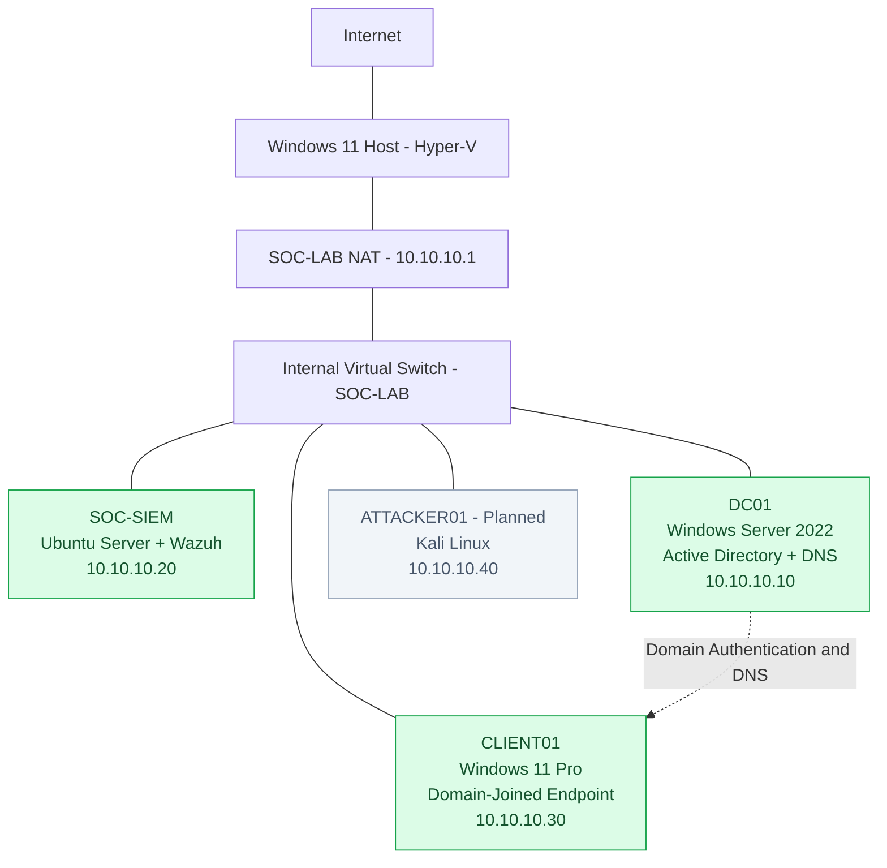

# SOC-Homelab

Hands-on SOC homelab focused on security monitoring, adversary simulation, detection engineering, threat hunting, and incident response using Hyper-V, Wazuh, Active Directory, and Sysmon.

## Project Overview

This project focuses on building a realistic enterprise security monitoring environment to develop practical Security Operations Center (SOC) skills through hands-on security monitoring, adversary simulation, detection engineering, threat hunting, and incident response.

The laboratory is built using Microsoft Hyper-V and Wazuh, with a functional Active Directory environment, a simulated corporate identity structure, and a domain-joined Windows endpoint.

The next stage focuses on security telemetry collection and centralized endpoint monitoring.

## Project Objectives

- Build a controlled enterprise-like security laboratory.
- Deploy and configure a centralized SIEM platform.
- Implement Active Directory and Windows endpoint monitoring.
- Simulate controlled adversarial activity.
- Analyze security alerts and investigate suspicious behavior.
- Develop and validate custom detection rules.
- Map adversarial techniques to the MITRE ATT&CK framework.
- Develop incident response procedures and investigation reports.

## Technology Stack

| Technology | Purpose | Status |
|---|---|---|
| Microsoft Hyper-V | Virtualization | Implemented |
| Ubuntu Server 24.04 LTS | SIEM operating system | Implemented |
| Wazuh | SIEM and security monitoring | Implemented |
| Windows Server 2022 | Active Directory and DNS | Implemented |
| Active Directory | Centralized identity management | Implemented |
| Windows 11 Pro | Enterprise endpoint | Implemented |
| Wazuh Agents | Endpoint security monitoring | Planned |
| Sysmon | Endpoint telemetry | Planned |
| Group Policy | Centralized security policies | Planned |
| Kali Linux | Adversary simulation | Planned |
| MITRE ATT&CK | Adversary technique mapping | Planned |

## Lab Architecture

## Virtual Machine Configuration

| Machine | Operating System | RAM | vCPU | Storage | Status |
|---|---|---|---|---|---|
| SOC-SIEM | Ubuntu Server 24.04.5 LTS | 8 GB | 4 | 100 GB | Operational |
| DC01 | Windows Server 2022 | 4 GB | 2 | 60 GB | Operational |
| CLIENT01 | Windows 11 Pro | 4 GB | 2 | 80 GB | Operational |
| ATTACKER01 | Kali Linux | 4 GB | 2 | 40 GB | Planned |

## Network Configuration

| Parameter | Configuration |
|---|---|
| Virtual Switch | SOC-LAB |
| Switch Type | Internal |
| Network | 10.10.10.0/24 |
| Gateway | 10.10.10.1 |
| NAT | SOC-LAB-NAT |
| Active Directory Domain | corp.soclab.test |
| NetBIOS Name | CORP |
| Internal DNS Server | 10.10.10.10 |
| SIEM Server | 10.10.10.20 |

The laboratory currently uses an internal virtual switch with NAT connectivity. Additional network restrictions and isolation controls will be validated before adversary simulations are performed.

## Active Directory Environment

A simulated corporate Active Directory environment was deployed to provide centralized authentication, identity management, and a realistic foundation for identity-based security monitoring.

| Component | Configuration |
|---|---|
| Domain Controller | DC01 |
| Domain | corp.soclab.test |
| Forest Functional Level | Windows Server 2016 |
| Domain Functional Level | Windows Server 2016 |
| Departments | 4 |
| Departmental Security Groups | 4 |
| Standard User Accounts | 6 |
| Additional Privileged Accounts | 1 |
| Provisioned Service Accounts | 2 |
| Domain-Joined Workstations | 1 |

### Corporate Departments

- IT
- Finance
- Human Resources
- Sales

The environment implements separation between standard and privileged identities, departmental security groups, dedicated service identities, and a centralized workstation Organizational Unit.

The service accounts are provisioned but are not yet assigned to operational services.

## Project Roadmap

- [x] Phase 01 - Infrastructure and SIEM Deployment
- [x] Phase 02 - Active Directory and Endpoint Deployment
- [ ] Phase 03 - Security Monitoring and Telemetry Collection
- [ ] Phase 04 - Adversary Simulation
- [ ] Phase 05 - Detection Engineering
- [ ] Phase 06 - Threat Hunting and Incident Investigation
- [ ] Phase 07 - Incident Response and Playbooks

## Project Documentation

| Phase | Documentation | Status |
|---|---|---|
| 01 | [Infrastructure and SIEM Deployment](01-Infrastructure/README.md) | Completed |
| 02 | [Active Directory and Endpoint Deployment](02-Active-Directory/README.md) | Completed |
| 03 | Security Monitoring and Telemetry Collection | Next Phase |
| 04 | Adversary Simulation | Planned |
| 05 | Detection Engineering | Planned |
| 06 | Threat Hunting and Incident Investigation | Planned |
| 07 | Incident Response and Playbooks | Planned |

## Skills Demonstrated

### Infrastructure and System Administration

- Virtualization and infrastructure deployment
- Virtual network configuration and NAT
- Linux system administration
- Windows Server administration
- SIEM deployment and service validation
- Infrastructure troubleshooting
- Resource and performance monitoring
- Virtual machine checkpoint management

### Active Directory and Identity Management

- Active Directory Domain Services deployment
- DNS configuration and service validation
- Organizational Unit management
- Security group administration
- User and service account provisioning
- Standard and privileged identity separation
- Windows endpoint domain integration
- Domain authentication validation
- Network connectivity troubleshooting

### Security Operations - In Development

- Endpoint security monitoring
- Windows security event collection
- Security event analysis
- Alert triage
- Log correlation
- Detection engineering
- MITRE ATT&CK mapping
- Threat hunting
- Incident investigation
- Incident response

## Project Status

**In Progress - Phase 02 Completed**

The initial infrastructure, Wazuh SIEM, Active Directory environment, and Windows endpoint deployment have been successfully completed.

The laboratory currently includes:

- An operational Wazuh SIEM platform.
- A functional Windows Server 2022 Domain Controller.
- A simulated corporate identity structure.
- Six standard domain users.
- One additional privileged account.
- Two provisioned service accounts.
- A domain-joined Windows 11 workstation.
- Validated Active Directory services and domain authentication.

The next phase focuses on deploying Wazuh agents, configuring Sysmon, implementing Windows auditing policies, enabling PowerShell logging, and validating centralized security telemetry collection.

Subsequent phases will focus on controlled adversary simulations, custom detection rules, threat hunting, incident investigations, and response procedures.

## Disclaimer

This project is intended exclusively for educational purposes and professional development.

All security testing and adversary simulations are intended for authorized systems within a controlled laboratory environment.
