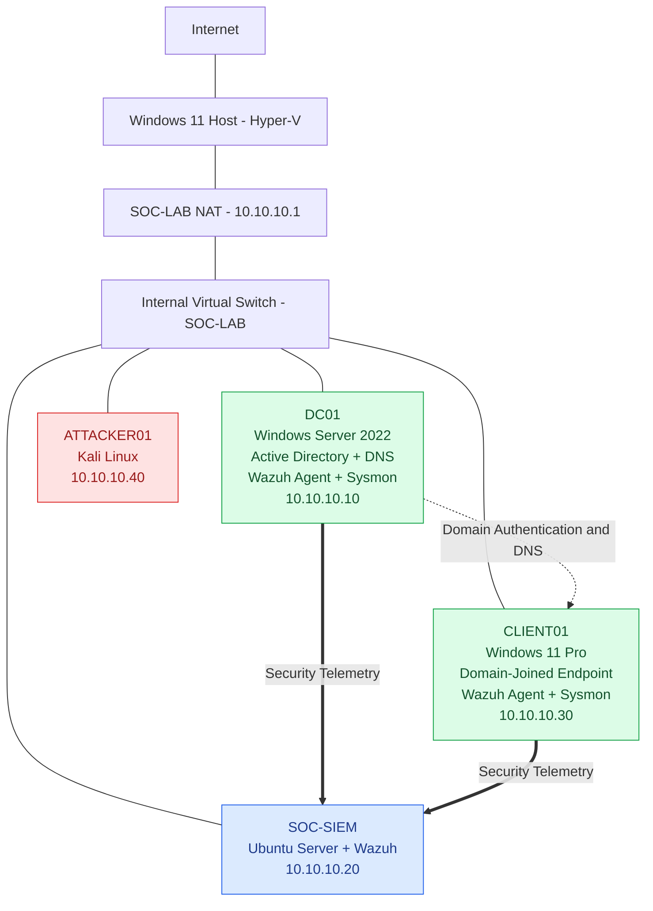
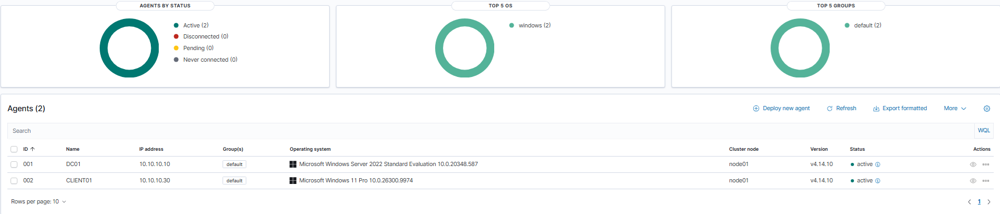
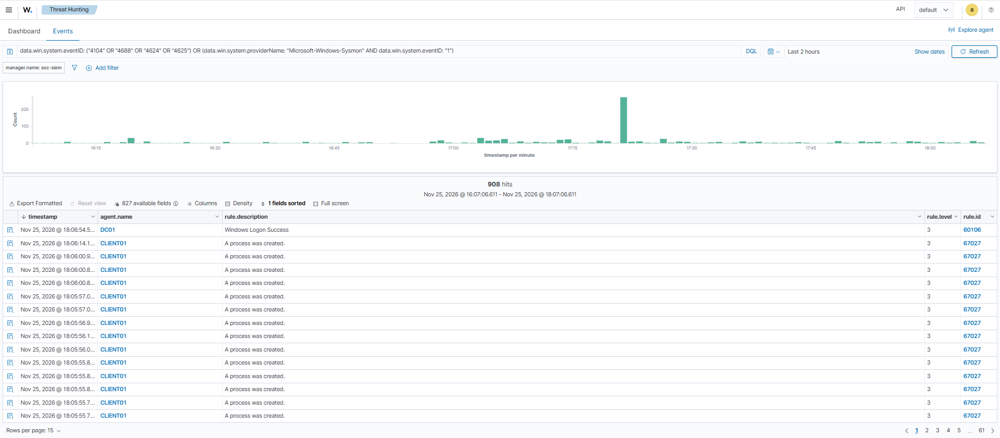
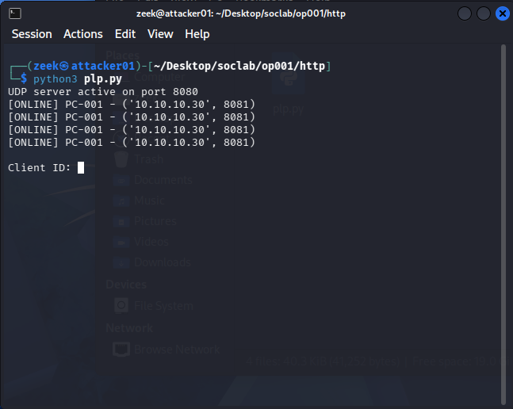
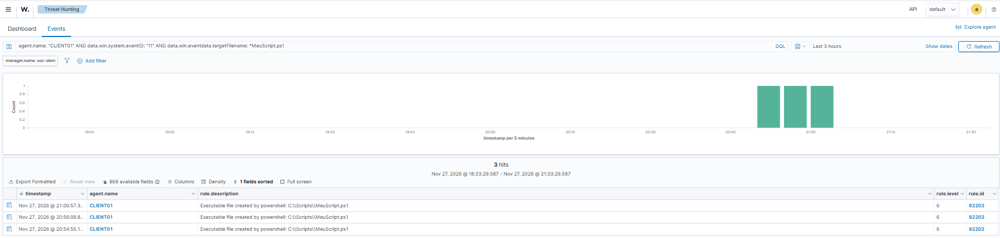
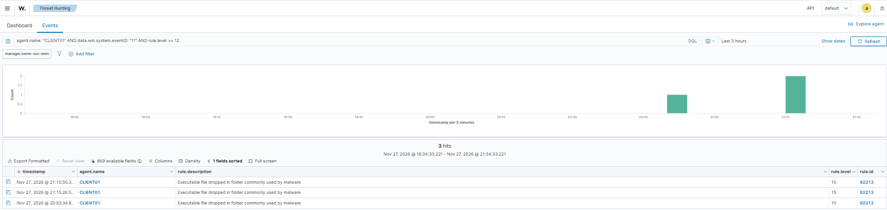
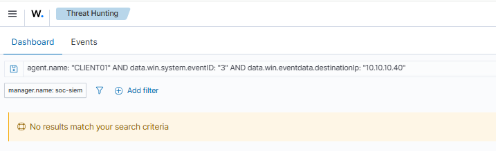
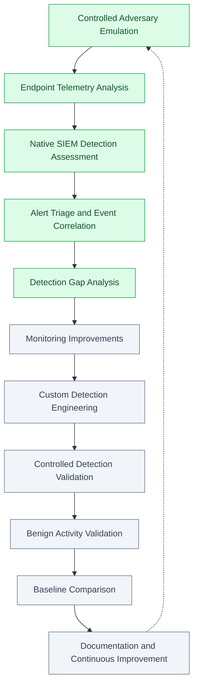

# SOC-Homelab

Hands-on enterprise security laboratory focused on Security Operations, adversary emulation, detection engineering, threat hunting, and incident response using Hyper-V, Wazuh, Active Directory, Sysmon, PowerShell, Python, and Kali Linux.

## Project Overview

This project focuses on building a realistic enterprise security monitoring environment to develop practical Security Operations Center (SOC) skills through hands-on adversary emulation, security event analysis, detection engineering, threat hunting, and incident response.

The laboratory is built using Microsoft Hyper-V and Wazuh, with a functional Active Directory environment, a simulated corporate identity structure, a domain-joined Windows endpoint, and centralized security telemetry collection.

The initial security monitoring baseline has been established through Wazuh agents, Microsoft Sysmon, Windows Advanced Audit Policies, and PowerShell Logging.

A dedicated Kali Linux attacker machine has been deployed and validated.

The project has progressed beyond infrastructure deployment into controlled adversary emulation and evidence-based security investigations.

The initial operation, OP-001 — Corporate Intrusion, includes an independently developed PowerShell and Python communication prototype, endpoint telemetry analysis, native Wazuh detection assessment, incident timeline reconstruction, and structured detection gap analysis.

## Project Highlights

| Metric | Current Result |
|---|---|
| Operational Virtual Machines | 4 |
| Monitored Windows Endpoints | 2 |
| Corporate Departments | 4 |
| Provisioned Corporate Identities | 9 |
| Configured Windows Event Channels per Endpoint | 8 |
| Documented Adversary Emulation Operations | 1 — In Progress |
| Selected OP-001 Alerts Investigated | 9 |
| Confirmed True Positive Alerts | 4 |
| Confirmed Benign Positive Alerts | 2 |
| Likely Benign Positive Alerts | 3 |
| Observed MITRE ATT&CK Techniques in OP-001 | 3 |
| Documented Detection and Monitoring Findings | 8 |
| Custom Detection Rules | Planned |

The alert metrics represent a selected investigation sample and should not be interpreted as overall SIEM detection accuracy.

## Project Objectives

- Build a controlled enterprise-like security laboratory.
- Deploy and configure a centralized SIEM platform.
- Implement Active Directory and Windows endpoint monitoring.
- Establish centralized security telemetry collection.
- Simulate controlled adversarial activity.
- Evaluate native SIEM detection capabilities.
- Perform contextual security alert triage.
- Correlate events across multiple telemetry sources.
- Reconstruct incident timelines.
- Identify monitoring and detection gaps.
- Develop and validate custom detection rules.
- Map observed adversarial techniques to MITRE ATT&CK.
- Evaluate alert severity and contextual relevance.
- Develop incident response procedures and investigation reports.
- Compare native and improved detection coverage.

## Technology Stack

| Technology | Purpose | Status |
|---|---|---|
| Microsoft Hyper-V | Virtualization | Implemented |
| Ubuntu Server 24.04 LTS | SIEM operating system | Implemented |
| Wazuh | SIEM and security monitoring | Implemented |
| Windows Server 2022 | Active Directory and DNS | Implemented |
| Active Directory | Centralized identity management | Implemented |
| Windows 11 Pro | Enterprise endpoint | Implemented |
| Wazuh Agents | Endpoint security monitoring | Implemented |
| Microsoft Sysmon | Advanced endpoint telemetry | Implemented |
| Sysmon Modular | Sysmon configuration baseline | Implemented |
| Group Policy | Centralized security policies | Implemented |
| Windows Advanced Audit Policies | Windows security event generation | Implemented |
| PowerShell Logging | Command and script execution visibility | Implemented |
| Windows Defender | Endpoint protection and security telemetry | Monitoring Configured |
| Kali Linux 2026.3 | Adversary emulation | Implemented |
| PowerShell | Automation and security research | Used |
| Python | Application development and security research | Used |
| MITRE ATT&CK | Adversary technique mapping | In Progress |
| Custom Wazuh Rules | Detection engineering | Planned |

## Lab Architecture

## Virtual Machine Configuration

| Machine | Operating System | RAM | vCPU | Storage | Status |
|---|---|---|---|---|---|
| SOC-SIEM | Ubuntu Server 24.04.5 LTS | 8 GB | 4 | 100 GB | Operational |
| DC01 | Windows Server 2022 | 4 GB | 2 | 60 GB | Operational |
| CLIENT01 | Windows 11 Pro | 4 GB | 2 | 80 GB | Operational |
| ATTACKER01 | Kali Linux 2026.3 | 4 GB | 2 | 40 GB | Operational |

## Network Configuration

| Parameter | Configuration |
|---|---|
| Virtual Switch | SOC-LAB |
| Switch Type | Internal |
| Network | 10.10.10.0/24 |
| Gateway | 10.10.10.1 |
| NAT | SOC-LAB-NAT |
| Active Directory Domain | corp.soclab.test |
| NetBIOS Name | CORP |
| Internal DNS Server | 10.10.10.10 |
| SIEM Server | 10.10.10.20 |
| Corporate Workstation | 10.10.10.30 |
| Attacker Machine | 10.10.10.40 |

The laboratory uses an internal virtual switch with NAT connectivity.

Internet connectivity is intentionally retained to represent a connected enterprise environment.

The laboratory is not fully isolated. Security exercises are restricted to authorized laboratory systems using controlled test activity and synthetic data.

Real malware execution is outside the scope of this environment. Existing endpoint protections remain enabled.

## Active Directory Environment

A simulated corporate Active Directory environment was deployed to provide centralized authentication, identity management, and a realistic foundation for identity-based security monitoring.

| Component | Configuration |
|---|---|
| Domain Controller | DC01 |
| Domain | corp.soclab.test |
| Forest Functional Level | Windows Server 2016 |
| Domain Functional Level | Windows Server 2016 |
| Departments | 4 |
| Departmental Security Groups | 4 |
| Standard User Accounts | 6 |
| Additional Privileged Accounts | 1 |
| Provisioned Service Accounts | 2 |
| Domain-Joined Workstations | 1 |

### Corporate Departments

- IT
- Finance
- Human Resources
- Sales

The environment implements separation between standard and privileged identities, departmental security groups, dedicated service identities, and a centralized workstation Organizational Unit.

The service accounts are provisioned but are not yet assigned to operational services.

## Security Monitoring and Telemetry

A centralized security monitoring infrastructure has been implemented across the Active Directory environment using Wazuh, Sysmon, Windows Advanced Audit Policies, and PowerShell Logging.

### Monitored Endpoints

| Agent ID | Hostname | Agent Version | Status |
|---|---|---|---|
| 001 | DC01 | 4.14.10 | Active |
| 002 | CLIENT01 | 4.14.10 | Active |

Both endpoints successfully synchronized their centralized Wazuh configuration during baseline validation.

### Implemented Monitoring Capabilities

- Centralized endpoint security monitoring.
- Role-based Wazuh agent group structure.
- Centralized Windows event collection.
- Advanced endpoint telemetry through Microsoft Sysmon.
- Role-based Windows Advanced Audit Policies.
- PowerShell Module Logging.
- PowerShell Script Block Logging.
- Process Creation Command Line Auditing.
- Authentication and account management auditing.
- Kerberos authentication auditing.
- Privileged activity auditing.
- Active Directory change auditing, subject to applicable auditing requirements.

### Monitored Event Channels

| Event Channel | Monitoring Purpose |
|---|---|
| Security | Authentication, account management, and privilege usage |
| System | System activity and service-related events |
| Application | Application-level events |
| Sysmon Operational | Advanced endpoint activity |
| PowerShell Operational | Command and script execution |
| Task Scheduler Operational | Scheduled task activity |
| WMI Activity Operational | Windows Management Instrumentation activity |
| Windows Defender Operational | Endpoint protection and security-related events |

All eight event channels were configured for monitoring on both Windows endpoints.

### Telemetry Validation

| Telemetry | Event ID | Validation Status |
|---|---|---|
| Windows Authentication | 4624 / 4625 | SIEM visibility confirmed through combined query |
| Windows Process Creation | 4688 | SIEM visibility confirmed |
| Sysmon Process Creation | 1 | SIEM visibility confirmed |
| Sysmon Network Activity | 3 | Confirmed locally; centralized alerts not observed |
| Sysmon File Creation | 11 | SIEM visibility confirmed |
| PowerShell Script Block Logging | 4104 | SIEM visibility confirmed |
| PowerShell Module Logging | 4103 | Confirmed locally; direct SIEM validation pending |
| WMI Activity | Multiple | SIEM visibility confirmed |
| Task Scheduler | 100, 106, 140, 200 | Confirmed locally; centralized alerts not observed |
| Scheduled Task Security Auditing | 4698 / 4702 | Relevant audit subcategory disabled |
| Windows Defender | Multiple | Direct SIEM validation pending |

Windows Authentication Event IDs 4624 and 4625 were investigated using a combined query and have not yet been independently validated.

The OP-001 investigation expanded the initial telemetry assessment by identifying additional endpoint activity and centralized visibility limitations.

The absence of indexed alerts does not necessarily establish a telemetry collection failure.

## Initial Security Alert Analysis

During telemetry validation, a native Wazuh detection rule generated an alert associated with PowerShell file deletion activity on the domain controller.

| Field | Value |
|---|---|
| Endpoint | DC01 |
| Wazuh Rule ID | 92021 |
| Severity Level | 3 |
| Event Source | Sysmon Event ID 1 |
| MITRE ATT&CK Technique | T1070.004 — File Deletion |
| Classification | Benign Positive |
| Confidence | High |

Analysis of the command-line arguments, process ancestry, execution context, and Wazuh Security Configuration Assessment policy established that the observed activity was associated with a legitimate automated security assessment.

No containment actions or detection rule modifications were required.

This exercise demonstrated the importance of contextual alert analysis and distinguishing potentially suspicious behavior from confirmed malicious activity.

Further details are available in the [Sysmon Integration documentation](03-Security-Monitoring/02-Sysmon-Integration.md).

## Adversary Emulation Environment

A dedicated Kali Linux virtual machine was deployed to support controlled adversary emulation and generate security-relevant activity across the monitored infrastructure.

### Attacker Machine

| Parameter | Configuration |
|---|---|
| Virtual Machine | ATTACKER01 |
| Hostname | attacker01 |
| Operating System | Kali Linux 2026.3 Rolling |
| IP Address | 10.10.10.40 |
| Network | SOC-LAB |
| Remote Administration | SSH |
| Status | Operational |

Internal DNS resolution, connectivity to the domain controller and SIEM, workstation-to-attacker connectivity, and SSH administration were validated.

### Available Security Tools

| Tool | Purpose |
|---|---|
| Nmap | Network discovery and service enumeration |
| Wireshark | Network traffic analysis |
| Tcpdump | Packet capture |
| Impacket SMBClient | SMB security testing |
| NetExec | Active Directory security testing |
| Metasploit Framework | Controlled adversary emulation |
| Hydra | Authentication security testing |
| John the Ripper | Password security auditing |
| Hashcat | Password hash auditing |

Executable availability was confirmed.

Individual operational testing will be performed when required by specific authorized simulation scenarios.

Further details are available in the [Kali Linux Deployment documentation](04-Attacker-Machine/01-Kali-Linux-Deployment.md).

## Adversary Emulation Operations

| Operation ID | Scenario | Status | Documentation |
|---|---|---|---|
| OP-001 | Corporate Intrusion | In Progress | [Investigation Report](05-Adversary-Emulation/01-Corporate-Intrusion/README.md) |

The laboratory follows an operation-based methodology to organize adversary emulation activities, associated security telemetry, investigation findings, and detection improvements.

Independent controlled simulations will complement the operation-based approach.

## OP-001 — Corporate Intrusion

### Operation Overview

OP-001 represents an assumed-breach scenario involving a monitored corporate Windows endpoint.

The initial investigation focuses on PowerShell execution, custom network communication, scheduled task artifacts, Windows security contexts, and native Wazuh detection coverage.

| Attribute | Value |
|---|---|
| Operation ID | OP-001 |
| Scenario | Corporate Intrusion |
| Initial Access Model | Assumed Breach |
| Target Endpoint | CLIENT01 |
| Associated Remote Host | ATTACKER01 |
| Primary Monitoring Platform | Wazuh |
| Investigation Status | Initial Assessment Documented |
| Overall Operation Status | In Progress |

Initial access was assumed rather than experimentally performed.

Administrative privileges were explicitly provided during laboratory testing.

No successful privilege escalation exploit or arbitrary remote command execution is claimed.

### Custom Communication Prototype

A custom Command and Control research prototype was independently developed using PowerShell and Python to study the relationship between application behavior, Windows endpoint telemetry, and centralized security monitoring.

The project involved practical concepts including:

- Client-server architecture.
- Socket programming and UDP communication.
- Structured JSON data processing.
- Unique message identifiers.
- UTC timestamp generation.
- Concurrent programming.
- Windows execution contexts.
- Endpoint artifact analysis.

Laboratory testing demonstrated application initialization, recurring heartbeat communication, acknowledgment reception, and bidirectional communication.

Endpoint investigation also identified script replication, scheduled task registration, and SYSTEM-associated activity.

Arbitrary remote command execution and remote command-result correlation were not experimentally validated.

Operational remote execution and privileged persistence implementation details are intentionally excluded from the published documentation.

Further details are available in the [C2 Architecture documentation](05-Adversary-Emulation/01-Corporate-Intrusion/02-C2-Architecture.md).

### Native Wazuh Detection Assessment

The initial investigation evaluated native Wazuh detection behavior before introducing custom detection rules.

Nine selected alerts were examined.

| Alert Category | Rule ID | Native Level | Count | Analyst Classification |
|---|---|---|---|---|
| PowerShell script block | 91826 | 4 | 1 | True Positive |
| Process discovery | 91815 | 4 | 2 | Benign Positive |
| PowerShell file creation | 92203 | 6 | 3 | True Positive |
| Temporary executable script creation | 92213 | 15 | 3 | Likely Benign Positive |

The investigation identified a significant difference between native alert severity and contextual investigative relevance.

Confirmed simulated adversarial activity generated severity level 4 and 6 alerts.

Meanwhile, apparently legitimate PowerShell policy-check activity generated severity level 15 alerts.

The legitimate explanation for the temporary files remains preliminary and requires further validation.

### Alert Classification Summary

| Classification | Count | Percentage |
|---|---|---|
| True Positive | 4 | 44.4% |
| Confirmed Benign Positive | 2 | 22.2% |
| Likely Benign Positive | 3 | 33.3% |
| Total | 9 | 100% |

These results represent the selected investigation sample, not a statistically representative detection accuracy or false-positive rate.

Multiple alert records may relate to the same underlying activity.

Further details are available in the [Native Detection Assessment](05-Adversary-Emulation/01-Corporate-Intrusion/04-Native-Detection-Assessment.md).

### Endpoint Investigation and Event Correlation

The investigation correlated security-relevant events using:

- Windows process identifiers.
- Sysmon ProcessGuid values.
- Scheduled task instance identifiers.
- Windows security contexts.
- Event occurrence timestamps.
- Centralized Wazuh alert records.

A PowerShell Script Block Logging event and a corresponding Sysmon file creation event were recorded approximately 21 milliseconds apart under the same process identifier.

Task Scheduler events were also correlated using a shared task instance identifier.

A separate timestamp inconsistency of approximately 14 hours and 28 minutes was identified in Sysmon network event records.

The underlying cause remains unresolved, and the original timestamps have been preserved.

The investigation distinguishes direct event relationships from contextual correlations and unverified assumptions.

Further details:

- [Execution and Persistence Investigation](05-Adversary-Emulation/01-Corporate-Intrusion/03-Execution-and-Persistence.md)
- [Incident Timeline](05-Adversary-Emulation/01-Corporate-Intrusion/05-Incident-Timeline.md)

## MITRE ATT&CK Coverage

The following techniques are supported by observed behavior during OP-001.

| Technique ID | Technique | Endpoint Evidence | Native SIEM Coverage |
|---|---|---|---|
| T1059.001 | PowerShell | PowerShell script block and process telemetry | Observed |
| T1095 | Non-Application Layer Protocol | Sysmon network telemetry | Corresponding alerts not observed |
| T1053.005 | Scheduled Task | Task Scheduler Operational events | Corresponding alerts not observed |

### Technique Classification Review

The investigation also identified native MITRE ATT&CK mappings that were not independently supported by the observed behavior.

| Native Technique | Analyst Assessment |
|---|---|
| T1560 — Archive Collected Data | Data archiving was not established |
| T1105 — Ingress Tool Transfer | External file transfer was not established |
| T1057 — Process Discovery | Observed in legitimate troubleshooting activity |

Native alert classifications are not automatically treated as confirmed adversarial techniques.

The coverage matrix represents observed behavior within the laboratory investigation and does not establish complete MITRE ATT&CK coverage.

Additional techniques will be introduced as future authorized simulations are performed and validated.

## Detection Gap Analysis

The initial OP-001 investigation identified eight findings affecting endpoint auditing, centralized visibility, detection coverage, classification accuracy, evidence retention, and alert prioritization.

| Gap ID | Finding | Priority | Status |
|---|---|---|---|
| GAP-001 | Missing UDP network alerts | P2 — High | Root cause unknown |
| GAP-002 | Missing Task Scheduler alerts | P2 — High | Root cause unknown |
| GAP-003 | Scheduled task security auditing disabled | P1 — Critical | Confirmed |
| GAP-004 | Unsupported MITRE ATT&CK classifications | P3 — Medium | Confirmed |
| GAP-005 | Sysmon network timestamp inconsistency | P1 — Critical | Root cause unknown |
| GAP-006 | Dynamic execution detection coverage | P2 — High | Validation required |
| GAP-007 | Raw event archiving disabled | P1 — Critical | Confirmed |
| GAP-008 | Potentially excessive alert severity | P3 — Medium | Preliminary |

Priorities represent proposed remediation priorities rather than native Wazuh alert severity.

Not all findings represent confirmed detection failures.

Several require additional telemetry validation before their root causes can be established.

### Initial Detection Coverage

| Observed Behavior | Local Evidence | Native Alert Visibility |
|---|---|---|
| PowerShell script block | Confirmed | Confirmed |
| Local script replication | Confirmed | Confirmed |
| UDP network communication | Confirmed | Not observed |
| Scheduled task registration | Confirmed | Not observed |
| Scheduled task update | Confirmed | Not observed |
| Scheduled task execution | Confirmed | Not observed |
| SYSTEM-associated network activity | Confirmed | Not observed |
| Arbitrary remote command execution | Not tested | Not evaluated |

Raw event archiving was disabled during the initial assessment.

Consequently, the absence of centralized alerts cannot independently establish whether relevant events failed to reach the Wazuh Manager or were received without generating qualifying alerts.

The identified findings establish the foundation for the next detection engineering activities.

Further details are available in the [Detection Gap Analysis](05-Adversary-Emulation/01-Corporate-Intrusion/06-Detection-Gap-Analysis.md).

## Detection Engineering Approach

The laboratory follows a baseline-first detection engineering methodology.

The initial monitoring environment retains native Wazuh detection rules without introducing custom detection logic or suppressing existing rules.

The methodology consists of the following stages:

The completed stages in this diagram represent the initial OP-001 assessment rather than completion of the entire adversary emulation campaign.

### Planned Monitoring Improvements

- Correct the identified Windows auditing gap.
- Investigate endpoint timestamp integrity.
- Validate raw event reception.
- Confirm Sysmon network event collection.
- Confirm Task Scheduler event collection.
- Review native Wazuh rule behavior.
- Develop contextual behavioral detections.
- Validate legitimate activity before introducing alert tuning.
- Compare native and improved detection coverage.

### Detection Validation Principles

Each detection improvement will be evaluated using documented test cases.

Validation will consider:

- Local event generation.
- Manager event reception.
- Rule evaluation.
- Alert generation.
- Alert severity.
- MITRE ATT&CK classification.
- Investigative context.
- Benign control activity.
- Reproducibility.
- Evidence quality.

Configuration changes alone will not be considered proof of successful remediation.

## Security Boundaries

The laboratory maintains Internet connectivity to represent a connected enterprise environment and support software updates, security intelligence, and tool installation.

The following security boundaries apply:

- Security exercises are restricted to authorized laboratory systems.
- Real malware execution is outside the scope of this environment.
- Controlled test activity and synthetic data are used.
- Existing endpoint security protections remain enabled.
- Laboratory services must not be intentionally exposed to the public Internet.
- Recovery checkpoints are maintained before simulation activities.
- Experimental communication prototypes must not be treated as secure remote administration software.
- Published documentation prioritizes defensive analysis and excludes operational remote execution and privileged persistence implementation details.

## Recovery Baseline

Recovery checkpoints were established across all four virtual machines before beginning controlled adversary simulations.

| Virtual Machine | Reference Checkpoint |
|---|---|
| SOC-SIEM | 03 - Security Monitoring Baseline |
| DC01 | 03 - Security Monitoring Baseline |
| CLIENT01 | 02 - Security Monitoring Baseline |
| ATTACKER01 | 01 - Kali Linux Clean Deployment |

These checkpoints provide a recovery mechanism for restoring the laboratory to its established monitoring and deployment baseline.

## Project Roadmap

- [x] Phase 01 — Infrastructure and SIEM Deployment
- [x] Phase 02 — Active Directory and Endpoint Deployment
- [x] Phase 03 — Security Monitoring and Telemetry Collection
- [x] Phase 04 — Attacker Machine Deployment
- [ ] Phase 05 — Adversary Emulation
  - [x] Initial OP-001 activity
  - [x] Endpoint telemetry investigation
  - [x] Native Wazuh detection assessment
  - [x] Preliminary incident timeline
  - [x] Detection gap analysis
  - [ ] Additional controlled simulations
- [ ] Phase 06 — Detection Engineering
  - [ ] Monitoring foundation improvements
  - [ ] Telemetry validation
  - [ ] Custom detection rule development
  - [ ] Detection tuning and validation
  - [ ] Before-and-after detection assessment
- [ ] Phase 07 — Threat Hunting and Incident Investigation
- [ ] Phase 08 — Incident Response and Playbooks

The project follows an iterative methodology.

Adversary emulation, detection engineering, and investigation activities may overlap as new findings are identified.

## Project Documentation

| Phase | Documentation | Status |
|---|---|---|
| 01 | [Infrastructure and SIEM Deployment](01-Infrastructure/README.md) | Completed |
| 02 | [Active Directory and Endpoint Deployment](02-Active-Directory/README.md) | Completed |
| 03 | [Security Monitoring and Telemetry Collection](03-Security-Monitoring/README.md) | Completed |
| 04 | [Attacker Machine Deployment](04-Attacker-Machine/README.md) | Completed |
| 05 | [Adversary Emulation](05-Adversary-Emulation/README.md) | In Progress |
| 06 | Detection Engineering | Planned |
| 07 | Threat Hunting and Incident Investigation | Planned |
| 08 | Incident Response and Playbooks | Planned |

### Featured Investigation — OP-001

| Document | Focus |
|---|---|
| [Operation Overview](05-Adversary-Emulation/01-Corporate-Intrusion/01-Operation-Overview.md) | Scenario, scope, methodology, and objectives |
| [C2 Architecture](05-Adversary-Emulation/01-Corporate-Intrusion/02-C2-Architecture.md) | Prototype architecture and defensive telemetry |
| [Execution and Persistence](05-Adversary-Emulation/01-Corporate-Intrusion/03-Execution-and-Persistence.md) | Endpoint artifact analysis and event correlation |
| [Native Detection Assessment](05-Adversary-Emulation/01-Corporate-Intrusion/04-Native-Detection-Assessment.md) | Alert triage, severity, and classification |
| [Incident Timeline](05-Adversary-Emulation/01-Corporate-Intrusion/05-Incident-Timeline.md) | Chronological reconstruction and timestamp analysis |
| [Detection Gap Analysis](05-Adversary-Emulation/01-Corporate-Intrusion/06-Detection-Gap-Analysis.md) | Monitoring findings and remediation roadmap |

## Skills Demonstrated

### Security Operations and Incident Investigation

- Security alert triage.
- True Positive and Benign Positive classification.
- Security event analysis.
- Multi-source event correlation.
- Process ancestry analysis.
- Command-line analysis.
- Windows execution context analysis.
- PowerShell script block analysis.
- Endpoint artifact investigation.
- Scheduled task event analysis.
- Network telemetry investigation.
- Preliminary incident timeline reconstruction.
- Timestamp integrity assessment.
- Evidence confidence assessment.
- Contextual alert prioritization.
- MITRE ATT&CK technique interpretation.
- Detection coverage assessment.
- Monitoring gap identification.
- Remediation planning.
- Structured technical investigation reporting.

### Security Monitoring and Telemetry

- Wazuh agent deployment and enrollment.
- Centralized agent configuration management.
- Role-based agent group management.
- Microsoft Sysmon deployment and integration.
- Windows security event collection.
- Advanced Audit Policy configuration through Group Policy.
- PowerShell Module and Script Block Logging.
- Process creation and command-line auditing.
- Endpoint telemetry validation.
- SIEM search and event filtering.
- Security monitoring troubleshooting.
- Identification of telemetry visibility limitations.

### Programming and Networking

- PowerShell scripting.
- Python application development.
- Client-server architecture.
- Socket programming.
- UDP network communication.
- JSON serialization and deserialization.
- UTF-8 data encoding.
- Unique message identification.
- UTC timestamp handling.
- Concurrent programming.
- Application-level communication analysis.
- Security implications of experimental application design.

### Active Directory and Identity Management

- Active Directory Domain Services deployment.
- DNS configuration and service validation.
- Organizational Unit management.
- Security group administration.
- User and service account provisioning.
- Standard and privileged identity separation.
- Windows endpoint domain integration.
- Domain authentication validation.
- Network connectivity troubleshooting.

### Infrastructure and System Administration

- Virtualization and infrastructure deployment.
- Virtual network configuration and NAT.
- Linux system administration.
- Windows Server administration.
- SIEM deployment and service validation.
- Infrastructure troubleshooting.
- Resource and performance monitoring.
- Virtual machine checkpoint management.
- Kali Linux deployment and SSH administration.
- Security tool availability validation.
- Definition of authorized simulation boundaries.

### Skills Currently in Development

- Advanced behavioral detection engineering.
- Custom Wazuh rule development.
- Detection rule testing and tuning.
- Detection effectiveness measurement.
- Structured threat hunting.
- Advanced Active Directory security investigations.
- Incident response procedures.
- Security playbook development.
- Detection coverage improvement.

## Project Status

**In Progress — Phase 05: Adversary Emulation**

The infrastructure, Wazuh SIEM, Active Directory environment, Windows endpoint deployment, initial security monitoring baseline, and dedicated attacker machine have been successfully established.

The initial OP-001 investigation has been documented, including:

- Custom communication prototype architecture.
- Endpoint execution and persistence investigation.
- Native Wazuh alert assessment.
- Nine selected alert investigations.
- Multi-source event correlation.
- Preliminary incident timeline reconstruction.
- Eight monitoring and detection findings.
- Proposed remediation priorities.
- Detection validation acceptance criteria.

The next stage focuses on correcting foundational monitoring limitations, validating telemetry collection, and developing evidence-based custom detections.

The original native detection baseline will remain available for comparison against subsequent improvements.

## Disclaimer

This project is intended exclusively for educational purposes and professional development.

All security testing and adversary emulation activities are intended for authorized systems within a controlled laboratory environment.

No security testing will be intentionally performed against unauthorized external systems or third-party infrastructure.

The published documentation focuses on defensive security research, telemetry analysis, detection engineering, and evidence-based investigation.

Experimental capabilities are distinguished from independently validated behavior throughout the project.
