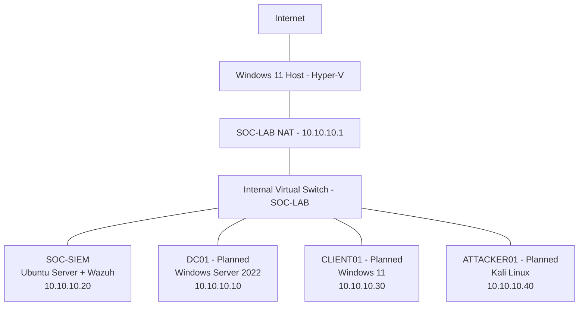

# SOC-Homelab
Hands-on SOC homelab focused on security monitoring, adversary simulation, detection engineering, threat hunting, and incident response using Hyper-V, Wazuh, Active Directory, and Sysmon.

## Project Overview

This project focuses on building a realistic enterprise security monitoring environment to develop practical Security Operations Center (SOC) skills through hands-on security monitoring, adversary simulation, detection engineering, threat hunting, and incident response.

The laboratory is built using Microsoft Hyper-V and Wazuh, with a planned Active Directory environment and monitored Windows endpoints.

## Project Objectives

- Build a controlled enterprise-like security laboratory.
- Deploy and configure a centralized SIEM platform.
- Implement Active Directory and Windows endpoint monitoring.
- Simulate controlled adversarial activity.
- Analyze security alerts and investigate suspicious behavior.
- Develop and validate custom detection rules.
- Map adversarial techniques to the MITRE ATT&CK framework.
- Develop incident response procedures and investigation reports.

## Technology Stack

| Technology | Purpose | Status |
|---|---|---|
| Microsoft Hyper-V | Virtualization | Implemented |
| Ubuntu Server 24.04 LTS | SIEM operating system | Implemented |
| Wazuh | SIEM and security monitoring | Implemented |
| Windows Server 2022 | Active Directory and DNS | Planned |
| Windows 11 | Enterprise endpoint | Planned |
| Sysmon | Endpoint telemetry | Planned |
| Kali Linux | Adversary simulation | Planned |
| MITRE ATT&CK | Adversary technique mapping | Planned |

## Lab Architecture

## Virtual Machine Configuration

| Machine | Operating System | RAM | vCPU | Storage | Status |
|---|---|---|---|---|---|
| SOC-SIEM | Ubuntu Server 24.04.5 LTS | 8 GB | 4 | 100 GB | Operational |
| DC01 | Windows Server 2022 | 4 GB | 2 | 60 GB | Planned |
| CLIENT01 | Windows 11 | 4 GB | 2 | 80 GB | Planned |
| ATTACKER01 | Kali Linux | 4 GB | 2 | 40 GB | Planned |

## Network Configuration

| Parameter | Configuration |
|---|---|
| Virtual Switch | SOC-LAB |
| Switch Type | Internal |
| Network | 10.10.10.0/24 |
| Gateway | 10.10.10.1 |
| NAT | SOC-LAB-NAT |
| Planned AD Domain | corp.soclab.test |

## Project Roadmap

- [x] Phase 01 - Infrastructure and SIEM Deployment
- [ ] Phase 02 - Active Directory Deployment
- [ ] Phase 03 - Windows Endpoint Deployment
- [ ] Phase 04 - Endpoint Monitoring and Sysmon
- [ ] Phase 05 - Attacker Machine Deployment
- [ ] Phase 06 - Adversary Simulation
- [ ] Phase 07 - Detection Engineering
- [ ] Phase 08 - Threat Hunting
- [ ] Phase 09 - Incident Response and Playbooks
- [ ] Phase 10 - Final Documentation

## Skills Demonstrated

### Implemented

- Virtualization and infrastructure deployment
- Virtual network configuration and NAT
- Linux system administration
- SIEM deployment and service validation
- Infrastructure troubleshooting
- Resource and performance monitoring
- Virtual machine checkpoint management

### In Development

- Security event analysis
- Alert triage
- Log correlation
- Detection engineering
- Threat hunting
- Incident investigation
- Incident response

## Project Status

**In Progress**

The initial infrastructure and Wazuh SIEM deployment have been successfully completed. All four core services are operational, and initial performance testing has shown stable resource utilization and responsive dashboard access.

The next phase focuses on deploying an Active Directory environment and integrating monitored Windows endpoints.

## Disclaimer

This project is intended exclusively for educational purposes and professional development. All planned security testing and adversary simulations are intended for authorized systems within a controlled laboratory environment.
