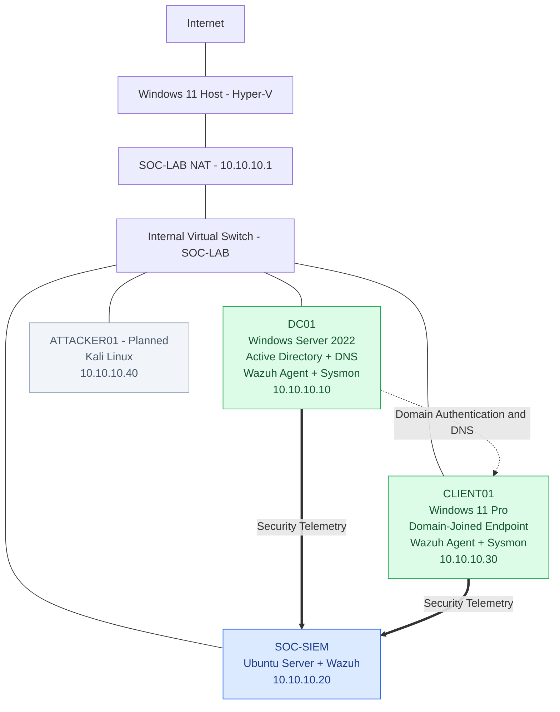

# SOC-Homelab

Hands-on SOC homelab focused on security monitoring, adversary simulation, detection engineering, threat hunting, and incident response using Hyper-V, Wazuh, Active Directory, and Sysmon.

## Project Overview

This project focuses on building a realistic enterprise security monitoring environment to develop practical Security Operations Center (SOC) skills through hands-on security monitoring, adversary simulation, detection engineering, threat hunting, and incident response.

The laboratory is built using Microsoft Hyper-V and Wazuh, with a functional Active Directory environment, a simulated corporate identity structure, a domain-joined Windows endpoint, and centralized security telemetry collection.

The initial security monitoring baseline has been established through Wazuh agents, Microsoft Sysmon, Windows Advanced Audit Policies, and PowerShell Logging.

The next stage focuses on deploying a dedicated attacker machine and preparing the environment for controlled adversary simulations.

## Project Objectives

- Build a controlled enterprise-like security laboratory.
- Deploy and configure a centralized SIEM platform.
- Implement Active Directory and Windows endpoint monitoring.
- Establish centralized security telemetry collection.
- Evaluate native SIEM detection capabilities.
- Simulate controlled adversarial activity.
- Analyze security alerts and investigate suspicious behavior.
- Identify monitoring and detection gaps.
- Develop and validate custom detection rules.
- Map adversarial techniques to the MITRE ATT&CK framework.
- Develop incident response procedures and investigation reports.

## Technology Stack

| Technology | Purpose | Status |
|---|---|---|
| Microsoft Hyper-V | Virtualization | Implemented |
| Ubuntu Server 24.04 LTS | SIEM operating system | Implemented |
| Wazuh | SIEM and security monitoring | Implemented |
| Windows Server 2022 | Active Directory and DNS | Implemented |
| Active Directory | Centralized identity management | Implemented |
| Windows 11 Pro | Enterprise endpoint | Implemented |
| Wazuh Agents | Endpoint security monitoring | Implemented |
| Microsoft Sysmon | Advanced endpoint telemetry | Implemented |
| Sysmon Modular | Sysmon configuration baseline | Implemented |
| Group Policy | Centralized security policies | Implemented |
| Windows Advanced Audit Policies | Windows security event generation | Implemented |
| PowerShell Logging | Command and script execution visibility | Implemented |
| Windows Defender | Endpoint protection and security telemetry source | Monitoring Configured |
| Kali Linux | Adversary simulation | Planned |
| MITRE ATT&CK | Adversary technique mapping | Partially Implemented |
| Custom Wazuh Rules | Detection engineering | Planned |

## Lab Architecture

## Virtual Machine Configuration

| Machine | Operating System | RAM | vCPU | Storage | Status |
|---|---|---|---|---|---|
| SOC-SIEM | Ubuntu Server 24.04.5 LTS | 8 GB | 4 | 100 GB | Operational |
| DC01 | Windows Server 2022 | 4 GB | 2 | 60 GB | Operational |
| CLIENT01 | Windows 11 Pro | 4 GB | 2 | 80 GB | Operational |
| ATTACKER01 | Kali Linux | 4 GB | 2 | 40 GB | Planned |

## Network Configuration

| Parameter | Configuration |
|---|---|
| Virtual Switch | SOC-LAB |
| Switch Type | Internal |
| Network | 10.10.10.0/24 |
| Gateway | 10.10.10.1 |
| NAT | SOC-LAB-NAT |
| Active Directory Domain | corp.soclab.test |
| NetBIOS Name | CORP |
| Internal DNS Server | 10.10.10.10 |
| SIEM Server | 10.10.10.20 |

The laboratory currently uses an internal virtual switch with NAT connectivity.

Additional network restrictions and isolation controls will be implemented and validated before adversary simulations are performed.

## Active Directory Environment

A simulated corporate Active Directory environment was deployed to provide centralized authentication, identity management, and a realistic foundation for identity-based security monitoring.

| Component | Configuration |
|---|---|
| Domain Controller | DC01 |
| Domain | corp.soclab.test |
| Forest Functional Level | Windows Server 2016 |
| Domain Functional Level | Windows Server 2016 |
| Departments | 4 |
| Departmental Security Groups | 4 |
| Standard User Accounts | 6 |
| Additional Privileged Accounts | 1 |
| Provisioned Service Accounts | 2 |
| Domain-Joined Workstations | 1 |

### Corporate Departments

- IT
- Finance
- Human Resources
- Sales

The environment implements separation between standard and privileged identities, departmental security groups, dedicated service identities, and a centralized workstation Organizational Unit.

The service accounts are provisioned but are not yet assigned to operational services.

## Security Monitoring and Telemetry

A centralized security monitoring infrastructure has been implemented across the Active Directory environment using Wazuh, Sysmon, Windows Advanced Audit Policies, and PowerShell Logging.

### Monitored Endpoints

| Agent ID | Hostname | Agent Version | Status |
|---|---|---|---|
| 001 | DC01 | 4.14.10 | Active |
| 002 | CLIENT01 | 4.14.10 | Active |

Both endpoints successfully synchronized their centralized Wazuh configuration.

### Implemented Monitoring Capabilities

- Centralized endpoint security monitoring.
- Role-based Wazuh agent group structure.
- Centralized Windows event collection.
- Advanced endpoint telemetry through Microsoft Sysmon.
- Role-based Windows Advanced Audit Policies.
- PowerShell Module Logging.
- PowerShell Script Block Logging.
- Process Creation Command Line Auditing.
- Authentication and account management auditing.
- Kerberos authentication auditing.
- Privileged activity auditing.
- Active Directory change auditing, subject to applicable auditing requirements.

### Monitored Event Channels

| Event Channel | Monitoring Purpose |
|---|---|
| Security | Authentication, account management, and privilege usage |
| System | System activity and service-related events |
| Application | Application-level events |
| Sysmon Operational | Advanced endpoint activity |
| PowerShell Operational | Command and script execution |
| Task Scheduler Operational | Scheduled task activity |
| WMI Activity Operational | Windows Management Instrumentation activity |
| Windows Defender Operational | Endpoint protection and security-related events |

All eight event channels were configured for monitoring on both Windows endpoints.

### Telemetry Validation

| Telemetry | Event ID | SIEM Alert Visibility |
|---|---|---|
| Windows Authentication | 4624 / 4625 | Confirmed |
| Windows Process Creation | 4688 | Confirmed |
| Sysmon Process Creation | 1 | Confirmed |
| PowerShell Script Block Logging | 4104 | Confirmed |
| PowerShell Module Logging | 4103 | Pending Direct Validation |
| WMI Activity | Multiple | Confirmed |
| Task Scheduler | Multiple | Pending Direct Validation |
| Windows Defender | Multiple | Pending Direct Validation |

PowerShell Module Logging was successfully validated locally on both endpoints.

Direct ingestion of PowerShell Event ID 4103, Task Scheduler events, and Windows Defender events was not independently confirmed during the initial validation period.

The absence of indexed alerts does not necessarily indicate a telemetry collection failure. These sources will be further validated during future detection engineering activities.

## Initial Security Alert Analysis

During telemetry validation, a native Wazuh detection rule generated an alert associated with PowerShell file deletion activity on the domain controller.

| Field | Value |
|---|---|
| Endpoint | DC01 |
| Wazuh Rule ID | 92021 |
| Severity Level | 3 |
| Event Source | Sysmon Event ID 1 |
| MITRE ATT&CK Technique | T1070.004 - File Deletion |
| Classification | Benign Positive |
| Confidence | High |

Analysis of the command-line arguments, process ancestry, execution context, and Wazuh Security Configuration Assessment policy established that the observed activity was associated with a legitimate automated security assessment.

No containment actions or detection rule modifications were required.

This exercise demonstrated the importance of contextual alert analysis and distinguishing potentially suspicious behavior from confirmed malicious activity.

Further details are available in the [Sysmon Integration documentation](03-Security-Monitoring/Sysmon-Integration.md).

## Detection Engineering Approach

The laboratory follows a baseline-first detection engineering methodology.

The initial monitoring environment retains native Wazuh detection rules without introducing custom detection logic or suppressing existing rules.

Future adversary simulations will be used to:

1. Execute controlled adversarial activity.
2. Identify the resulting endpoint telemetry.
3. Evaluate native Wazuh detection coverage.
4. Analyze generated alerts.
5. Identify telemetry and detection gaps.
6. Develop custom detection rules.
7. Validate detection effectiveness.
8. Document findings and investigation procedures.

This methodology allows detection improvements to be based on observed adversary behavior rather than theoretical assumptions alone.

## Project Roadmap

- [x] Phase 01 - Infrastructure and SIEM Deployment
- [x] Phase 02 - Active Directory and Endpoint Deployment
- [x] Phase 03 - Security Monitoring and Telemetry Collection
- [ ] Phase 04 - Attacker Machine Deployment
- [ ] Phase 05 - Controlled Adversary Simulations
- [ ] Phase 06 - Detection Engineering
- [ ] Phase 07 - Threat Hunting and Incident Investigation
- [ ] Phase 08 - Incident Response and Playbooks

## Project Documentation

| Phase | Documentation | Status |
|---|---|---|
| 01 | [Infrastructure and SIEM Deployment](01-Infrastructure/README.md) | Completed |
| 02 | [Active Directory and Endpoint Deployment](02-Active-Directory/README.md) | Completed |
| 03 | [Security Monitoring and Telemetry Collection](03-Security-Monitoring/README.md) | Completed |
| 04 | Attacker Machine Deployment | In Progress |
| 05 | Controlled Adversary Simulations | Planned |
| 06 | Detection Engineering | Planned |
| 07 | Threat Hunting and Incident Investigation | Planned |
| 08 | Incident Response and Playbooks | Planned |

## Skills Demonstrated

### Infrastructure and System Administration

- Virtualization and infrastructure deployment.
- Virtual network configuration and NAT.
- Linux system administration.
- Windows Server administration.
- SIEM deployment and service validation.
- Infrastructure troubleshooting.
- Resource and performance monitoring.
- Virtual machine checkpoint management.

### Active Directory and Identity Management

- Active Directory Domain Services deployment.
- DNS configuration and service validation.
- Organizational Unit management.
- Security group administration.
- User and service account provisioning.
- Standard and privileged identity separation.
- Windows endpoint domain integration.
- Domain authentication validation.
- Network connectivity troubleshooting.

### Security Monitoring and Telemetry

- Wazuh agent deployment and enrollment.
- Centralized agent configuration management.
- Role-based agent group management.
- Microsoft Sysmon deployment and integration.
- Windows security event collection.
- Advanced Audit Policy configuration through Group Policy.
- PowerShell Module and Script Block Logging.
- Process creation and command-line auditing.
- Endpoint telemetry validation.
- SIEM search and event filtering.
- Security monitoring troubleshooting.
- Identification of telemetry visibility limitations.

### Security Operations

- Initial security alert triage.
- Security event analysis.
- Process ancestry analysis.
- Command-line analysis.
- Execution context analysis.
- Benign Positive classification.
- MITRE ATT&CK technique interpretation.
- Timestamp and event timeline analysis.
- Evidence-based alert investigation.

### Security Operations - In Development

- Controlled adversary simulation.
- Behavioral detection engineering.
- Custom Wazuh rule development.
- Detection coverage assessment.
- Detection rule tuning and validation.
- Multi-source event correlation.
- Structured threat hunting.
- Incident investigation.
- Incident response procedures.
- Security playbook development.

## Project Status

**In Progress - Phase 03 Completed**

The initial infrastructure, Wazuh SIEM, Active Directory environment, Windows endpoint deployment, and security monitoring baseline have been successfully established.

The laboratory currently includes:

- An operational Wazuh SIEM platform.
- A functional Windows Server 2022 Domain Controller.
- A simulated corporate identity structure.
- Six standard domain users.
- One additional privileged account.
- Two provisioned service accounts.
- A domain-joined Windows 11 workstation.
- Two active Wazuh agents.
- Microsoft Sysmon deployed across both Windows endpoints.
- Twenty enabled audit subcategories on the domain controller.
- Fifteen enabled audit subcategories on the corporate workstation.
- Centralized PowerShell logging.
- Eight monitored Windows event channels per endpoint.
- Validated SIEM visibility for multiple security telemetry sources.
- An initial documented security alert triage exercise.

The next phase focuses on deploying a dedicated attacker machine and validating laboratory isolation controls.

Subsequent phases will focus on controlled adversary simulations, custom detection rules, threat hunting, incident investigations, and response procedures.

## Disclaimer

This project is intended exclusively for educational purposes and professional development.

All security testing and adversary simulations are intended for authorized systems within a controlled laboratory environment.

No security testing will be intentionally performed against unauthorized external systems or third-party infrastructure.
